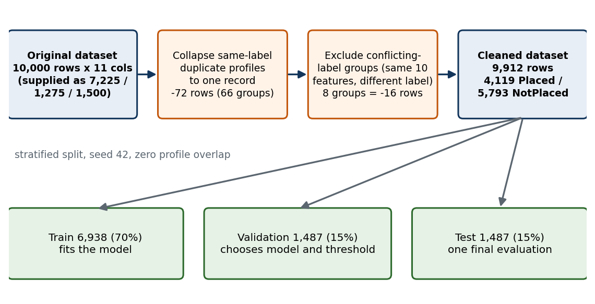
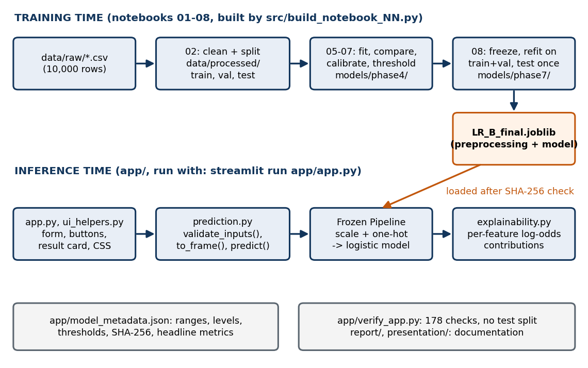
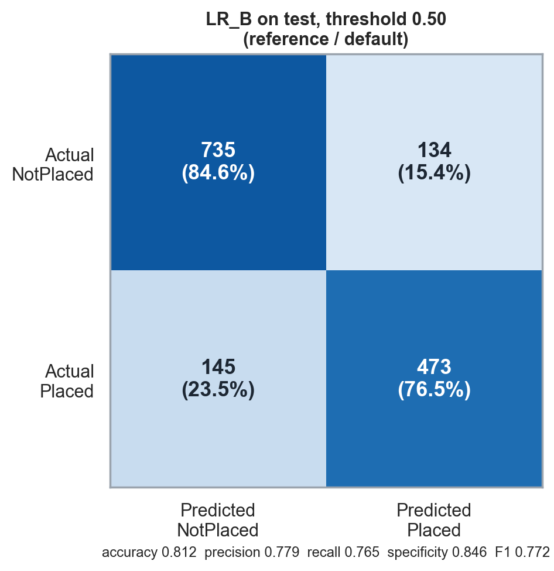
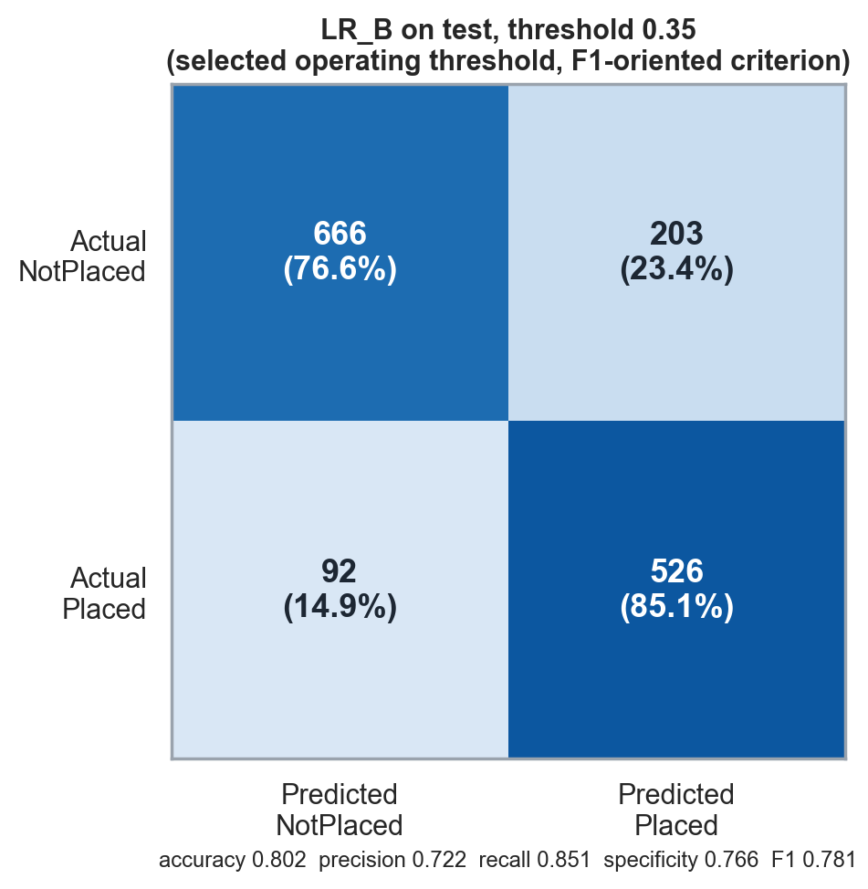

Predictive Analysis course project · study guide

<h1 class="cover-title">Student Placement Probability Predictor</h1>

Complete project guide: how it was built, how to defend it, how to present it

Prepared for: [Your name] · [University / course] · [Date of presentation] 
Guide written: 27 October 2026 from the repository at <code>student-placement-prediction/</code> 
Final model: Logistic Regression B (<code>models/phase7/LR_B_final.joblib</code>) 
Companion documents: <code>report/final_report.md</code> (full 40-page report), <code>report/viva_questions.md</code> (72 Q&amp;A), <code>presentation/final_presentation.pptx</code>

<b>How to use this guide.</b> Chapters 1–9 teach the project from zero, in the order the data flows. Chapter 10 is the presentation plan and demo script. Chapter 11 is the viva bank. Chapters 12–13 are a glossary and future work. The appendices are quick-reference sheets. Everything is taken from the repository; where the repository does not say, this guide says so.

<b>Evidence labels used throughout.</b>
VERIFIED read from code, artifact or saved output &nbsp;
MEASURED an experimental result saved by the project &nbsp;
ESTIMATE derived by counting code loops &nbsp;
INTERPRETATION a reading of the evidence &nbsp;
UNKNOWN not established by the repository

# 1. The Product From Zero

## 1.1 What problem it addresses

A campus placement outcome (a student gets a job offer through the college, or not) depends on many things at once: marks, projects, internships, aptitude, communication, training. The project asks one question: **given ten recorded characteristics of a student, what is the estimated probability that the student is "Placed"?**

It is a *predictive analytics* project because it learns a mapping from past records (features) to an outcome (target) and then applies that mapping to a new record. It is a *supervised classification* problem because the target has two labels, and the output is a probability rather than only a yes/no label.

## 1.2 What the app does VERIFIED

| Step | What happens | Where |
|---|---|---|
| Input | User enters 10 values: CGPA, Internships, Projects, Workshops/Certifications, Aptitude Test Score, Soft Skills Rating, Extracurricular Activities, Placement Training, SSC Marks, HSC Marks. All are required. | `app/app.py` |
| Validation | Missing, non-numeric, or out-of-range values are rejected with a message; nothing is clipped. | `prediction.validate_inputs()` |
| Prediction | The frozen Logistic Regression pipeline returns P(Placed). | `prediction.predict()` |
| Output | A percentage (for example 37.3%), a classification at threshold 0.35 and at 0.50 side by side, a descriptive probability band, and a bar chart of which inputs raised or lowered the estimate. | `app/app.py`, `ui_helpers.py`, `explainability.py` |

It runs **locally only** (`run_app.bat` or `streamlit run app/app.py`). The repository contains no evidence that it is deployed publicly or used by any placement office, and this guide never claims so.

## 1.3 Probability versus classification

The model first produces a **probability** between 0 and 1. A **classification** ("Placed" / "Not Placed") is made afterwards by comparing the probability with a **threshold**: Placed if probability ≥ threshold. The probability never changes; only the label does.

| Predicted probability | Label at threshold 0.50 | Label at threshold 0.35 |
|---|---|---|
| 0.20 | Not Placed | Not Placed |
| 0.40 | Not Placed | **Placed** |
| 0.60 | Placed | Placed |
| 0.90 | Placed | Placed |

So a student at 0.40 is "Not Placed" under one rule and "Placed" under the other, with the same probability. That is why the app shows both rows and names neither "best".

## 1.4 What the output means, and does not mean INTERPRETATION

* **Means:** among students with characteristics like these, in *this dataset*, about 37% were placed (approximately, if the model is well calibrated, which the test results support: calibration slope 1.05, ECE 0.016).
* **Does not mean:** "this student has a 37% chance of a job". The dataset's origin is not documented (Chapter 2), so the number is an estimate learned from this dataset, not a literal personal chance.
* **Association, not causation.** If raising CGPA raises the probability, the model has learned that higher CGPA *goes with* placement here. It has not shown that CGPA *causes* placement. Nothing in the project can establish that, because the data are observational.

## 1.5 Spoken pitches (natural English; read, then say in your own words)

**One-minute explanation.** "My project estimates the probability that a student gets placed, using ten things a college records about them, such as CGPA, projects, internships, aptitude score and whether they had placement training. I used a public campus-recruitment dataset of 10,000 rows. First I cleaned it, because 72 rows were duplicates and 16 rows contradicted each other, which left 9,912 rows. I split them 70/15/15 into train, validation and test. I compared four kinds of model, and logistic regression, random forest and gradient boosting performed almost identically, so I kept logistic regression because it is simple and I can explain it. On the held-out test set it reached an ROC-AUC of 0.886, and its probabilities are well calibrated. I built a Streamlit app around it that gives the probability and shows which inputs pushed it up or down. The limits are that the dataset's origin is not documented and may be constructed, so I treat the output as an estimate, not a prediction of any real student's future."

**30-second elevator pitch.** "It is a Streamlit app that takes ten student characteristics and returns an estimated placement probability from a logistic regression model, with an explanation of which inputs mattered. The model reaches ROC-AUC 0.886 on a held-out test set, and I was careful about leakage, calibration and honest limitations."

**Two-minute pitch.** Use the one-minute explanation, then add: "Three decisions I would highlight. One, I did not trust the dataset's own train/validation/test files, because 33 feature profiles appeared in more than one of them, so I rebuilt a clean split. Two, I judged models on probability quality (log loss, Brier score, calibration) and not only accuracy. Three, I froze the model and thresholds before the one-time test evaluation. I also report that the early exploratory analysis did look at the eventual test rows descriptively, so I do not claim the test set was untouched for the whole project."

**Five-minute technical version:** use the slide plan in Chapter 10.

**Closing statement.** "For this dataset and protocol, logistic regression was the right balance of accuracy, calibration and explainability. The result shows that the pipeline is sound; it does not show that the model would work on a different college's students, and I would validate it on real institutional data before anyone relied on it."

**Likely follow-ups:** Is the data real? Why not a more complex model? What does 0.886 mean? Why two thresholds? What if CGPA is 10? Did you touch the test set?

# 2. The Dataset

## 2.1 Source and provenance

| Question | Answer | Evidence |
|---|---|---|
| Name and source | Hugging Face dataset `Krooz/Campus_Recruitment_CSV`, <https://huggingface.co/datasets/Krooz/Campus_Recruitment_CSV> | `README.md`, `app/model_metadata.json` VERIFIED |
| Licence | CC0-1.0 as recorded in the project documents (the licence page was not re-checked online for this guide) | `README.md`, `final_report.md` App. C.3 |
| Real, synthetic or constructed? | **Unknown.** The dataset card does not state provenance. The data show hard floors/ceilings with pile-ups at the limits, very large effects for every predictor, and step-like patterns. These are *consistent with* a rule-based or generated dataset, but that is an observation, not a conclusion. | `src/eda_findings.md` §D UNKNOWN |
| Supplied as | Three files: 7,225 / 1,275 / 1,500 rows = 10,000, saved unmodified in `data/raw/` | `README.md`, `results/metrics/02_data_quality_audit.csv` |

**How to say it:** "The data come from a public Hugging Face dataset under CC0. Its origin is not documented, and the structure looks rule-generated, so I do not claim it is real student data or that results transfer to any real college."

## 2.2 The columns VERIFIED (ranges from `results/metrics/01_descriptive_statistics.csv` and `app/model_metadata.json`)

The repository has no data dictionary. Meanings below are the conventional reading of the column names.

| Column | Type | Observed range | Role |
|---|---|---|---|
| CGPA | continuous | 6.5 – 9.1 (mean 7.70) | predictor |
| Internships | count | 0, 1, 2 | predictor |
| Projects | count | 0, 1, 2, 3 | predictor |
| Workshops/Certifications | count | 0, 1, 2, 3 | predictor |
| AptitudeTestScore | integer | 60 – 90 | predictor |
| SoftSkillsRating | continuous | 3.0 – 4.8 | predictor |
| ExtracurricularActivities | Yes / No | – | predictor |
| PlacementTraining | Yes / No | – | predictor |
| SSC_Marks | integer | 55 – 90 | predictor (Class 10 marks, by convention) |
| HSC_Marks | integer | 57 – 88 | predictor (Class 12 marks, by convention) |
| PlacementStatus | label | Placed = 1, NotPlaced = 0 | **target** |

There are no missing values and no values outside plausible bounds (`01_data_quality_summary.csv`). Raw class balance: 4,197 Placed / 5,803 NotPlaced (41.97% minority).

## 2.3 Cleaning: exact counts VERIFIED

| Step | Rows | What it means | Source |
|---|---|---|---|
| Original | 10,000 | three files stacked | `02_data_quality_audit.csv` |
| Surplus exact duplicates | −72 | 66 groups of identical rows (138 rows in groups); same 10 features **and** same label → keep one | same |
| Conflicting-label groups | −16 | 8 groups (16 rows): same 10 features, one Placed and one NotPlaced. No majority vote; all excluded. Listed in `02_conflicting_label_groups.csv`. | same |
| **Final** | **9,912** | 4,119 Placed (41.56%) / 5,793 NotPlaced | `02_split_summary.csv` |

The three expected audit figures (10,000; 72; 8 groups / 16 rows; 9,912) all matched the saved outputs. 10,000 − 72 − 16 = 9,912.

**Apparent discrepancy, explained.** `01_data_quality_summary.csv` says 28 records appear in more than one split, while the README says 33 feature profiles (69 rows) do. They count different things (exact records versus feature profiles regardless of label). Both describe the same leakage risk in the supplied files, and both reach zero after the rebuild.

**Four different operations, not to be confused.**

| Operation | Done here? |
|---|---|
| Remove duplicate records | Yes (72 surplus rows) |
| Resolve conflicting labels | Yes, by excluding the 8 groups (no guessing which label is right) |
| Remove invalid records | No invalid values were found |
| Remove outliers | No. Ranges have hard limits and no tails; counts have no outlier rule. |

**Why clean?** Duplicates across train and test make a model look better by memorising; contradictory labels teach the model noise. The conflicting rows are all top-profile students (aptitude 90, 2 workshops, 3 projects, both Yes), so the label depends on something not in the features, which limits the best achievable accuracy there.

**Could filtering bias the data?** Only 88 of 10,000 rows (0.9%) were removed, but the 16 conflicting rows are all high-profile, so the cleaned set slightly under-represents the top end. The effect on the global results is small and is a stated limitation, not a measured one.

## 2.4 Answers to hard dataset questions

| Question | Safe answer |
|---|---|
| Where did it come from? | Public Hugging Face dataset, CC0. |
| Why this dataset? | Public, free to use, ten sensible predictors, a binary target, enough rows for a clean three-way split. |
| Is it real student data? | I cannot establish that; the source does not say, and the structure looks rule-generated. |
| How do you know labels are correct? | I do not; I can only check consistency. Eight profiles carry contradictory labels, which I excluded. |
| Can it represent all Indian college students? | No. One dataset of unknown origin cannot. |

# 3. EDA, Preprocessing and Data Splitting

## 3.1 What the EDA found MEASURED (notebooks 03–04; `src/eda_findings.md`, `src/stat_findings.md`)

| Analysis | Method | Result | Cannot conclude |
|---|---|---|---|
| Target balance | counts | 58.44% NotPlaced / 41.56% Placed (about 1.4 : 1, moderate) | no resampling was needed |
| Scores vs placement | violin plots, Mann-Whitney, Cohen's *d* | all five scores differ; *d* from 0.94 (CGPA) to 1.23 (aptitude) | not causal |
| Binary predictors | placement rate, chi-square, odds ratio | extracurricular 61.6% vs 13.7% placed; placement training 51.2% vs 15.6% | the two co-occur (85% overlap) |
| Count predictors | placement rate with Wilson intervals | **non-monotonic**: Internships 33.4/32.6/69.0%; Workshops 28.4/21.1/72.6/56.3%; Projects 60.0 (n=30) /16.9/31.4/71.4% | patterns are descriptive; Projects = 0 is tiny |
| Redundancy | correlations, VIF | all VIF < 2; strongest pair aptitude–HSC r = 0.56 | no feature removed |
| Split sanity | KS statistics, ECDFs | train/validation/test look alike | – |

**What it changed in modelling.** Because counts are non-monotonic, Phase 4 compared treating them as numbers (Variant A) with treating them as categories (Variant B). B was kept. No feature was engineered.

**Projects = 0 appears as 30, 22 and 19** in different documents: the full dataset, train + validation, and train only. Same group, different denominators.

## 3.2 The preprocessing pipeline, in execution order VERIFIED (loaded from `LR_B_final.joblib`)

The pipeline is one scikit-learn `Pipeline` with two steps: `prep` (a `ColumnTransformer`) and `model`.

| Step | Columns | Operation | Output columns |
|---|---|---|---|
| 1 | CGPA, AptitudeTestScore, SoftSkillsRating, SSC_Marks, HSC_Marks | `StandardScaler`: subtract the mean, divide by the SD | 5 |
| 2 | Internships, Projects, Workshops/Certifications | `OneHotEncoder`, dropping the reference levels 1, 3, 0 respectively | 2 + 3 + 3 = 8 |
| 3 | ExtracurricularActivities, PlacementTraining | `OneHotEncoder(drop='first')`: keep only the "Yes" column | 2 |
| 4 | – | `LogisticRegression` on the 15 columns | – |

**10 raw predictors become 15 columns:** 5 + 8 + 2 = 15. The three count variables have 3, 4 and 4 levels; dropping one reference level each gives 2, 3 and 3 columns. The 15 names, in order: CGPA, AptitudeTestScore, SoftSkillsRating, SSC_Marks, HSC_Marks, Internships_0, Internships_2, Projects_0, Projects_1, Projects_2, Workshops/Certifications_1, _2, _3, ExtracurricularActivities_Yes, PlacementTraining_Yes.

**Why a reference level is dropped.** The remaining columns already determine it; keeping all would make the columns perfectly redundant, which makes the coefficients ambiguous.

**Why the pipeline matters.** The scaler's mean and SD and the encoders' levels are learned during `fit` and reused unchanged at prediction time, so the app applies exactly the same transformation as training, with no re-implementation.

## 3.3 Splitting and what each part is for VERIFIED

| Part | Rows | Role |
|---|---|---|
| Train | 6,938 | fits every learned parameter (including scaler and encoders) |
| Validation | 1,487 | compares models and settings; picks the threshold |
| Test | 1,487 | one final evaluation after everything was frozen |
| Train + validation | 8,425 | used only to refit the already-chosen model at the end |

6,938 + 1,487 + 1,487 = 9,912. The split is stratified (placed rate 41.55–41.56% in each part), `random_state = 42`, and was checked for zero feature-profile overlap between parts.

**"Unseen" data** means rows the model's parameters, settings and threshold were never adjusted on. If you tune against the test set, it stops being unseen, and its score becomes optimistic.

## 3.4 The test-set caveat you must state accurately VERIFIED

* **Phases 1–3 (EDA, statistics):** loaded the eventual test rows for *descriptive* analysis only, not for fitting or evaluating predictive models.
* **Two orientation shell commands** (`head -2` showing the header and one data row, and `wc -l`) touched `test.csv` outside the audit hook; nothing from them was used.
* **Phases 4–6:** the notebooks' own audit hooks blocked test access. This is a statement about those notebooks, not the whole project history.
* **Phase 7:** one gated read at 2026-10-02 18:51 UTC (`results/metrics/modeling/08_test_access_log.json`), after the protocol was frozen (`08_frozen_protocol.json`). A marker file blocks re-execution.
* **Safe wording:** "The test set was not used for model development, selection, tuning, calibration or threshold selection." **Never say** "the test set was untouched" without qualification.
* This guide was prepared without opening any test file; only aggregate saved outputs (`08_*` summary files and figures) were used.

**Data leakage** is any path by which information from outside the training data influences the model. Safeguards here: duplicate profiles removed across splits, preprocessing fitted inside the pipeline on training data only, cross-validation done on train only, and the test gate. Remaining risk: the early descriptive look, which is why the final claim is qualified.

# 4. The Models and How They Were Trained

## 4.1 Logistic Regression (the final model)

**Plain English.** Give each input a weight, add them up into one score, and squash the score into a probability between 0 and 1.

z = b0 + b1x1 + b2x2 + … + b15x15 &nbsp;&nbsp;&nbsp; P(Placed) = σ(z) = 1 / (1 + e−z)

* *z* is the **log-odds**. σ is the **sigmoid**: z = 0 gives 0.5, large positive z gives near 1, large negative z gives near 0.
* The **coefficients** b are *learned parameters* (found by training); the intercept b0 is the score for the all-reference profile.
* **Linear boundary, useful predictions:** the boundary between "above 0.5" and "below 0.5" is a straight (flat) surface in the 15-column space, yet the output is a smooth probability. When classes overlap and effects are mostly additive, which seems to hold here, that is enough.
* **Regularisation** adds a penalty on large coefficients to reduce over-fitting. **L2** shrinks all coefficients smoothly (L1 can set some to exactly zero). **C** is the inverse strength: smaller C means stronger penalty. Here C = 1.
* **Solver `lbfgs`** is the numerical optimiser that finds the coefficients. `max_iter = 5000` is its safety limit; the fitted model stopped after **`n_iter_ = [30]`**, so the limit was never reached and the fit converged. (`l1_ratio = 0` is how scikit-learn 1.9.1 expresses pure L2.)

**Final model, verified from the artifact** VERIFIED: `LogisticRegression(C=1.0, solver='lbfgs', l1_ratio=0, max_iter=5000, random_state=42, class_weight=None)`, 15 coefficients, intercept −1.661, fitted on **8,425** rows (train + validation).

Largest learned coefficients (log-odds per unit; scores are per SD): PlacementTraining_Yes +0.97, ExtracurricularActivities_Yes +0.72, Projects_0 +0.62 (only 22 students; unreliable), AptitudeTestScore +0.50, Workshops_2 +0.45. Odds multiplier = ecoefficient, for example placement training: e0.974 ≈ 2.65. (Phase 6 reports 2.75 from a different fit, an unpenalised fit on train only, so the two figures are not in conflict.)

## 4.2 The other models VERIFIED (`models/phase4/model_configs.json`, loaded artifacts)

| Model | Plain English | Key settings used | Validation AUC |
|---|---|---|---|
| Decision Tree B | a flowchart of yes/no splits on features; each leaf gives a probability | depth 5, min 5 per leaf, 32 leaves | 0.846 |
| Random Forest B | 300 independent trees on random data/feature subsets, averaged | 300 trees, depth 10, min 10 per leaf, √(features) per split | 0.869 |
| Gradient Boosting B | trees added one after another, each correcting the previous errors | 300 stages, learning rate 0.05, depth 2 | 0.871 |
| Logistic Regression B | weighted sum + sigmoid | L2, C = 1 | 0.872 |
| Dummy (reference) | always predicts the training placed rate | – | 0.500 |

* **Depth / min leaf size** limit how finely a tree can carve the data; too deep memorises (overfitting). A single unlimited tree scored a validation log loss of 11.05–11.47 with training AUC 1.0, a textbook overfit; limiting depth fixed it (`05_tuning_grids.csv`).
* **Learning rate** shrinks each boosting stage's contribution; lower rates need more stages.
* **Overfitting** = great on training data, worse on new data. **Underfitting** = poor on both.
* **Why LR here:** statistically tied with GB and RF on validation, cross-validation and test, so simplicity, interpretability, calibration (test ECE 0.016 vs 0.031 GB, 0.024 RF) and the smallest train–validation gap decided it (rule in `05_provisional_selection.json`: lowest validation log loss among the statistically indistinguishable set, tie broken by interpretability).

## 4.3 Loops, fits and the word "epoch" ESTIMATE

**Terminology.** An *epoch* is a full pass over the data in an iterative, mini-batch procedure such as a neural network. This project has none. The terms that apply:

| Term | Meaning here |
|---|---|
| Fit | one `.fit()` of a whole pipeline (scaler, encoder, model) |
| Fold | one part of cross-validation; a 5-fold CV means 5 fits |
| Optimiser iteration | one L-BFGS step inside one logistic fit (`n_iter_`, 30 for the final model) |
| Tree / boosting stage | RF B has 300 trees; GB B has 300 sequential stages |

**Fit-count reconstruction from the build scripts** (`src/build_notebook_05.py`–`08.py`):

| Operation | Arithmetic | Fits | Data |
|---|---|---|---|
| Tuning grids DT/RF/GB (variants A and B) | 12×2 + 18×2 + 16×2 (rows in `05_tuning_grids.csv` = 92) | 92 | train → validation |
| Logistic baselines | LR_A, LR_B, LR_A_balanced, LR_B_balanced | 4 | train → validation |
| Regularisation sensitivity | 2 variants × 5 values of C | 10 | train → validation |
| Dummy baseline | 1 | 1 | train |
| 5-fold CV | 3 models × 5 folds | 15 | train only |
| Nested calibration | 3 models × 5 outer × 5 inner | 75 | train only |
| Validation confirmation | 3 models | 3 | train → validation |
| Feature-group ablation | 5 groups × 5 folds + 5 validation fits + 1 full | 31 | train |
| Phase 7 | 3 reproducibility refits on train + 3 final fits on train + validation | 6 | train / train+val |
| **Total** | 107 + 15 + 75 + 3 + 31 + 6 | **≈ 237** | |

Plus about 36 small calibrator fits (sigmoid and isotonic). **How to describe it:** "about 237 model fits, reconstructed by counting the loops in the notebook-building scripts. It is an audit estimate, not a training log." It excludes statsmodels fits, preprocessor-only demos and unsaved dry runs, and per-fit iteration counts were not saved. The grid CSV records a `fit_seconds` per setting, but this guide does not quote any total runtime or hardware use because none was logged.

The only exactly known iteration count is the final model's `n_iter_ = 30`, from the artifact itself. A read-only re-fit on train + validation reproduced the saved coefficients exactly (`final_report.md` App. C.2).

# 5. Model Selection, Calibration and the Threshold

## 5.1 How the model was chosen

1. **Phase 4 (validation only).** Models fitted on train, compared on validation by ROC-AUC, log loss and Brier score with bootstrap CIs. LR_B, LR_A, GB_B, GB_A and RF_B formed a statistically indistinguishable set; LR_B was picked for lowest validation log loss and interpretability.
2. **Phase 5 (cross-validation on train).** 5-fold stratified CV (seed 42) confirmed the tie: mean AUC 0.879 (LR) / 0.876 (GB) / 0.876 (RF). CV was used for *stability and calibration checks*, not to choose between the models.
3. **Phase 6 (threshold, explanation).** Threshold analysis from 0.20 to 0.80 in steps of 0.05.
4. **Phase 7 (freeze and test).** Protocol frozen, final model refitted on train + validation, test evaluated once.

**Why refit on train + validation?** After choices are made, the validation rows no longer need to be held back, and 8,425 rows give a slightly better-trained model than 6,938. The specification (C, preprocessing, threshold) is unchanged, which `final_model_configs.json` records.

## 5.2 Calibration

A model is **calibrated** if, among students given about 40%, about 40% are actually placed. The project measured calibration (reliability curves, slope, intercept, ECE) and tested sigmoid and isotonic recalibration in a nested, leakage-safe way. **No method met the pre-declared materiality rule**, so no recalibration was applied: the app uses raw model probabilities. Test calibration: slope 1.05, ECE 0.016 (below its noise yardstick of 0.023). A small under-prediction in the top decile (predicted 0.905, observed 0.946) is reported as a limitation.

## 5.3 The 0.35 threshold VERIFIED (`07_threshold_selection.json`)

* **Rule, fixed in advance:** the grid threshold with the highest *validation* F1; ties go to the value nearest 0.50.
* **Result:** 0.35 (validation F1 0.766 versus 0.756 at 0.50).
* **But:** F1 is flat from about 0.30 to 0.55; the bootstrap difference (0.35 − 0.50) is +0.010 with 95% interval −0.007 to +0.028, which **includes zero**. On the test set 0.35 gave F1 0.781 versus 0.772. **Discrepancy to know about:** the project brief says the test-set F1 difference has a confidence interval including zero. The saved record (`src/phase7_findings.md`) says that *no paired interval for the test F1 difference was computed*; only the two separate F1 intervals were compared, and they overlap almost completely. The paired interval that includes zero is the *validation* one above. Either way, no F1 advantage is claimed. So 0.35 is "the selected operating threshold under the F1-oriented criterion", never "the best threshold".
* **What a lower threshold does:** labels more students Placed; catches more truly placed students (recall up) but also wrongly labels more unplaced ones (precision down). Which is better depends on the cost of each error, which the project never defined.

# 6. From Click to Result

## 6.1 Architecture

## 6.2 The path of one prediction VERIFIED (read from `app/app.py`, `prediction.py`, `explainability.py`)

1. `streamlit run app/app.py` starts the page; `st.cache_resource` calls `load_bundle()` once.
2. **`load_bundle()`** reads `model_metadata.json`, computes the SHA-256 of `LR_B_final.joblib`, refuses to continue if it does not match or if the installed scikit-learn is not 1.9.1, then loads the pipeline and checks it expects the ten feature names.
3. The user fills ten fields (all start empty). Numeric boxes have no widget min/max on purpose, because Streamlit would silently revert an out-of-range entry.
4. On **Predict Placement Probability**, `validate_inputs()` checks each field against the ranges and levels in the metadata. Errors are listed and no prediction is made.
5. `to_frame()` builds a one-row `DataFrame` with the exact column names and integer count types.
6. `predict()` calls `pipeline.predict_proba(df)[0, 1]` (the pipeline scales, one-hot encodes, then applies the logistic model) and `decision_function(df)` (the log-odds *z*).
7. `classify(p, threshold)` applies `p >= threshold` for 0.35 and for 0.50; `probability_band()` gives a descriptive label.
8. `explain()` multiplies each transformed value by its coefficient and sums per raw feature, so intercept + contributions reconstruct *z* (checked to 1e-9 by the verification script).
9. The UI renders the percentage, both labels, the band, the factor bars and an "Inputs used" table. Editing any input afterwards removes the stale result.

## 6.3 A worked example MEASURED in this session

In Chrome, "Load typical profile" (CGPA 7.7, 1 internship, 2 projects, 1 workshop, aptitude 80, soft skills 4.4, extracurricular Yes, placement training Yes, SSC 70, HSC 73) returned **37.3%**: *Placed* at 0.35, *Not Placed* at 0.50, band "Low estimated probability". Contributions shown: placement training +0.97, extracurricular +0.72, soft skills +0.05, aptitude +0.04, SSC +0.02; workshops −0.32, projects −0.31, HSC −0.03.

z = −1.66 (intercept) + 1.14 (sum of contributions) ≈ −0.52 &nbsp;&nbsp; P = 1 / (1 + e0.52) ≈ 0.373

Changing CGPA to 8.45 (one standard deviation is about 0.64, coefficient +0.233 per SD) adds about +0.27 to *z*, giving **43.9%**, as the app displayed. A higher CGPA raises the estimate because, in this dataset, higher CGPA goes with placement. It does not show CGPA causes placement.

## 6.4 Terms often confused

| Term | Meaning |
|---|---|
| Model score | raw output before squashing (the log-odds *z*) |
| Predicted probability | σ(z), between 0 and 1 |
| Decision threshold | cut-off turning a probability into a label |
| Binary prediction | the label after thresholding |
| Calibration | whether stated probabilities match observed frequencies |
| Confidence interval | uncertainty about a *statistic* (like AUC) across resampling; **not** a statement that an individual prediction is correct |

# 7. Results and Metrics

## 7.1 Metric glossary

| Metric | Plain English | Formula / idea | Better |
|---|---|---|---|
| ROC-AUC | chance that a random Placed student scores higher than a random NotPlaced one | area under ROC curve | higher |
| Log loss | penalty for confident wrong probabilities | −mean[y ln p + (1−y) ln(1−p)] | lower |
| Brier score | mean squared probability error | mean (p − y)² | lower |
| Accuracy | fraction correct at a threshold | (TP+TN)/n | higher |
| Precision | of those predicted Placed, how many are | TP/(TP+FP) | higher |
| Recall | of the truly Placed, how many were found | TP/(TP+FN) | higher |
| F1 | harmonic mean of precision and recall | 2PR/(P+R) | higher |
| ECE | average gap between predicted and observed rates across bins | binned | lower |

## 7.2 Test results (n = 1,487; placed rate 41.6%) MEASURED

Source: `results/metrics/modeling/08_*.csv`; matches `app/model_metadata.json` and `final_report.md` exactly.

| Metric | Value | 95% CI |
|---|---|---|
| ROC-AUC | 0.8857 | 0.868 – 0.902 |
| Log loss | 0.420 | 0.393 – 0.449 |
| Brier | 0.134 | 0.124 – 0.145 |
| Calibration slope / intercept | 1.05 / +0.04 | 0.95–1.15 / −0.10 to +0.18 |
| ECE | 0.016 | noise level 0.023 |

| Threshold | Acc. | Prec. | Recall | F1 | TP | TN | FP | FN | Correct |
|---|---|---|---|---|---|---|---|---|---|
| 0.50 | 0.812 | 0.779 | 0.765 | 0.772 | 473 | 735 | 134 | 145 | 1,208 / 1,487 |
| 0.35 | 0.802 | 0.722 | 0.851 | 0.781 | 526 | 666 | 203 | 92 | 1,192 / 1,487 |

**Definitions as used in the code and figures:** "Placed" is the positive class. TP = placed and predicted Placed; TN = not placed and predicted Not Placed; FP = not placed but predicted Placed; FN = placed but predicted Not Placed. In the figures below, rows are actual, columns are predicted.

<table class="imgpair"><tr>
<td>
Figure: test confusion matrix at 0.50
</td>
<td>
Figure: test confusion matrix at 0.35
</td>
</tr></table>

**Reading it.** Moving from 0.50 to 0.35 finds 53 more truly placed students (FN 145 → 92) at the cost of 69 more false alarms (FP 134 → 203). Accuracy drops slightly (1,208 → 1,192 correct), F1 rises slightly (0.772 → 0.781), and no F1 advantage is claimed (see §5.3).

## 7.3 Why these numbers are easy to misread

* **AUC 0.8857 is not 88.57% accuracy.** AUC is a ranking probability across all thresholds; accuracy is at one threshold (81.2% at 0.50).
* **Accuracy at a threshold is not a probability for one student.** It is a group success rate.
* **An 85.8% estimate is not a guarantee.** Among students predicted 0.2–0.8 in development, about 48% were placed: genuinely uncertain.
* **Accuracy alone is insufficient:** always predicting NotPlaced is 58.4% accurate yet useless; the dummy baseline has log loss 0.679 against 0.420.
* **A CI is not a promise for an individual prediction.**
* **Development versus test:** CV AUC 0.879, validation 0.872, test 0.886. "Broadly consistent", not "no generalisation loss"; the higher test value may be sampling variation plus the larger refit.
* **The three models tie on test** (AUC 0.8857 LR, 0.8858 GB, 0.8859 RF); LR was retained for other reasons, not because it won.

# 8. Technology Stack, Testing and Quality

## 8.1 Stack VERIFIED (`requirements-app.txt`, run in this session)

| Library | Version | Use |
|---|---|---|
| Python | 3.11.9 (3.11+ required) | language |
| Streamlit | 1.64.0 | web UI |
| scikit-learn | 1.9.1 (must match the model; the app refuses otherwise) | pipeline, models, metrics |
| pandas / NumPy / SciPy | 3.0.5 / 2.4.2 / 1.17.0 | data handling, numerics, statistics |
| joblib | 1.6.0 | saving and loading the model artifact |

The notebooks additionally use matplotlib, seaborn, statsmodels and Jupyter (`requirements.txt`). No SHAP, LIME or deep-learning library is used. **Training-time code** = `src/build_notebook_*.py` and notebooks; **inference-time code** = `app/prediction.py`, `explainability.py`; **UI code** = `app/app.py`, `ui_helpers.py`; **testing code** = `app/verify_app.py`; **documentation** = `report/`, `presentation/`, READMEs. `run_app.bat` creates `.venv` once, installs `requirements-app.txt`, and starts Streamlit at <http://localhost:8501>.

**Model versioning:** `model_metadata.json` pins the artifact's SHA-256, scikit-learn version, ranges, levels, thresholds and headline metrics, so a swapped or mismatched model is refused rather than silently used.

## 8.2 Testing: what was verified and what was not

| Claim | Status |
|---|---|
| `python app/verify_app.py` → **178 PASS, 0 FAIL** | VERIFIED re-run in this session. Checks the model hash, probabilities equal direct pipeline output, thresholds incl. boundary values, explanation reconstruction, input validation, a headless end-to-end UI run, and metadata consistency; confirms no test file was opened. |
| Real-Chrome check of the live app | VERIFIED in this session: app loads; typical profile → 37.3%; CGPA 8.45 accepted and shown as 8.45 in "Inputs used" → 43.9%; CGPA 9.8 rejected with "outside the range the model was developed on (6.5 to 9.1)", and no result panel is shown. |
| "Targeted CGPA tests 46/46", "Soft Skills 37/37", file-hash comparisons for each UI fix | Reported in the project history; **no saved record of them exists in the repository, so they were not re-verified** here. Do not add them to the 178 (they likely overlap). |

**Why passing tests do not prove accuracy for real students:** tests check that the code does what it was designed to do; model accuracy is a separate, data-dependent question.

**Known caveats to disclose:** cross-browser and accessibility testing are not exhaustive; "Inputs used" shows 6 significant digits (the prediction uses the full value); steppers move in 0.1 steps; the first page load after a cold start can be slow; the test set was used descriptively in early EDA.

**Supporting a CGPA above 9.1.** The model never saw such values, so a prediction there is extrapolation. The honest route is to obtain data that include them, re-run cleaning, split, fit and evaluation, update `model_metadata.json` and the artifact hash, and re-verify. Widening the allowed range alone would only hide the problem, and a real student with a 9.8 or 10 CGPA is entirely plausible; the app declines rather than guess.

# 9. Explainability, Fairness and Limitations

## 9.1 What the explanation actually is VERIFIED

`app/explainability.py` gives a **local, additive** explanation for one prediction: each feature's contribution to the log-odds relative to a baseline student (training-average scores, reference categories). The bars are coefficient × transformed value. It is exact for this model (contributions sum to *z*). It is **not** SHAP or LIME; those are not used. Global views (coefficients, permutation importance) appear in the notebooks (Phase 6); top three by permutation importance: aptitude, placement training, extracurricular activities.

**Transparency / interpretability / individual explanation.** Transparency: the model's structure is open to inspection (15 coefficients). Interpretability: a person can understand why it behaves as it does. Individual explanation: the account of one prediction, which the bars provide. None of these implies causation.

## 9.2 Limitations and ethics INTERPRETATION

* Dataset of unknown origin that may be rule-generated; no external validation; one dataset, one split.
* Label quality unknown; 8 contradictory profiles show some noise or hidden factors.
* Marks, extracurriculars and training access may reflect unequal opportunity; the data contain no sensitive attributes, so no fairness audit was possible.
* Distribution shift: a different year or college may behave differently; the app's range check only catches obviously unsupported inputs.
* Threshold depends on error costs that were never defined.
* Privacy: the app keeps entries in session memory only, and never logs or stores them. A real deployment with real records would need consent and data governance.
* Disclaimer for use: "an educational estimate, not a guarantee, not a causal assessment, not for decisions about real students."

## 9.3 What I can confidently claim, what I should qualify, what I must not claim

| Confidently claim | Qualify | Must not claim |
|---|---|---|
| Data cleaned: 10,000 → 9,912 with verified counts | Test AUC 0.886 ("on this dataset and split") | The test set was untouched for the whole project |
| Clean leakage-free 70/15/15 split | Calibration is good ("raw probabilities, slight top-end under-prediction") | The model predicts real placements, or is accurate for all students |
| LR, RF, GB tied; LR kept for simplicity and calibration | 0.35 threshold ("selected by a predeclared rule; not conclusively better") | 0.35 is the best threshold; LR beat the others |
| Final LR converged (`n_iter_` = 30 of 5000) | About 237 fits ("reconstructed estimate") | Any epoch count; exact training time |
| App validated: 178/178 checks; Chrome check done | Explanations ("associations in this data") | CGPA or any feature causes placement |
| Frozen artifact verified by SHA-256 | The dataset ("public, CC0, origin undocumented") | The data are real, or synthetic, as a fact; the app is deployed or used by a placement cell |

# 10. Presentation Plan and Live Demo

## 10.1 Slide-by-slide (5–7 minutes, 8 slides)

| # | Title | Show | Say (short) | Likely question |
|---|---|---|---|---|
| 1 | Problem and goal | title, 10 inputs → probability | "Estimate placement probability from ten student characteristics." | Why probability, not yes/no? |
| 2 | Dataset and cleaning | cleaning flow (Fig. §2.3) | "10,000 rows; 72 duplicates and 16 conflicting rows removed; 9,912 left. Source is Hugging Face, CC0; origin undocumented." | Is it real data? |
| 3 | Features and split | 10 → 15 columns; 6,938/1,487/1,487 | "Standardise scores, one-hot the counts; stratified split, seed 42." | Why one-hot for counts? (non-monotonic EDA) |
| 4 | Models compared | table of 4 models + validation AUC | "Four families; three were statistically tied." | Why logistic regression? |
| 5 | Final results | AUC 0.886, log loss, Brier, calibration | "Test AUC 0.886; well calibrated; evaluated once after freezing." | AUC vs accuracy? Did you leak test? |
| 6 | Threshold trade-off | two confusion matrices | "0.35 catches more placed students but more false alarms; neither is best." | Why 0.35? |
| 7 | Live demo | the app | see script below | CGPA 10? |
| 8 | Limits and future | limitations list; two-line close | "Dataset origin unknown, associations not causes; next step is real data." | Weakest part? |

## 10.2 Demo script

1. **Start** (before the class): `run_app.bat`; open <http://localhost:8501>; the first load after a cold start can take several seconds: wait for it, do not refresh repeatedly. If the page stays blank, refresh once.
2. **Load typical profile**, press **Predict Placement Probability**. Expect 37.3%: "Placed at 0.35, Not Placed at 0.50. Same probability, different threshold."
3. **Explain the bars:** placement training and extracurriculars push up; fewer workshops/projects than the reference push down: "associations, not causes".
4. **Decimal input:** set CGPA to 8.45, predict: 43.9%; open "Inputs used" to show 8.45.
5. **Out-of-range:** type 9.8: red message "Out of range: enter a value from 6.5 to 9.1" and no prediction. Say: "The model was trained on 6.5–9.1. A 10 CGPA is perfectly real; the app refuses because the model has never seen that range, and an extrapolated number would look more reliable than it is."
6. **If challenged on credibility:** "You are right to ask. The source is a public CC0 dataset with undocumented origin and rule-like structure; I treat the result as a demonstration of a sound pipeline, not of real-world accuracy."

## 10.3 Statements to avoid, and safer alternatives

| Avoid | Say instead |
|---|---|
| "88.6% accurate" | "ROC-AUC 0.886; accuracy at 0.50 is 81.2%" |
| "The test set was never touched" | "Not used for model development, selection, tuning, calibration or threshold selection" |
| "0.35 is the best threshold" | "0.35 was selected by a predeclared validation-F1 rule; 0.50 is practically tied" |
| "CGPA increases your chances" | "Higher CGPA is associated with higher placement in this dataset" |
| "This predicts real placements" | "This estimates probability from a dataset of undocumented origin" |
| "It trained for N epochs" | "Logistic regression is fitted by L-BFGS; it converged in 30 iterations" |
| "Used by placement officers / deployed" | "A local demonstration app" |

# 11. Viva Question Bank

*Format: **direct answer** first, then reasoning. Section codes follow the course topics. For more depth see `report/viva_questions.md` (72 Q&A).*

## A. Overview

**1. What does your project do?** Estimates the probability of placement from ten student characteristics, with a Streamlit app around a logistic regression model.

**2. Why is it predictive analytics?** It learns from historical labelled records to estimate an unknown outcome for a new record, and it is evaluated on held-out data.

**3. Probability versus classification?** The probability is the model's estimate; the classification is that probability compared with a threshold. Same probability, different labels at different thresholds.

**4. Can you prove CGPA causes placement?** No. The data are observational; the model captures association. Confounders such as aptitude and training travel with CGPA.

## B. Dataset

**5. Source and licence?** Hugging Face `Krooz/Campus_Recruitment_CSV`, CC0-1.0 (as recorded; not re-checked online).

**6. Why should I trust this dataset?** You should treat it cautiously. Origin is undocumented and the structure looks rule-generated, so I use it to demonstrate a sound methodology, not to claim real-world accuracy.

**7. Is it real student data?** Unknown. I would not claim either way.

**8. Can it represent all Indian college students?** No; a single dataset of unknown origin cannot.

## C. Cleaning

**9. What did you remove?** 72 surplus exact duplicates and 16 rows in 8 conflicting-label groups: 10,000 → 9,912.

**10. Why remove duplicates?** Identical rows in train and test let a model score well by memorisation. Duplicates also overweight some profiles.

**11. Why not take a majority vote for conflicting labels?** With pairs there is no majority, and guessing a label would invent data.

**12. Could filtering bias it?** Slightly: the conflicting rows are all top-end profiles. Only 0.9% of rows were affected.

**13. Why not use the supplied splits?** 33 feature profiles (69 rows) occurred in more than one file, so evaluating on them would partly measure memorisation.

## D. EDA

**14. What did EDA show?** All ten predictors associate with placement; the three count predictors are non-monotonic (for example Workshops 28.4%, 21.1%, 72.6%, 56.3%).

**15. How did EDA affect modelling?** It motivated treating counts as categories (Variant B) instead of numbers.

**16. Is class imbalance a problem?** Moderate (58.4 / 41.6); handled by judging probability quality, and class-weighted variants were compared but not adopted (validation AUC essentially unchanged: 0.8718 balanced vs 0.8717 plain for Variant B).

## E–F. Features and preprocessing

**17. What does preprocessing do?** Standardises the five scores; one-hot encodes the three counts (reference level dropped) and two Yes/No fields: 10 columns become 15.

**18. Why standardise?** Puts scores on a common scale so regularisation penalises them fairly and the optimiser converges quickly.

**19. Why is the pipeline fitted only on training data?** To prevent leakage: scaler means and encoder levels must not come from validation or test data.

**20. Validation versus test?** Validation is used repeatedly to choose; test is used once to report. Optimising against test would make its score optimistic.

**21. Did you leak test data?** Not into model development, selection, tuning, calibration or threshold selection. I disclose that early EDA looked at the eventual test rows descriptively, and two orientation commands touched the file, so independence is not absolute.

**22. Why train + validation for the final model?** More data for the final fit after choices were frozen; the specification did not change.

## G. Algorithms

**23. Why logistic regression, not random forest?** Three models tied on every primary metric; LR is simplest, best calibrated and explainable. It is not claimed to be better.

**24. Why is a linear model useful?** Effects here are largely additive, and a linear log-odds model gives calibrated probabilities with 15 interpretable coefficients.

**25. What is C?** Inverse regularisation strength. C = 1 is moderate; a sensitivity check showed validation AUC of 0.871–0.872 for C from 0.1 to 100 (Variant B), and only 0.869 at C = 0.01, so the choice is not delicate.

**26. What is the sigmoid?** σ(z) = 1/(1+e−z); it maps any score to (0, 1).

**27. How does a random forest differ from gradient boosting?** Forest: many independent trees averaged. Boosting: shallow trees added one at a time, each fixing earlier errors.

**28. What is overfitting here?** An unlimited decision tree: training AUC 1.0 but validation log loss 11+.

## H–I. Loops, CV and selection

**29. Exactly how many fits?** About 237, reconstructed from code loops (92 + 4 + 10 + 1 + 15 + 75 + 3 + 31 + 6). An estimate, not a log.

**30. How many epochs?** None; epochs belong to mini-batch procedures like neural networks. The final model's L-BFGS stopped after 30 iterations (limit 5,000).

**31. What was cross-validation for?** Stability and calibration checks of already-chosen configurations on train only (5 folds, seed 42), not model selection.

**32. How was the final model selected?** Lowest validation log loss within the statistically indistinguishable set, ties broken by interpretability (`05_provisional_selection.json`).

## J. Calibration and thresholds

**33. What is calibration and did you apply it?** Agreement of stated probabilities with observed frequencies. Sigmoid and isotonic recalibration were tested; neither met the pre-declared materiality rule, so none was applied.

**34. Why 0.35?** It had the highest validation F1 under a rule fixed in advance. But F1 is flat and the improvement over 0.50 is not conclusive (validation bootstrap interval −0.007 to +0.028, includes zero; no paired test interval was computed).

**35. Why is F1 higher at 0.35 but accuracy lower?** Recall rises (0.765 → 0.851) while precision falls (0.779 → 0.722); F1 balances those two and ignores true negatives, which accuracy counts.

**36. Is 0.35 universally best?** No; it depends on the relative cost of false negatives and false positives, which was not defined.

## K. Metrics

**37. Why does 0.8857 AUC not mean 88.57% accuracy?** AUC is the probability that a random placed student outranks a random unplaced one; accuracy needs a threshold (81.2% at 0.50).

**38. Is an 85% prediction an 85% guarantee?** No. It means that about 85% of similar students in this dataset were placed, if calibrated. Any single student is either placed or not.

**39. What do log loss 0.420 and Brier 0.134 mean?** Both are proper scoring rules for probabilities; lower is better; the dummy baseline scores 0.679 and 0.243.

**40. What is a confusion matrix?** A table of TP/TN/FP/FN. At 0.50: 473 / 735 / 134 / 145.

## L–N. Prediction, stack and app

**41. Walk me through a prediction.** Validate → `to_frame` → pipeline (scale, one-hot) → logistic → sigmoid → threshold → explanation. See §6.2.

**42. What if CGPA is 9.8 or 10?** The app rejects it: outside the 6.5–9.1 range seen in training. A prediction would be extrapolation. Supporting it requires data that include such students and a full refit and re-verification.

**43. What if the input distribution changes?** Accuracy and calibration may degrade without warning; the range check only catches extreme cases. It would need monitoring and re-validation.

**44. Why Streamlit?** Quick Python-only interface that calls the same saved pipeline the notebooks used.

**45. How does the app guard against a wrong model file?** It checks the SHA-256 and scikit-learn version recorded in the metadata and refuses to start otherwise.

## O–R. Testing, ethics and adversarial

**46. How was the app tested?** `verify_app.py` (178 checks, all pass, re-run for this guide) plus a manual Chrome run. Passing tests prove the code behaves as designed, not that the model is right for real students.

**47. What is the weakest part?** Dataset provenance and representativeness: strong metrics on data of unknown origin do not establish real-world accuracy.

**48. What would you improve in two more weeks?** Define error costs and choose a threshold from them; validate on a second dataset; add subgroup checks; document the data source; add an app screenshot and tests for the display rounding.

**49. What if the dataset were replaced?** The pipeline code would re-run, but all numbers (cleaning counts, metrics, threshold, ranges, artifact hash) would change and the model must be re-evaluated from scratch.

**50. A real placement officer wants to use it. What do you say?** Not on this evidence: the data may be constructed, there is no external validation, costs are undefined, and fairness and privacy are unassessed. After validation on their own data it could be a decision *aid*, never an automated decision.

# 12. Glossary

| Term | Meaning (project example) |
|---|---|
| Dataset / dataframe | the collection of records / its in-memory pandas table |
| Row / column | one student / one attribute |
| Feature / target | input (CGPA) / label to predict (PlacementStatus) |
| Cleaning / preprocessing | fixing the data's rows (dedupe) / transforming columns for the model (scale, one-hot) |
| Fit / predict | learn parameters from data / apply them to new data |
| Hyperparameter / learned parameter | chosen by us (C = 1) / found by training (coefficients) |
| Logistic vs linear regression | predicts a probability of a class / predicts a number |
| Classification vs regression | choose a category / predict a quantity |
| Precision / recall | correctness of "Placed" calls / share of real Placed found |
| False positive / negative | predicted Placed but not / predicted Not Placed but placed |
| Cross-validation | repeated train/test rotation inside the training set (5 folds) |
| Standardisation | rescale to mean 0, SD 1 |
| Reproducibility | same seed (42), same pipeline, same result |
| Inference vs training | using the frozen model vs fitting it |
| Model artifact | saved file `LR_B_final.joblib` |
| Generalisation | performing on new data; distribution shift = new data differ from training data |

# 13. Future Improvements

| Area | Improvement | Importance | Effort | Needed for classroom demo? |
|---|---|---|---|---|
| Data | Document provenance; test on a second, real dataset | High | Medium–High | No; essential for any real use |
| Modelling | Define error costs; derive the threshold from them | High | Low | No |
| Modelling | Nested CV; repeated splits for stability | Medium | Medium | No |
| Product | Add an app screenshot to the deck; show a rounding notice for long decimals | Low | Low | Helpful |
| Product | Support CGPA up to 10 (needs data, refit, re-verify) | Medium | High | No |
| Explainability | Subgroup and fairness audit (needs sensitive attributes) | High | Medium | No |
| Deployment | Hosting, access control, monitoring and drift checks | High (real use) | High | No |
| Research quality | External validation on another institution and year | High | High | No |

# Appendix A. Verified Project Statistics

| Item | Value |
|---|---|
| Raw rows / columns | 10,000 / 11 (10 predictors + target) |
| Raw classes | 4,197 Placed / 5,803 NotPlaced |
| Duplicates removed | 72 (66 groups, 138 rows in groups) |
| Conflicting-label rows excluded | 16 (8 groups) |
| Modelling dataset | 9,912 (4,119 Placed = 41.56%) |
| Split | 6,938 / 1,487 / 1,487 (70/15/15), stratified, seed 42 |
| Final fit | 8,425 rows (train + validation) |
| Predictors / processed columns | 10 / 15 |
| CV (train, 5-fold) LR_B | AUC 0.879 ± 0.010, log loss 0.431 ± 0.016, Brier 0.139 ± 0.006 |
| Validation LR_B | AUC 0.872, log loss 0.441, Brier 0.141 |
| Test LR_B | AUC 0.886, log loss 0.420, Brier 0.134, slope 1.05, ECE 0.016 |
| Supported input ranges | CGPA 6.5–9.1; Aptitude 60–90; Soft Skills 3.0–4.8; SSC 55–90; HSC 57–88 |

# Appendix B. Model Configurations

| ID | Settings |
|---|---|
| LR_B (final) | L2 (`l1_ratio=0`), C = 1, lbfgs, `max_iter=5000`, no class weight, `random_state=42`, `n_iter_=[30]` |
| DT_B | depth 5, min leaf 5, 32 leaves, gini |
| RF_B | 300 trees, depth 10, min leaf 10, `max_features='sqrt'` |
| GB_B | 300 stages, learning rate 0.05, depth 2, min leaf 1 |
| Tuning grids | DT: depth {3, 5, 7, None} × leaf {1, 5, 10}; RF and GB grids in `05_tuning_grids.csv` (92 rows) |

# Appendix C. Fit-Count Audit

See §4.3 for the table. Total ≈ 237 pipeline fits (+ about 36 calibrator fits). Authoritative sources: loops in `src/build_notebook_05.py`–`08.py`, `05_tuning_grids.csv`, `final_report.md` App. C. **Not known:** per-fit iteration counts, total runtime, hardware use. The only exact iteration figure is `n_iter_ = [30]` on the final model.

# Appendix D. Metrics and Confusion Matrices

See §7.2. Orientation: rows actual, columns predicted; Placed = positive. At 0.50: [[TN 735, FP 134], [FN 145, TP 473]]. At 0.35: [[666, 203], [92, 526]].

# Appendix E. File Reference

| Path | Purpose |
|---|---|
| `data/raw/*.csv` | the three files as supplied |
| `data/processed/` | `modeling_dataset.csv` (9,912), `train/validation/test.csv`, flagged combined file |
| `notebooks/01–08` and `src/build_notebook_NN.py` | analysis phases; the scripts generate the notebooks |
| `src/*_findings.md` | written findings per phase |
| `models/phase4/` | candidate models and `model_configs.json` |
| `models/phase7/` | final refits and `final_model_configs.json`; **`LR_B_final.joblib` is the app's model** |
| `results/metrics/`, `results/figures/` | saved numbers and charts |
| `app/` | `app.py` (UI), `prediction.py`, `explainability.py`, `ui_helpers.py`, `model_metadata.json`, `build_app_metadata.py`, `verify_app.py` |
| `report/` | final report (md/html/pdf), viva questions, figures, this guide |
| `presentation/` | 15-slide deck, slide notes |
| `design/ui_ux/` | design briefs and reviews (no code) |
| `run_app.bat`, `.streamlit/config.toml` | launcher; light theme and local-only server |

# Appendix F. Viva Quick Answers

* Dataset: Hugging Face, CC0, undocumented origin, 10,000 → 9,912 rows.
* Model: logistic regression, L2, C = 1, 15 columns, converged in 30 iterations.
* Why LR: tied with RF and GB; simplest, calibrated, explainable.
* Result: test AUC 0.886 (CI 0.868–0.902); accuracy 0.812 at 0.50.
* Thresholds: 0.50 reference, 0.35 selected by validation-F1 rule; not conclusively better.
* Fits: about 237, reconstructed; no epochs.
* Test set: not used for development decisions; early descriptive look disclosed.
* CGPA beyond 9.1: refused; needs new data and refit.
* Causation: none claimed.

# Appendix G. One-Page Presentation Cheat Sheet

**Say:** problem → data and cleaning (10,000 → 9,912) → 10 → 15 columns → split 6,938/1,487/1,487 → four models, three tied → LR kept → test AUC 0.886, calibrated → two thresholds → demo (37.3%, 8.45 → 43.9%, 9.8 rejected) → limits → close.
**Numbers:** 72 · 16 · 9,912 · 8,425 · 0.886 · 0.420 · 0.134 · 1.05 · 0.016 · 0.50 / 0.35 · 473/735/134/145 · 526/666/203/92 · ≈237 fits · 30 iterations · 178 checks.
**Never say:** untouched test set · best threshold · real student data · causes · epochs · deployed.

# Appendix H. Known Limitations and Safe Claims

Limitations: undocumented data origin; one dataset and one split; early descriptive access to test rows; validation-selection optimism in development figures; threshold costs undefined; small top-decile under-prediction; supported range limited to the training range (CGPA 6.5–9.1); steppers snap to 0.1; "Inputs used" rounds to 6 significant digits; cross-browser and accessibility testing not exhaustive; the 46/46, 37/37 and hash-comparison results are not recorded in the repository. Safe claim: **"For this dataset and experimental protocol, Logistic Regression B was retained as the final model."**
