<div class="cover">
<div class="cover-kicker">Predictive Analytics (CSE 3141) · learning &amp; viva masterbook</div>

<h1 class="cover-title">Student Placement Probability Predictor</h1>

<div class="cover-sub">From predictive-analytics basics to the mathematics of Logistic Regression and the working of our own app, explained so that you can defend every decision</div>

<div class="cover-meta">
Prepared for: [Your name] · B.Tech CSE, Semester V · Manipal University Jaipur<br>
Written: 1 November 2026, from the repository <code>student-placement-prediction/</code> and the course material in <code>theory ppts/</code><br>
Final model: Logistic Regression B (<code>models/phase7/LR_B_final.joblib</code>)<br>
Companions: <code>report/final_report.md</code> · <code>report/Student_Placement_Predictor_Complete_Project_Guide.pdf</code> · <code>report/viva_questions.md</code>
</div>

<div class="cover-box">
<b>How to use this book.</b> Chapters 1–2 set the scene. Chapters 3–6 follow the data from raw file to model input. Chapters 7–9 are the core: Logistic Regression, the other models, and what training really did. Chapters 10–12 explain the results, the two thresholds and the explanations. Chapters 13–15 explain the software. Chapter 16 is limitations, Chapter 17 is your presentation, Chapter 18 is the viva bank (110 questions). Glossary, formula sheet and a one-page revision sheet close the book. Chapters 1–14 and 16 end with a short wrap-up box (takeaways, formulas, five revision questions, likely follow-ups).
</div>

<div class="cover-box legend">
<b>Source labels used throughout.</b>
<span class="tag v">VERIFIED</span> read from code or from the saved model file &nbsp;
<span class="tag m">REPORTED</span> a result saved by the project &nbsp;
<span class="tag c">COURSE</span> taught in your course slides &nbsp;
<span class="tag s">SUPPLEMENT</span> standard ML theory that the slides do not cover &nbsp;
<span class="tag e">ESTIMATE</span> counted or inferred &nbsp;
<span class="tag u">UNKNOWN</span> not recorded anywhere
</div>
</div>

<div class="toc-placeholder"></div>

# 1. Understanding Predictive Analytics

## 1.1 The ladder of analytics <span class="tag c">COURSE</span>

Your course (Unit 1) defines **Predictive Analytics** as "using historical data, statistical methods and Machine Learning algorithms to predict future events or outcomes" and, in the simplest words, "learning from the past to predict the future". It separates three kinds of analytics by the question they answer:

| Type | Question | Uses | Course baby example | Our project |
|---|---|---|---|---|
| Descriptive | What happened? | past data, charts, averages | "The baby cried at 2 PM every day" | The EDA notebooks: placement rate by CGPA band, class balance |
| **Predictive** | What will / could happen? | past data + statistics + machine learning | "The baby is likely to cry at 2 PM today" | **The model: P(Placed) for a new student** |
| Prescriptive | What should we do? | prediction + optimisation | "Feed the baby at 1:50 PM" | **Not done.** The app never recommends an action |

The course also lists **Education – student performance prediction** among the application areas. Our project is exactly that kind of application. Remember that the *prescriptive* step is deliberately absent: telling a student "do this to get placed" would need causal evidence that our data cannot give (Chapter 16).

## 1.2 Core vocabulary, tied to our problem

| Term | Meaning | In our project |
|---|---|---|
| **Machine learning** | The computer finds the rule from examples instead of being given the rule | The weights of the model are found from 8,425 labelled students |
| **Supervised learning** | Every training example comes with the correct answer (a *label*) | Each student row carries "Placed" or "NotPlaced" |
| **Classification vs regression** | Classification predicts a category; regression predicts a number (course: "a continuous numerical value") | We predict a category, so it is classification. Logistic *Regression* is classification despite its name (Chapter 7) |
| **Binary classification** | Exactly two classes | Placed (1) and NotPlaced (0) |
| **Features / predictors / independent variables** | The inputs used to make the prediction (the course says "independent variable (input)") | Ten columns: CGPA, Internships, … HSC_Marks |
| **Target / dependent variable / label** | The thing we predict (course: "dependent variable (target)") | `PlacementStatus` |
| **Training data / test data** | Data the model learns from / data held back to judge it fairly | 6,938 rows to learn from; 1,487 held back for the final test |
| **Prediction model** | The saved function that maps the ten inputs to a prediction | `LR_B_final.joblib`, a scikit-learn *Pipeline* |

<div class="note" markdown="1">
**Probability first, label second.** Our model does not just say "Placed / Not placed". It first outputs a probability such as 0.373, and a *threshold* then converts it into a label. This one idea is the key to Chapters 7, 10 and 11.
</div>

<div class="wrap" markdown="1">
**Key takeaways.** Predictive analytics = learn from labelled history, estimate an unknown outcome. Ours is supervised, binary classification, with ten features and one label. It stops at prediction (no prescription).

**Formulas.** None yet.

**Revision questions.** (1) Descriptive vs predictive vs prescriptive: which is our app? (2) Feature vs target? (3) Why is our task classification, not regression? (4) What does "supervised" mean? (5) Why hold back test data?

**Professor may ask.** "Is this prescriptive?" No: it estimates a probability, it does not recommend actions. "Why not just regression?" Our target is a category.
</div>

# 2. Understanding Our Dataset

## 2.1 Where the data came from <span class="tag v">VERIFIED</span>

| Question | Answer | Evidence |
|---|---|---|
| Source | Dataset `Krooz/Campus_Recruitment_CSV` on **Hugging Face** (a public website where people share datasets and models), <https://huggingface.co/datasets/Krooz/Campus_Recruitment_CSV> | `README.md`, `app/model_metadata.json` |
| Licence | **CC0-1.0**: "Creative Commons Zero", a public-domain dedication. The creator gives up copyright claims, so anyone may copy, change and use it, even commercially, without asking. *Recorded in project documents; the licence page was not re-checked online for this book.* | `README.md` |
| Real or synthetic? | <span class="tag u">UNKNOWN</span> The dataset card does not say. The data show hard floors/ceilings and very strong effects for every predictor, which is *consistent with* a rule-generated dataset, but that is an observation, not a proof | `src/eda_findings.md` §D |
| Supplied as | Three CSV files of 7,225 + 1,275 + 1,500 = **10,000 rows**, kept unmodified in `data/raw/` | `results/metrics/02_data_quality_audit.csv` |
| Shape | 10,000 rows × 11 columns (10 predictors + 1 target); no missing values | `results/metrics/01_data_quality_summary.csv` |

**Rows vs columns.** A *row* (record, observation) is one student. A *column* (variable, attribute) is one measured property. A table of 10,000 rows × 11 columns holds 110,000 cells.

## 2.2 The ten predictors and the target

The repository has no data dictionary, so the "meaning" column is the conventional reading of the column name. Ranges are observed in the 8,425 model-fitting rows (`app/model_metadata.json`).

| # | Column | Meaning (conventional) | Python type | Kind | Supported values | Treatment in preprocessing |
|---|---|---|---|---|---|---|
| 1 | CGPA | Cumulative grade point average | float | numerical, continuous | 6.5 – 9.1 | StandardScaler |
| 2 | Internships | Number of internships | int | numerical *count*, treated as category | 0, 1, 2 | one-hot, reference level 1 dropped |
| 3 | Projects | Number of projects | int | count, as category | 0, 1, 2, 3 | one-hot, reference 3 dropped |
| 4 | Workshops/Certifications | Number of workshops/certificates | int | count, as category | 0, 1, 2, 3 | one-hot, reference 0 dropped |
| 5 | AptitudeTestScore | Score in an aptitude test | int | numerical | 60 – 90 | StandardScaler |
| 6 | SoftSkillsRating | Rating of soft skills | float | numerical | 3.0 – 4.8 | StandardScaler |
| 7 | ExtracurricularActivities | Takes part in extracurriculars | text | **binary** categorical | No, Yes | one-hot `drop='first'` → "Yes" flag |
| 8 | PlacementTraining | Attended placement training | text | binary categorical | No, Yes | one-hot `drop='first'` → "Yes" flag |
| 9 | SSC_Marks | Class 10 board marks (SSC) | int | numerical | 55 – 90 | StandardScaler |
| 10 | HSC_Marks | Class 12 board marks (HSC) | int | numerical | 57 – 88 | StandardScaler |
| – | **PlacementStatus** | **Target**: "Placed" or "NotPlaced" | text | binary label | Placed → 1, NotPlaced → 0 | not an input; used only as the answer |

**Terms.** *Numerical* variables are measured quantities. *Categorical* variables are labels. *Binary* has two values (Yes/No); *multicategory* has more than two. The three count columns are numbers, but Chapter 3 shows that placement does not rise steadily with them (for workshops: 28.4%, 21.1%, 72.6%, 56.3% placed at 0, 1, 2, 3), so the model treats each count as a **category** (this is "Variant B", Chapter 8).

**Input features versus the target.** Features go *into* the model; the target is what the model must *reproduce*. During training the model sees both; at prediction time (in the app) it sees only the ten features and outputs the estimate of the target. The target must never be used as an input, otherwise the model would just copy the answer (data leakage, Chapter 4).

**Why each feature is plausible.** Marks (CGPA, SSC, HSC) and the aptitude score measure academic and reasoning ability; internships, projects and workshops measure practical exposure; soft skills, extracurriculars and placement training measure employability. Plausible reasons are not proof of cause (Chapter 12).

## 2.3 Limitations of the dataset

* **Unknown provenance** (above). We cannot claim it is verified institutional data.
* **Label quality unknown.** Eight feature profiles carry contradictory labels (Chapter 4).
* **One dataset, one distribution.** Ranges are narrow (CGPA 6.5–9.1), so the app refuses inputs outside them.
* **No sensitive attributes** (gender, caste, income), so fairness cannot be audited (Chapter 16).
* **Rare levels.** Projects = 0 occurs for only 22 of 8,425 rows; its coefficient is unreliable and the app warns about it.

<div class="wrap" markdown="1">
**Key takeaways.** Public CC0 dataset from Hugging Face; 10,000 raw rows × 11 columns; ten predictors (five continuous, three counts, two Yes/No) and one binary target; origin undocumented.

**Formulas.** None.

**Revision questions.** (1) Dataset ID and licence? (2) Which columns are numerical, which categorical? (3) Why are the three count columns treated as categories? (4) Why must the target not be an input? (5) Name two limitations of the data.

**Professor may ask.** "Is it real student data?" Unknown; say so. "What does CC0 mean?" Public-domain dedication: free to reuse.
</div>

# 3. EDA: Exploratory Data Analysis

## 3.1 What EDA is and why we do it first <span class="tag c">COURSE</span>

The course note (EDA.pdf) says: "EDA means understanding the data before building a Machine Learning model." It asks: what is the average value? are there missing values? are there outliers? which features are related? The five steps it teaches are: understand the dataset (rows, columns, types) → check missing values → summary statistics → detect outliers → visualise. We followed that order, and added statistical tests (notebook 04).

Without EDA we would not have discovered the duplicates and contradictions, the non-monotonic count variables (which decided Variant A vs B), or the fact that the data look rule-generated.

## 3.2 The EDA operations that were actually performed <span class="tag v">VERIFIED</span>

| Operation | Pandas / library call in the notebooks | Notebook |
|---|---|---|
| Shape, types, unique values | `.shape`, `.dtypes`, `.nunique()`, `.head(10)` (`.info()` was **not** used) | 01 |
| Missing values | `.isna().sum()` (result: none) | 01, 02 |
| Summary statistics | `.describe(percentiles=[.01,.25,.5,.75,.99])`, `.skew()`, `.kurt()` | 01 |
| Class distribution | `.value_counts()`, `pd.crosstab(..., normalize='index')`, `sns.countplot` | 01 |
| Outlier check | IQR rule with `.quantile([.25,.75])`, **for information only; no row removed** | 01 |
| Histograms (with KDE), box plot | `sns.histplot(..., kde=True)`, `sns.boxplot` | 01 |
| Correlation heat-map | `.corr()` + `sns.heatmap` | 01, 03 |
| Relationship to target | `groupby` placement rates, violin plots, bar charts with Wilson-interval error bars, scatter/joint grids, ECDF step plots | 03 |
| Statistical tests | Mann-Whitney U, Welch t, Cohen's *d*, chi-square, odds ratios, VIF (all in `scipy`/`statsmodels`) | 04 |

**Not done:** pie charts (the course teaches them, we did not use one), imputation (nothing missing), log transforms, binning or any feature creation (`src/eda_findings.md`: "No transformation, binning or feature creation was applied").

## 3.3 The statistics, with one tiny example <span class="tag c">COURSE</span>

For the five marks **40, 50, 60, 70, 80**:

| Statistic | Formula | Value |
|---|---|---|
| Mean μ | Σx / n | (40+50+60+70+80)/5 = **60** |
| Median | middle value when sorted | **60** |
| Mode | most frequent value | none (all appear once) |
| Variance σ² | Σ(x − μ)² / n | (400+100+0+100+400)/5 = **200** |
| Standard deviation σ | √variance | √200 = **14.14** |

The course divides by *n* here (σ = 14.14), which is the **population** formula; pandas `.std()` divides by *n − 1* and would give 15.81. This matters in Chapter 6, because scikit-learn's StandardScaler also divides by *n*.

**Skewness** (course): when the tail is on the right, mean > median (right-skewed); symmetric data have mean = median = mode.

**Our data.** The summary table (`results/metrics/01_descriptive_statistics.csv`) shows, for example, CGPA mean 7.70, aptitude mean 79.3, soft skills mean 4.32; all five score columns have hard ceilings and floors (CGPA starts at exactly 6.5, aptitude ends at 90).

## 3.4 Reading the charts: what they tell us and what they cannot

| Chart | What it shows | Our finding | Cannot conclude |
|---|---|---|---|
| **Bar chart / countplot** | height = count of each category | 5,803 NotPlaced vs 4,197 Placed in the raw file (41.97% minority) | nothing about *why* |
| **Histogram** | how a number is spread over bins | scores have no long tails; piles at the limits | the data are normal; or real |
| **Box plot** | median, quartiles (box) and fences (whiskers) | IQR rule flags **0** outliers in all five score columns | counts (3–4 values) cannot be judged by IQR: it flags 4,458 Internships rows, which is meaningless because IQR = 0 |
| **Violin plot** | the whole distribution for each class | all five scores are higher for Placed students | overlapping shapes mean no clean cut |
| **Heat-map** | colour = correlation, −1 to +1 | largest predictor–predictor correlation r = 0.56 (aptitude–HSC); the eight numeric predictors correlate 0.25–0.52 with the 0/1 target | correlation is not causation |
| **Placement rate by level** | bars with error bars | counts are **non-monotonic** (see §2.2) | the Projects = 0 value rests on 30 students only |

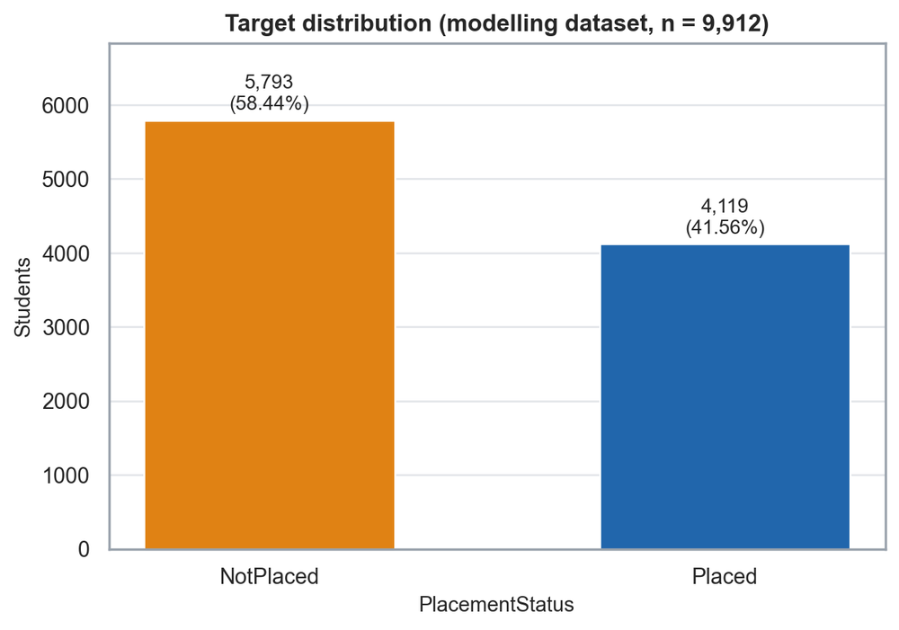

**Class imbalance.** After cleaning, 41.56% of rows are Placed (4,119 of 9,912). The ratio is about 1.4 : 1, a *moderate* imbalance: accuracy alone would be misleading (always saying "NotPlaced" is 58.4% accurate), so Chapter 10 uses probability-based metrics as well. **Outliers.** Course method: a value is an outlier if it is below Q1 − 1.5·IQR or above Q3 + 1.5·IQR. We applied it for information; no row was deleted, because the course's own rule is "investigate before acting".

**Correlation** is a number from −1 to +1 saying how strongly two variables move together (Pearson *r*). Strong correlation with the target means "useful for prediction", not "cause".

<div class="wrap" markdown="1">
**Key takeaways.** EDA = look before you model. We used shape/dtypes/describe, value counts, IQR, histograms, box/violin/bar plots, heat-maps and tests. EDA led to: dedupe, treat counts as categories, judge by probability quality. No pie chart, no imputation, no feature creation.

**Formulas.** mean = Σx/n; σ² = Σ(x−μ)²/n; outlier fences = Q1 − 1.5·IQR, Q3 + 1.5·IQR.

**Revision questions.** (1) Name three EDA outputs we produced. (2) Why not `.info()`? (it was simply not used; `.dtypes` and `.shape` gave the same facts). (3) What is class imbalance and what is ours? (4) What does r = 0.56 between aptitude and HSC tell us? (5) Why did EDA stop us from treating counts as numbers?

**Professor may ask.** "Did you remove outliers?" No, the IQR check was informational. "Which EDA did you not do?" Pie chart, imputation, transformations.
</div>

# 4. Data Cleaning and Preparation

## 4.1 Why raw data cannot always be used directly <span class="tag c">COURSE</span>

Your course (Module 2) defines data cleaning as "detecting, correcting, or removing inaccurate, incomplete, duplicate, inconsistent, and irrelevant data" and lists five steps: handle missing values, remove duplicates, correct inconsistent data, handle outliers, standardise formats. Its own baby example: "If your school prints two ID cards accidentally, only one valid card should be kept."

Our audit (notebook 02) applied the same checklist:

| Check | Result | Action |
|---|---|---|
| Missing values | none | nothing to impute |
| Invalid values (CGPA outside 0–10, marks outside 0–100, negative or non-integer counts) | none | nothing to fix |
| Inconsistent formats | none (text columns only contain Yes/No and Placed/NotPlaced) | nothing to standardise |
| Outliers | IQR rule flags none in the five score columns | nothing removed |
| **Exact duplicate rows** | 66 groups = 138 rows; 72 surplus copies | **kept one copy of each: −72** |
| **Conflicting labels** | 8 groups = 16 rows | **excluded all of them: −16** |
| Overlap between the supplied train/validation/test files | 33 feature profiles (69 rows) appeared in more than one file | removed by rebuilding the split (Chapter 5) |

<div class="note" markdown="1">
**Do not invent other filtering.** There were exactly two removal operations: surplus exact duplicates (72 rows) and conflicting-label rows (16 rows). Nothing else was filtered, no outlier was dropped, and nothing was imputed.
</div>

## 4.2 The two operations in detail <span class="tag v">VERIFIED</span> (`src/build_notebook_02.py`)

**(a) Exact duplicates.** Two rows are exact duplicates if all 11 columns (10 features and the label) are identical. Identical students with the same answer add no new information and make the model over-trust that profile. In pandas:

```python
exact_extra = df.duplicated(subset=COLS, keep="first")   # True for every copy after the first
n_exact_extra = int(exact_extra.sum())                    # 72
```

**(b) Conflicting labels.** Group the rows by their ten features. A group in which the label is *not* the same everywhere is a conflict. Eight such groups exist, each with exactly two rows (one Placed, one NotPlaced). All eight have the top-end profile (aptitude 90, two workshops, three projects, extracurricular and training both Yes). With no majority in a pair and no way to know which label is right, we excluded the rows instead of guessing:

```python
kept = df[~is_conf]                                        # drop the 16 conflicting rows
model_df = kept.drop_duplicates(subset=FEATURES, keep="first")   # then one row per remaining profile
assert 10000 - 16 - 72 == len(model_df) == 9912
```

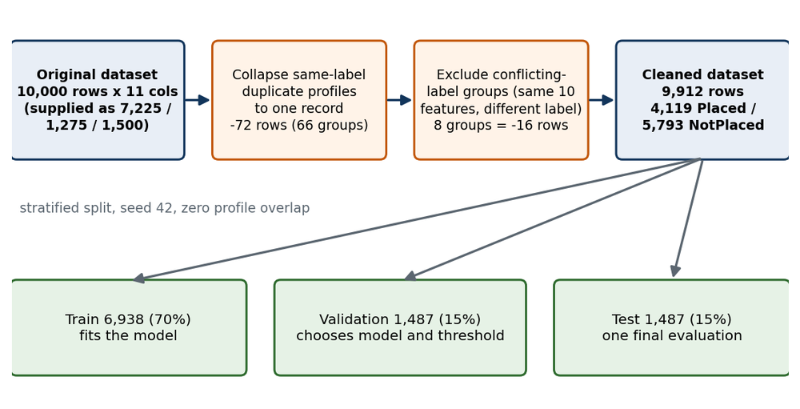

**Effect on the data.** 88 of 10,000 rows (0.88%) were affected. Because the 16 contradictory rows are all top-end profiles, the cleaned data slightly under-represent that corner: a stated limitation, not a measured one.

## 4.3 Data leakage <span class="tag s">SUPPLEMENT</span>

**What:** any route by which information that would not exist at prediction time (or that belongs to the test data) influences training. **Why it matters:** it makes the measured score look better than the real score. **Examples in our project that we guarded against:**

1. The *same student profile* in both train and test files (the 33 overlapping profiles): the model would be graded on something it had memorised.
2. Fitting the scaler or encoder on all data, so test information flows into the mean/SD: avoided by fitting inside the pipeline on training rows only (Chapter 6).
3. Using the test set to choose the model or threshold: avoided by the validation set and a frozen protocol (Chapter 5).

<div class="wrap" markdown="1">
**Key takeaways.** 10,000 − 72 duplicates − 16 conflicting rows = **9,912**. No missing/invalid values, no outliers removed. Cleaning also removed cross-file leakage.

**Formulas.** 10,000 − 72 − 16 = 9,912.

**Revision questions.** (1) Difference between exact duplicate and conflicting duplicate? (2) Why not take a majority vote? (3) How many groups and rows were excluded as conflicting? (4) Why did we also rebuild the split? (5) Define data leakage with one example.

**Professor may ask.** "Why drop instead of fix the 16 rows?" No ground truth exists to decide which label is right. "Could filtering bias the result?" Slightly, at the top end; only 0.88% of rows.
</div>

# 5. Train, Validation and Test Splitting

*The course slides do not contain a lecture on this topic (the syllabus lists it under Model Validation). This chapter is standard theory* <span class="tag s">SUPPLEMENT</span> *connected to our code.*

## 5.1 Why we split, and the three roles

If you teach a student with exam paper A and then test with exam paper A, a high mark tells you they remembered paper A, not that they understood the subject. The same holds for models.

| Set | Rows | Role | Analogy |
|---|---|---|---|
| **Training** | 6,938 | The model learns its numbers here (scaler mean/SD, coefficients) | practice questions |
| **Validation** | 1,487 | We compare models and settings, and choose the threshold here | a mock exam |
| **Test** | 1,487 | Final one-time score after all choices are frozen | the real exam |

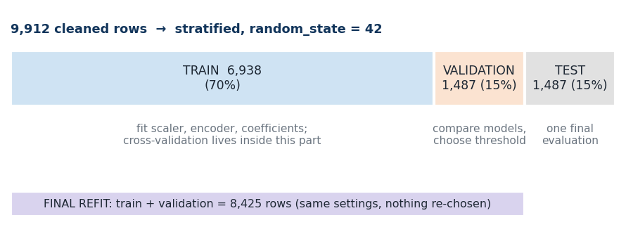

6,938 + 1,487 + 1,487 = 9,912. After all choices were frozen, the final model was **refitted on train + validation = 8,425 rows**, with the same settings, to use more data. The test rows were never part of any fit.

**Overfitting** = the model learns the quirks and noise of the training rows, so it scores very well on them and badly on new rows. **Underfitting** = the model is too simple to capture even the real pattern, so it scores badly everywhere. **Generalisation** = performing well on rows it has never seen, which is the actual goal. *Our own example of overfitting:* an unrestricted decision tree (`max_depth=None`, `min_samples_leaf=1`) reached **training AUC 1.000** but a validation AUC of only 0.67–0.68 and a validation log loss of 11.05–11.47 (`05_tuning_grids.csv`). Restricting the depth fixed it.

## 5.2 How we split <span class="tag v">VERIFIED</span> (`src/build_notebook_02.py`)

```python
train, tmp = train_test_split(model_df, test_size=0.30, stratify=model_df[TARGET], random_state=42)
val, test  = train_test_split(tmp,      test_size=0.50, stratify=tmp[TARGET],      random_state=42)
```

* **Two calls**: first 70% / 30%, then the 30% is halved into 15% / 15%.
* **Stratified** means each part keeps the same class proportion as the whole: Placed is 41.55% (train), 41.56% (validation), 41.56% (test), 41.56% overall. Without stratification a small test set could by chance contain far fewer Placed students and give a misleading score.
* **Random seed.** Shuffling uses pseudo-random numbers; `random_state=42` fixes the sequence, so everyone who re-runs the code gets the identical split and results. That is **reproducibility**. The number 42 has no special meaning; any fixed number works.
* The three parts share **zero** feature profiles (checked: `final_cross_split_profile_overlap = 0`).

## 5.3 Cross-validation <span class="tag s">SUPPLEMENT</span>

A single validation set gives one noisy estimate. **K-fold cross-validation** splits the training data into *K* equal folds; the model is fitted *K* times, each time holding out a different fold for scoring, and the *K* scores are averaged. **Stratified K-fold** keeps the class ratio in every fold.

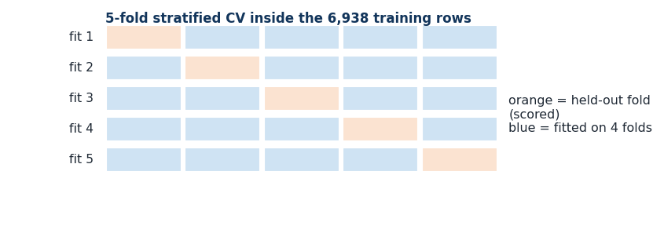

*Our usage:* `StratifiedKFold(n_splits=5, shuffle=True, random_state=42)` on the 6,938 training rows (notebook 06). It was used to check the *stability* of the three leading models and to test calibration methods, not to pick between them. Result for LR B: mean ROC-AUC 0.879 (fold SD 0.0095). Each fit uses 80% of the training rows.

## 5.4 The honest statement about the test set <span class="tag v">VERIFIED</span>

| Phase | What touched the eventual test rows | What it was used for |
|---|---|---|
| 1–3 (data understanding, quality, EDA, statistics) | The test rows were loaded for **descriptive** analysis (summaries, plots, tests on the whole dataset) | understanding the data; **not** fitting or scoring any prediction model |
| Orientation commands | Two shell commands (`head`, `wc -l`) glanced at `test.csv` | nothing was used from them |
| 4–6 (preprocessing, models, calibration, threshold) | The notebooks' own audit hooks blocked access to the test file | model development, selection, tuning, calibration, threshold |
| 7 (final evaluation) | **One gated read**, logged 2026-10-02 18:51 UTC (`08_test_access_log.json`), after the protocol was frozen (`08_frozen_protocol.json`) | the single reported test result |

<div class="note" markdown="1">
**Say:** "The test set was not used for model development, selection, tuning, calibration or threshold selection." **Never say** "the test set was untouched throughout the project": early descriptive EDA did look at those rows. **Limitation this introduces:** the descriptive look (for example, knowing the overall placement rate or a feature's range) is a weak form of information leak; it cannot change the fitted numbers, but it means independence is not absolute. In addition, we chose the final model on validation scores, which makes validation-based figures slightly optimistic; the test score is therefore the cleaner estimate.
</div>

<div class="wrap" markdown="1">
**Key takeaways.** Split 70/15/15 = 6,938 / 1,487 / 1,487, stratified, seed 42, two `train_test_split` calls. Validation for choosing, test for one final score, refit on 8,425. Five-fold stratified CV on training rows for stability only. Test-set wording must be qualified.

**Formulas.** n = 6,938 + 1,487 + 1,487; CV score = mean of K fold scores.

**Revision questions.** (1) Why not evaluate on training data? (2) Overfitting vs underfitting? (3) What does stratify do? (4) What does `random_state=42` guarantee? (5) What was CV used for here?

**Professor may ask.** "Did you touch the test set?" Qualified answer above. "Why also refit on validation?" More data after choices are frozen.
</div>

# 6. Data Preprocessing and Feature Engineering

## 6.1 What and why <span class="tag c">COURSE</span>

The course says preprocessing is "the process of making raw data ready for processing and analysis", and "machine learning algorithms require numerical input". A logistic-regression formula multiplies numbers by weights; it cannot multiply the word "Yes". The course lists the transformations we need: **feature scaling** (standardisation, normalisation) and **encoding** (label encoding, one-hot encoding). **Feature engineering** (creating new features such as BMI from weight and height) was *not* used in our project: we only encoded and scaled the ten original columns.

## 6.2 Concept card: Standardisation (z-score) <span class="tag c">COURSE</span>

* **What.** Rescale a numeric column so that its mean is 0 and its standard deviation is 1.
* **Why.** Our columns live on different scales (CGPA ≈ 6.5–9.1, marks ≈ 55–90). Two reasons matter for Logistic Regression: the L2 penalty (Chapter 7) punishes all coefficients equally, which is only fair if the inputs are on comparable scales; and the optimiser converges faster and more reliably. (The course note says standardisation is "required for Logistic Regression"; strictly, an *unpenalised* logistic regression would still give valid answers without it, but ours is penalised, so it matters.)
* **Simple words.** "How many standard deviations above or below the average is this student?"
* **Formula.**

<div class="eq">z = (x − μ) / σ</div>

*x* = the raw value; *μ* = mean of the column; *σ* = standard deviation of the column; *z* = standardised value. scikit-learn's `StandardScaler` uses the *population* σ (divides by *n*, `ddof=0`), the same as the course's examples.

* **Course worked example** {40, 50, 60, 70, 80}: μ = 60, σ = 14.14, so z = −1.41, −0.71, 0.00, 0.71, 1.41.
* **Our worked example (real numbers from the saved scaler).** The scaler stored, for CGPA, μ = 7.6974 and σ = 0.6390. A student with CGPA 8.45: z = (8.45 − 7.6974)/0.6390 = **+1.178**. For aptitude 80: μ = 79.3215, σ = 8.1600, z = **+0.083**.

<div class="note" markdown="1">
**Where do μ and σ come from?** From the 8,425 rows the final model was fitted on (train + validation), not from the training rows alone. (`model_metadata.json` calls the mean "train_mean": a loose label; the saved scaler's CGPA mean is 7.69740, while the train-only mean is about 7.699.)
</div>

* **Code.** `StandardScaler()` inside the pipeline (never by hand).
* **Without it.** The penalty would favour large-scale columns and the optimiser may need many more iterations.
* **Normalisation** (min-max, course formula x′ = (x − x_min)/(x_max − x_min)) squeezes into [0, 1]. We did **not** use it. Comparison: standardisation has no fixed range and is less sensitive to outliers (course table), which is why it suits regression-type models.
* **Limits.** Assumes mean and SD are meaningful; it does not change the shape of the distribution.

## 6.3 Concept card: One-hot encoding <span class="tag c">COURSE</span>

* **What.** Replace one categorical column by several 0/1 columns, one per category. The course example turns Colour {Red, Green, Yellow} into three columns Red, Green, Yellow.
* **Why not label encoding (0, 1, 2)?** It would tell the model that level 2 is "twice" level 1 in a straight line, which our EDA shows is false for the counts (workshops: 28.4%, 21.1%, 72.6%, 56.3%).
* **Dummy-variable trap / dropping a category.** If you keep *all* K columns, they always add up to 1, which duplicates the intercept (perfect redundancy) and makes each coefficient depend arbitrarily on the others. Dropping one **reference level** gives K − 1 columns; each coefficient then reads "compared with the reference level". <span class="tag s">SUPPLEMENT</span>
* **Our actual encoders** (loaded from the artifact):

| Columns | Categories found by the fitted encoder | Dropped (reference) | Output columns |
|---|---|---|---|
| Internships | 0, 1, 2 | 1 | `Internships_0`, `Internships_2` |
| Projects | 0, 1, 2, 3 | 3 | `Projects_0`, `Projects_1`, `Projects_2` |
| Workshops/Certifications | 0, 1, 2, 3 | 0 | `Workshops/Certifications_1`, `_2`, `_3` |
| ExtracurricularActivities | No, Yes | No (`drop='first'`) | `ExtracurricularActivities_Yes` |
| PlacementTraining | No, Yes | No | `PlacementTraining_Yes` |

The reference levels for the three counts are the most frequent level in the training data (the code uses the training mode); `handle_unknown='error'` means an unseen category would raise an error instead of silently being ignored.

* **Worked example.** A student with Internships = 2, Projects = 3, Workshops = 1, Extracurricular = Yes, Training = No becomes:

| Internships_0 | Internships_2 | Projects_0 | Projects_1 | Projects_2 | Work_1 | Work_2 | Work_3 | Extra_Yes | Train_Yes |
|---|---|---|---|---|---|---|---|---|---|
| 0 | **1** | 0 | 0 | 0 | **1** | 0 | 0 | **1** | 0 |

Projects = 3 is the reference, so all three Projects columns are 0.

## 6.4 From 10 predictors to 15 processed features <span class="tag v">VERIFIED</span>

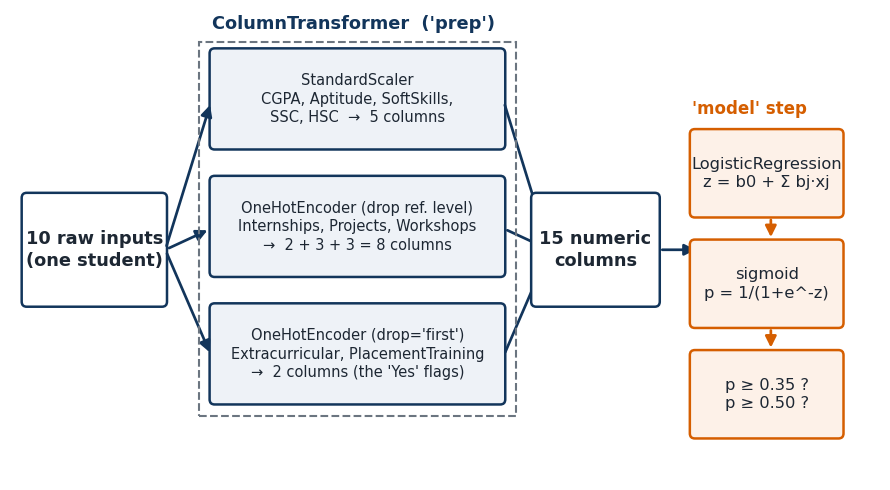

| Group | Columns in | Transformer | Columns out |
|---|---|---|---|
| continuous | CGPA, AptitudeTestScore, SoftSkillsRating, SSC_Marks, HSC_Marks | `StandardScaler` | 5 |
| counts | Internships, Projects, Workshops/Certifications | `OneHotEncoder(drop=[1, 3, 0])` | 2 + 3 + 3 = 8 |
| binary | ExtracurricularActivities, PlacementTraining | `OneHotEncoder(drop='first')` | 1 + 1 = 2 |
| | | **Total** | **5 + 8 + 2 = 15** |

**No column is "passed through unchanged":** the two Yes/No columns are one-hot encoded (they end up as a 0/1 column, but that is the encoder's output, not a pass-through). `ColumnTransformer(remainder='drop')` would discard any other column, and `verbose_feature_names_out=False` keeps the plain column names above. The 15 output names in order: CGPA, AptitudeTestScore, SoftSkillsRating, SSC_Marks, HSC_Marks, Internships_0, Internships_2, Projects_0, Projects_1, Projects_2, Workshops/Certifications_1, Workshops/Certifications_2, Workshops/Certifications_3, ExtracurricularActivities_Yes, PlacementTraining_Yes.

## 6.5 Fit, transform, fit_transform and pipelines <span class="tag s">SUPPLEMENT</span>

| Call | What it does | Example |
|---|---|---|
| `fit(X)` | *Learns* quantities from the data | scaler learns μ and σ per column; encoder learns the category list |
| `transform(X)` | *Applies* what was learned (no learning) | z = (x − μ)/σ using the stored μ, σ |
| `fit_transform(X)` | fit then transform on the same data | used on training data only |

**Rule:** learn only from training rows; apply to validation, test and app inputs. If validation or test data entered `fit`, their information would leak into the scaler. We never call these by hand: `Pipeline([("prep", ColumnTransformer(...)), ("model", LogisticRegression(...))])` fits the preprocessing and the model together in one `.fit(X_train, y_train)`, and calls `.transform` automatically in `.predict_proba(X_new)`. This guarantees that the app uses exactly the transformation learned in training.

```python
pipe = Pipeline([("prep", ColumnTransformer([
            ("num", StandardScaler(), CONT),
            ("cnt", OneHotEncoder(drop=[1, 3, 0], sparse_output=False), COUNT),
            ("bin", OneHotEncoder(drop="first", sparse_output=False), BIN)])),
         ("model", LogisticRegression(l1_ratio=0, solver="lbfgs", max_iter=5000, random_state=42))])
pipe.fit(X_train, y_train)
```

<div class="wrap" markdown="1">
**Key takeaways.** Standardise 5 scores (z = (x − μ)/σ); one-hot the 3 counts (reference dropped) and the 2 Yes/No columns; 10 → 15 columns. All learned inside a Pipeline from fitting rows only.

**Formulas.** z = (x − μ)/σ; x′ = (x − min)/(max − min) (course, not used); K categories → K − 1 columns.

**Revision questions.** (1) Why can't the model use the word "Yes"? (2) What does `fit` store in the scaler? (3) Why drop a category? (4) How do 10 columns become 15? (5) Why fit preprocessing on training data only?

**Professor may ask.** "Standardise or normalise?" We standardised, because the L2 penalty and L-BFGS behave better, and it is less outlier-sensitive. "Why one-hot for Internships if it is a number?" EDA showed non-monotonic effects.
</div>

# 7. Logistic Regression: the Complete Masterclass

## 7.1 What it is, and why "regression" for classification <span class="tag c">COURSE</span>

The course (Module 1, Dr. Divya Thakur) says: *"Logistic regression … is used for predicting the categorical dependent variable using a given set of independent variables … instead of giving the exact value as 0 and 1, it gives the probabilistic values which lie between 0 and 1 … Instead of a straight line, Logistic Regression uses the Sigmoid Function to 'S-shape' the output."*

**Why the odd name?** Historically it belongs to the family of regression methods: it *regresses* (fits a linear equation to) a transformed quantity, the **log-odds** of the class, not the class itself. The output is a number between 0 and 1 (a probability), and a threshold then turns it into a class. So the *model* is a regression of log-odds; its *use* here is classification.

| | Linear regression (course) | Logistic regression (course) |
|---|---|---|
| Predicts | a continuous number (house price) | the probability of a class (Placed) |
| Equation | Y = a + bX + ε, or Y = a + b₁X₁ + … + bₙXₙ + ε | p(y=1\|X) = 1 / (1 + e^−(β₀+β₁x₁+…+βₚxₚ)) |
| Output range | any real number | strictly between 0 and 1 |
| Fitted by | least squares | maximum likelihood (minimise log loss) |
| For our task | would give "placement = 1.3" or "−0.2": meaningless | gives 0.373 |

**Binary logistic regression** (two classes) is what we use. The course also covers multinomial (softmax, three or more unordered classes) and ordinal versions; **we did not use them**: our target has only two classes.

## 7.2 The linear predictor (the "score")

<div class="eq">z = b<sub>0</sub> + b<sub>1</sub>x<sub>1</sub> + b<sub>2</sub>x<sub>2</sub> + … + b<sub>n</sub>x<sub>n</sub></div>

* **x₁ … xₙ** (here n = 15): the processed input values of one student (Chapter 6).
* **b₁ … bₙ** (also called *weights* or *coefficients*; the course writes β or w): numbers the training learns. A bigger positive b means that feature pushes the score up more.
* **b₀** (the *intercept* or bias): the score when all x are 0, i.e. for the **reference student** (every scaled score at its average, Internships = 1, Projects = 3, Workshops = 0, Extracurricular = No, Training = No). Ours: b₀ = **−1.6607**.
* **z**: the **weighted sum**, a single number from −∞ to +∞; it is the log-odds of being Placed (§7.5).

*Relatable picture:* a scoring sheet in which each question gives plus or minus points; z is the total.

## 7.3 Concept card: the sigmoid (logistic) function <span class="tag c">COURSE</span>

* **What.** The S-shaped function that converts any score into a number between 0 and 1.
* **Why.** A raw score z can be −7 or +40; a probability must lie in [0, 1]. The sigmoid is a smooth, monotonic bridge.
* **Formula (course notation).**

<div class="eq">p = σ(z) = 1 / (1 + e<sup>−z</sup>)</div>

*z* = the score; *e* ≈ 2.718 (Euler's number, as in the course slide); *p* = probability of class 1 (Placed). So P(Placed) = p and P(Not Placed) = 1 − p; the two always add to 1.

| z | −4 | −2 | −1 | −0.52 | 0 | +1 | +2 | +4 |
|---|---|---|---|---|---|---|---|---|
| p = σ(z) | 0.018 | 0.119 | 0.269 | 0.373 | 0.500 | 0.731 | 0.881 | 0.982 |

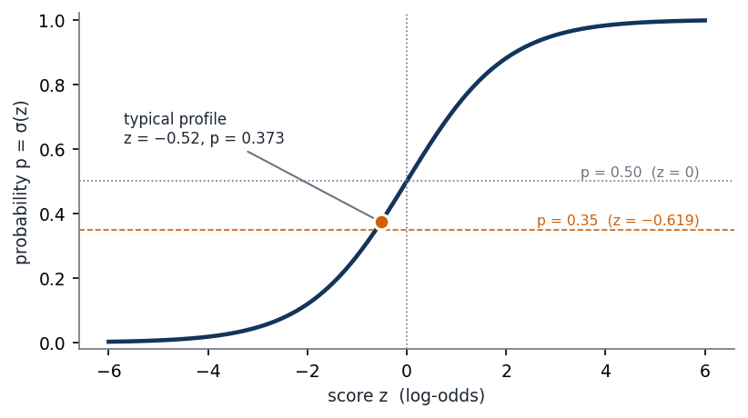

*Reading it:* z = 0 gives exactly 0.5 (the 0.50 threshold is the same as "z ≥ 0"); the 0.35 threshold is the same as "z ≥ ln(0.35/0.65) = −0.619". Large positive z saturates near 1; large negative near 0.

<div class="note" markdown="1">
**Course slide 23 says** the sigmoid is used "in logistic regression and neural network activation layers for binary classification". In **our** model there is **no neural network**: no layers, neurons, hidden units or epochs. The sigmoid is simply the **logistic link function** that turns the single linear score into a probability. It is applied once, at the end, to one number.
</div>

## 7.4 Decision rule <span class="tag c">COURSE</span>

The course states the decision boundary "is typically at 0.5: if p(y=1\|X) ≥ 0.5, predict class 1; if < 0.5, predict class 0". Our app uses the same rule with **two** cut-offs (Chapter 11): predict Placed when p ≥ threshold.

## 7.5 Log-odds, odds and the odds ratio

* **Odds** = p / (1 − p): how many times more likely Placed than Not Placed. p = 0.373 → odds = 0.373/0.627 = **0.595** (about 3 : 5).
* **Log-odds (logit)** = ln(odds). Start from p = 1/(1 + e⁻ᶻ): then 1 − p = e⁻ᶻ/(1 + e⁻ᶻ), so p/(1 − p) = eᶻ, hence

<div class="eq">ln( p / (1 − p) ) = z = b<sub>0</sub> + b<sub>1</sub>x<sub>1</sub> + … + b<sub>n</sub>x<sub>n</sub></div>

So the model is *linear in the log-odds*: that is what the "regression" regresses. Check: ln(0.595) = −0.519 ≈ our z.

* **Odds ratio**: if a 0/1 feature changes from 0 to 1, z rises by its coefficient b, and the odds are multiplied by **eᵇ**. For PlacementTraining_Yes, b = +0.9745, eᵇ = **2.65**: other things equal, the odds of Placed are 2.65 times higher for students who had training. For a standardised score, eᵇ is the odds multiplier per +1 SD. These are *associations in this dataset*, not causal effects (Chapter 12).

## 7.6 Maximum likelihood, likelihood, log-likelihood and cross-entropy <span class="tag c">COURSE</span>

**Question:** how do we choose the b's? **Course answer:** by **Maximum Likelihood Estimation (MLE)**: pick the weights that make the *observed* training labels most probable.

1. **Bernoulli model.** Each student's label y ∈ {0, 1} is a coin toss with success probability pᵢ: P(Y = y) = pᵢʸ (1 − pᵢ)¹⁻ʸ. If y = 1 this equals pᵢ; if y = 0 it equals 1 − pᵢ. (Course slide: "Bernoulli probability mass function".)
2. **Likelihood** of the whole training set (students assumed independent), as in the course:

<div class="eq">L(w, b) = Π<sub>i=1</sub><sup>n</sup> p<sub>i</sub><sup>y<sub>i</sub></sup> (1 − p<sub>i</sub>)<sup>1 − y<sub>i</sub></sup>,&nbsp;&nbsp; where p<sub>i</sub> = σ(w·x<sub>i</sub> + b)</div>

3. **Log-likelihood.** A product of thousands of numbers below 1 is astronomically small, so we take logarithms (log of a product = sum of logs): ℓ(w, b) = Σ [ yᵢ log pᵢ + (1 − yᵢ) log(1 − pᵢ) ].
4. **Negative log-likelihood = binary cross-entropy = log loss** (the course uses these names for the same quantity). Maximising ℓ is the same as minimising −ℓ; dividing by *n* makes it an average:

<div class="eq">L = − (1/n) Σ<sub>i=1</sub><sup>n</sup> [ y<sub>i</sub> log(p<sub>i</sub>) + (1 − y<sub>i</sub>) log(1 − p<sub>i</sub>) ]</div>

*n* = number of students; *yᵢ* = true label (0/1); *pᵢ* = predicted P(Placed); log = natural log. This is a **cost (loss) function**: one number that says how bad the current weights are.

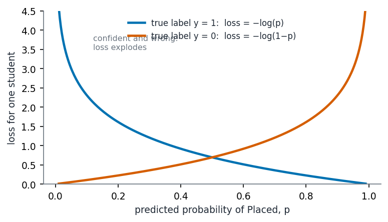

**Intuition.** A student who really was Placed (y = 1) contributes −log(p): tiny if p is near 1, huge if the model said p near 0. Confident wrong answers are punished most heavily.

**Worked example 1 (course "Numerical Example 1", likelihood).** Observations y = [1, 1, 0, 1, 0] (three successes, two failures) with a constant p. L(p) = p³(1 − p)². L(0.4) = 0.064 × 0.36 = 0.02304; L(0.5) = 0.125 × 0.25 = 0.03125; **L(0.6) = 0.216 × 0.16 = 0.03456**; L(0.7) = 0.343 × 0.09 = 0.03087. The best p is **0.6 = 3/5**, the observed proportion: MLE picks the value that makes the data most probable.

**Worked example 2 (log loss, four students).** True labels y = [1, 0, 1, 0], predicted p = [0.9, 0.2, 0.6, 0.7]:

| Student | y | p | loss = −[y ln p + (1−y) ln(1−p)] |
|---|---|---|---|
| 1 | 1 | 0.9 | −ln 0.9 = 0.105 |
| 2 | 0 | 0.2 | −ln 0.8 = 0.223 |
| 3 | 1 | 0.6 | −ln 0.6 = 0.511 |
| 4 | 0 | 0.7 | −ln 0.3 = 1.204 |

Mean = (0.105 + 0.223 + 0.511 + 1.204)/4 = **0.511**. Student 4 (the model was fairly confident, and wrong) costs 1.204, more than the other three students put together (0.839). A model that always answered 0.5 would score ln 2 = 0.693. Our final model on the test set: log loss **0.420** (for comparison, on validation the always-the-base-rate dummy scored 0.679).

## 7.7 Optimisation: gradient descent, then L-BFGS

**Gradient descent** <span class="tag c">COURSE</span>: "an iterative optimization algorithm used to minimize a function by adjusting its parameters in the direction of the steepest descent": initialise parameters, compute the gradient, update, repeat until the loss stops decreasing. For logistic regression the course gives the gradients (for the sum loss):

<div class="eq">∂L/∂w = Σ (σ(z<sub>i</sub>) − y<sub>i</sub>) x<sub>i</sub>,&nbsp;&nbsp; ∂L/∂b = Σ (σ(z<sub>i</sub>) − y<sub>i</sub>),&nbsp;&nbsp; w ← w − η ∂L/∂w,&nbsp;&nbsp; b ← b − η ∂L/∂b</div>

η = learning rate (step size). **Worked example 3 (the course's own, reproduced and checked in Python).** Data (x, y) = {(0, 0), (1, 1)}, η = 0.5, start w = 0, b = 0.

| Iteration | σ(z) for x=0, x=1 | ∂L/∂w | ∂L/∂b | new w | new b |
|---|---|---|---|---|---|
| 1 | 0.5, 0.5 | (0.5−0)·0 + (0.5−1)·1 = −0.5 | (0.5−0) + (0.5−1) = 0 | 0 − 0.5(−0.5) = **0.25** | 0 |
| 2 | 0.5, 0.5622 | (0.5)(0)+(0.5622−1)(1) = −0.4378 | 0.5 + (0.5622−1) = 0.0622 | 0.25 + 0.2189 = **0.4689** | 0 − 0.0311 = **−0.0311** |

After two iterations w ≈ 0.4689, b ≈ −0.0311, the course's answer. The loss falls each step.

**What our model actually uses: L-BFGS** <span class="tag s">SUPPLEMENT</span> <span class="tag v">VERIFIED</span>. Plain gradient descent uses only the slope. **L-BFGS** (limited-memory Broyden–Fletcher–Goldfarb–Shanno) is a *quasi-Newton* method: it remembers the last few steps and gradients to estimate the curvature of the loss and take much better-aimed steps, so it needs far fewer iterations. In scikit-learn 1.9.1, `solver='lbfgs'` calls SciPy's `L-BFGS-B` routine with `gtol = tol = 1e-4` and `maxiter = max_iter` (read from `sklearn/linear_model/_logistic.py`).

<div class="note" markdown="1">
**L-BFGS is an optimisation solver, not an activation function.** An activation function (sigmoid, ReLU) is part of the *model's formula* and transforms a score into an output. A solver is the *search procedure* that finds the weights. They answer different questions: "what is the formula?" (linear score + sigmoid) versus "how do we find the best b's?" (L-BFGS).
</div>

* **max_iter = 5000** is a safety cap on iterations. **Convergence** means the gradient became tiny (below tol) so the search stopped by itself. Our fitted model has `n_iter_ = [30]`: it converged after **30** iterations, far below 5,000. I checked independently that the gradient of the objective at the saved coefficients has maximum size 6.2 × 10⁻⁵ < 10⁻⁴.
* **Iteration ≠ epoch ≠ fit.** One *iteration* = one L-BFGS update step inside one fit. An *epoch* = a full pass over the data in mini-batch training of neural networks: **no epochs exist here**. A *fit* = one complete `.fit()` call (which itself contains many iterations). See Chapter 9 for counts.

## 7.8 Regularisation: L1, L2 and C <span class="tag s">SUPPLEMENT</span>

**Overfitting and the penalty.** With many features, the unrestricted MLE weights can become very large to chase noise. **Regularisation** adds a penalty for large weights to the loss, so the optimiser trades fit against size.

| | L2 (ridge) | L1 (lasso) |
|---|---|---|
| Penalty on weights | ½ Σ w_j² (sum of squares) | Σ \|w_j\| (sum of absolute values) |
| Effect | shrinks all weights smoothly, rarely to exactly 0 | can set weights to exactly 0 (feature selection) |
| scikit-learn 1.9.1 | `l1_ratio=0` (the old `penalty='l2'`) | `l1_ratio=1` (needs `liblinear` or `saga` solver) |
| **Ours** | **yes, L2** (L-BFGS supports only L2 or none) | no |

**The exact objective scikit-learn minimises** (I read the source: `l2_reg_strength = 1.0 / (C * sw_sum)`, intercept not penalised; and verified numerically that the saved coefficients satisfy the gradient condition with the intercept unpenalised, whereas they would fail it if it were penalised):

<div class="eq">minimise over (w, b):&nbsp; (1/n) Σ<sub>i</sub> loss(y<sub>i</sub>, p<sub>i</sub>) + (1 / (2 C n)) ‖w‖²&nbsp;&nbsp;&nbsp; ⇔ &nbsp;&nbsp; C Σ<sub>i</sub> loss(y<sub>i</sub>, p<sub>i</sub>) + ½ ‖w‖²</div>

‖w‖² = w₁² + … + w₁₅² (the squared lengths of the 15 coefficients; **b₀ is excluded**). The two forms have the same minimiser (multiply by n·C).

**C is the *inverse* of the regularisation strength:** *small C → strong penalty → smaller weights (simpler model); large C → weak penalty → weights near the unpenalised values.* (C = ∞ means no penalty.) In our case C = 1.

**Numbers for our model** (n = 8,425): Σ loss = 3,623.8 and ½‖w‖² = 1.52, so the penalty is only 0.04% of the objective: with 8,425 rows and 15 columns, C = 1 is a **gentle** regularisation. That matches the sensitivity check on validation data (`05_lr_C_sensitivity.csv`, Variant B, AUC): C = 0.01 → 0.8692; 0.1 → 0.8714; 1 → 0.8717; 10 → 0.8718; 100 → 0.8718. Results are almost identical for C ≥ 0.1: the choice is not delicate.

**Why standardisation matters here:** the penalty adds up w_j² over all columns, so it is only even-handed if all inputs share a scale.

## 7.9 Our coefficients, and how to read them <span class="tag v">VERIFIED</span>

From `LR_B_final.joblib` (intercept b₀ = −1.6607). "OR" = eᵇ.

| Column | b | OR | Read as |
|---|---|---|---|
| CGPA | +0.233 | 1.26 | per +1 SD (0.639 CGPA points) |
| AptitudeTestScore | +0.501 | 1.65 | per +1 SD (8.16 points) |
| SoftSkillsRating | +0.271 | 1.31 | per +1 SD (0.413) |
| SSC_Marks | +0.257 | 1.29 | per +1 SD (10.4 marks) |
| HSC_Marks | +0.212 | 1.24 | per +1 SD (8.9 marks) |
| Internships_0 / _2 | +0.201 / +0.193 | 1.22 / 1.21 | vs 1 internship |
| Projects_0 / _1 / _2 | +0.615 / −0.473 / −0.315 | 1.85 / 0.62 / 0.73 | vs 3 projects (Projects_0 rests on only 22 students) |
| Workshops_1 / _2 / _3 | −0.322 / +0.449 / +0.030 | 0.73 / 1.57 / 1.03 | vs 0 workshops |
| ExtracurricularActivities_Yes | +0.721 | 2.06 | vs No |
| PlacementTraining_Yes | **+0.974** | **2.65** | vs No |

**Cautions.** Each coefficient assumes the *other columns are held fixed*. Count-level coefficients are relative to their reference level, so a negative sign (Projects_1) means "worse than 3 projects", not "projects hurt". The dataset's non-monotonic patterns mean these coefficients are descriptive. Associations only.

## 7.10 Worked examples with our actual model <span class="tag v">VERIFIED</span>

*Numbers computed from the saved artifact with `decision_function` and `predict_proba` and hand-checked.*

**Example A: the course's customer (Logistic Regression – Example 1).** β₀ = −4, income coefficient β₁ = 0.02, age coefficient β₂ = 0.3; annual income $50,000 (the slide plugs in 50, i.e. thousands) and age 30. z = −4 + 0.02 × 50 + 0.3 × 30 = −4 + 1 + 9 = **6**, and P = 1/(1 + e⁻⁶) = 1/(1 + 0.00248) = **0.9975**, which the slide reports as "approximately 99.75%". The same recipe, with 15 inputs instead of 2, is what our app does.

**Example B: the typical profile in our app** (CGPA 7.7, 1 internship, 2 projects, 1 workshop, aptitude 80, soft skills 4.4, extracurricular Yes, training Yes, SSC 70, HSC 73). Non-zero terms (x × coefficient):

| Term | x | b | x·b |
|---|---|---|---|
| intercept | – | – | −1.6607 |
| CGPA, Aptitude, SoftSkills, SSC | +0.004, +0.083, +0.194, +0.083 | 0.233, 0.501, 0.271, 0.257 | +0.0009, +0.0417, +0.0524, +0.0212 |
| HSC | −0.162 | 0.212 | −0.0342 |
| Projects_2 (=1) | 1 | −0.315 | −0.3148 |
| Workshops_1 (=1) | 1 | −0.322 | −0.3216 |
| Extracurricular_Yes | 1 | 0.721 | +0.7210 |
| PlacementTraining_Yes | 1 | 0.974 | +0.9745 |
| **z (sum)** | | | **−0.5195** |

P = 1/(1 + e^0.5195) = 1/(1 + 1.681) = **0.373 → 37.3%**, the number the app shows. At threshold 0.35 → Placed; at 0.50 → Not Placed. Raising CGPA to 8.45 (z-score +1.178) adds 1.178 × 0.233 = +0.275, so z = −0.2456 and P = **0.439** (43.9%, as the app shows).

**Example C: a weaker and a stronger student.**

| Profile | z | P(Placed) |
|---|---|---|
| CGPA 6.8, 0 internships, 1 project, 0 workshops, aptitude 68, soft 3.8, Extra No, Training No, SSC 58, HSC 64 | −3.82 | **0.021** (2.1%) |
| CGPA 8.6, 2 internships, 3 projects, 2 workshops, aptitude 88, soft 4.6, Yes, Yes, SSC 80, HSC 82 | +2.17 | **0.898** (89.8%) |

Rebuilding the first in code:

```python
import math
z = -1.6607 + sum(x*b for x, b in zip(x_row, coefs))   # x_row: the 15 processed values
p = 1 / (1 + math.exp(-z))                              # identical to pipe.predict_proba(df)[0, 1]
```

## 7.11 Assumptions, limits, and our verified configuration

* **Linear in the log-odds.** Each feature adds a fixed amount to z; interactions (for example Extracurricular × Training) are *not* modelled unless created. The count columns are dummy-coded precisely to relax the straight-line assumption.
* **Independent rows**, no extreme multicollinearity (all VIF < 2 in notebook 04), enough rows per class. **Not guaranteed to be calibrated** unless checked (Chapter 10).
* **Output is an estimate for a group of similar students, not a certainty.**

| Setting | Required value | Found in artifact | Source |
|---|---|---|---|
| Model | Logistic Regression B | `Pipeline(prep, model)` with `LogisticRegression` | `LR_B_final.joblib` |
| Regularisation | L2 | `l1_ratio=0` (`penalty='deprecated'` in 1.9.1) | artifact |
| C | 1 | `C=1.0` | artifact, `final_model_configs.json` |
| Solver | lbfgs | `solver='lbfgs'` | artifact |
| max_iter | 5000 | `max_iter=5000` | artifact |
| Class weighting | none | `class_weight=None` | artifact |
| Iterations used | 30 | `n_iter_=[30]` | artifact |
| Processed features | 15 | `n_features_in_=15`, 15 coefficients | artifact |
| Other | | `tol=1e-4`, `fit_intercept=True`, `random_state=42`, classes `[0, 1]` | artifact |
| Rows fitted | 8,425 | `n = 8425` | `final_model_configs.json`, metadata |

<div class="wrap" markdown="1">
**Key takeaways.** Logistic regression = linear score z, sigmoid to probability, MLE/log-loss to fit, L2 penalty with C = 1 to stay stable, L-BFGS to optimise (30 iterations). It is not a neural network. Odds multiply by eᵇ.

**Formulas.** z = b₀ + Σbⱼxⱼ; p = 1/(1+e⁻ᶻ); ln(p/(1−p)) = z; L = −(1/n)Σ[y log p + (1−y) log(1−p)]; objective = (1/n)Σ loss + ‖w‖²/(2Cn).

**Revision questions.** (1) Why "regression"? (2) What does the sigmoid do and does our model have an "activation layer"? (3) Smaller C means…? (4) L-BFGS vs sigmoid? (5) Compute P for z = 1 (0.731).

**Professor may ask.** "Why not the closed-form solution?" There is none for logistic regression; it needs iteration. "What is n_iter_?" Optimiser iterations (30), not epochs. "Does L2 penalise the intercept?" No.
</div>

# 8. The Other Models We Evaluated

*The course slides do not cover trees or ensembles; this chapter is standard theory* <span class="tag s">SUPPLEMENT</span> *tied to our saved models.* Four model families were compared in notebook 05: Logistic Regression, Decision Tree, Random Forest and Gradient Boosting, plus a "dummy" reference that always predicts the training placement rate (0.584 NotPlaced / 0.416 Placed).

**Two input versions.** *Variant A* treats the three counts as ordinary numbers; *Variant B* one-hot encodes them (because EDA showed non-monotonic effects). **Logistic Regression uses the 15 processed columns** described in Chapter 6. **The three tree models use 18 columns** (verified by loading `DT_B`, `RF_B`, `GB_B`): all levels of the counts are kept (3 + 4 + 4 = 11 columns), the five scores are *not* scaled (trees only compare values with thresholds, so scale is irrelevant), plus the two Yes/No columns: 5 + 11 + 2 = 18.

## 8.1 Decision Tree

* **What.** A flowchart of yes/no questions. **Node** = a question ("Is aptitude ≤ 78?"); **branch** = an answer; **leaf** = an end box that stores the class mix (and so a probability) of the training rows that reached it; the first node is the **root**.
* **How it splits.** At each node it tries many questions and keeps the one that makes the two child groups *purer*. **Gini impurity** of a node with class proportions pₖ: G = 1 − Σ pₖ². **Entropy**: H = −Σ pₖ log₂ pₖ. **Information gain** = parent impurity − weighted average of the children's impurities. (scikit-learn's default, and our setting, is Gini.)
* **Worked example.** A node holds 10 students: 6 Placed, 4 Not. G = 1 − (0.6² + 0.4²) = **0.48**. A split sends 6 to the left (5 Placed, 1 Not) and 4 to the right (1 Placed, 3 Not): G_left = 1 − (0.833² + 0.167²) = 0.278, G_right = 1 − (0.25² + 0.75²) = 0.375; weighted = 0.6 × 0.278 + 0.4 × 0.375 = **0.317**; gain = 0.48 − 0.317 = **0.163**. With entropy: parent 0.971, children 0.650 and 0.811, weighted 0.715, information gain **0.257**.
* **Depth and overfitting.** Deeper tree = more questions = can memorise individual students. An unlimited tree reached training AUC 1.000 and validation log loss 11+ (Chapter 5).
* **Our DT_B.** `criterion='gini'`, `max_depth=5`, `min_samples_leaf=5`, 32 leaves (verified). Validation AUC 0.846.

## 8.2 Random Forest

* **Ensemble learning** = many models vote; errors of individual models partly cancel. **Bootstrap sampling** = draw *n* rows *with replacement* from the training set (about 63% of distinct rows appear in each sample). A random forest trains many trees, each on its own bootstrap sample, and at every split lets the tree consider only a random subset of the columns (`max_features='sqrt'`: √18 ≈ 4 columns). The forest **averages the trees' probabilities**.
* **Why it helps.** One deep tree is unstable (small data change → very different tree). Averaging many de-correlated trees reduces this variance, so predictions are more stable. This is **bagging** (bootstrap aggregating).
* **Our RF_B.** 300 trees, `max_depth=10`, `min_samples_leaf=10`, `max_features='sqrt'`, `bootstrap=True`, `random_state=42` (verified). Validation AUC 0.869.

## 8.3 Gradient Boosting

* **Sequential learning with weak learners.** A *weak learner* is a very small tree (ours: depth 2). Boosting starts from a simple guess (the class base rate), computes the **errors/residuals** (for log loss, essentially *y − p* for every student), fits a small tree to those errors, and **adds** the tree's output, scaled by the **learning rate**, to the running score. Repeat for `n_estimators` rounds.
* **Numbers:** a student who is Placed (y = 1) with current p = 0.60 has residual 0.40; the next tree learns to push such students up; the score becomes old score + 0.05 × tree output. A **small learning rate** (0.05) takes careful steps and needs more trees (300).
* **Bagging vs boosting.** Bagging: independent trees in parallel, *average* them, reduces variance. Boosting: dependent trees in sequence, each *fixes the previous ones*, reduces bias but can overfit if too many or too deep.

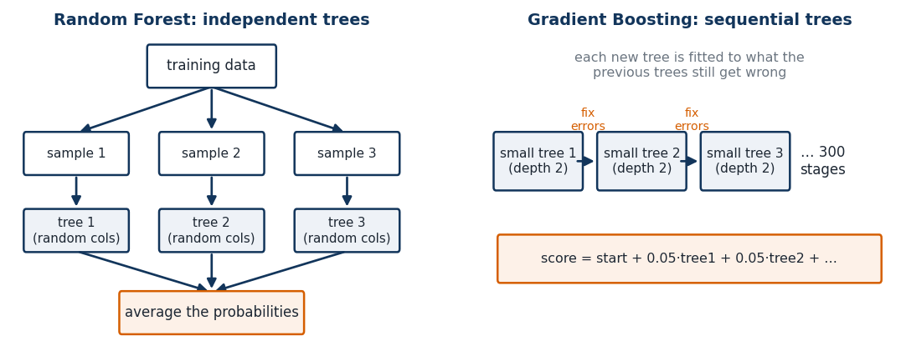

* **Our GB_B.** `GradientBoostingClassifier`, `n_estimators=300`, `learning_rate=0.05`, `max_depth=2`, `min_samples_leaf=1`, `loss='log_loss'` (verified; 300 stages fitted). Validation AUC 0.871.

## 8.4 What we compared, and why Logistic Regression was kept <span class="tag m">REPORTED</span>

Hyper-parameters of each tree family were searched on the **validation** set with a manual loop (`itertools.product`, not `GridSearchCV`; random search was not used): DT 12 settings, RF 18, GB 16 per variant. The best setting by validation log loss was kept.

| Model (Variant B) | Validation AUC | Validation log loss | **Test AUC** | Test log loss | Test ECE | Test cal. slope |
|---|---|---|---|---|---|---|
| Logistic Regression (L2, C=1) | 0.8717 | 0.4408 | **0.8857** | 0.4196 | **0.016** | 1.05 |
| Gradient Boosting | 0.8706 | 0.4413 | 0.8858 | 0.4186 | 0.031 | 1.06 |
| Random Forest | 0.8693 | 0.4432 | 0.8859 | 0.4204 | 0.024 | 1.15 |
| Decision Tree | 0.8464 | 0.4799 | not evaluated on test | – | – | – |
| Dummy (always the base rate) | 0.5000 | 0.6788 | – | – | – | – |

**Conclusion, stated carefully.** LR, GB and RF are **statistically indistinguishable** on validation, five-fold CV (AUC 0.879 / 0.876 / 0.876) and test (differences of 0.0001–0.0002 AUC, paired intervals include zero). Logistic Regression was retained, **not because it won**, but because (i) the selection rule was fixed in advance: lowest validation log loss within the indistinguishable set, ties broken by interpretability (`05_provisional_selection.json`); (ii) it has 15 readable coefficients; (iii) its test calibration (ECE 0.016) was the best of the three. The Decision Tree was clearly worse and was dropped before the final stage.

<div class="wrap" markdown="1">
**Key takeaways.** Trees ask questions (Gini/entropy); forests average many independent trees; boosting adds small trees sequentially. LR, RF, GB tied; LR kept for simplicity and calibration. Trees used 18 columns; LR used 15.

**Formulas.** G = 1 − Σpₖ²; H = −Σpₖ log₂pₖ; gain = parent − weighted children.

**Revision questions.** (1) Gini of a 50/50 node? (0.5) (2) What does bootstrap mean? (3) Bagging vs boosting? (4) Why did the tree models not need scaling? (5) Why was LR kept even though it did not win?

**Professor may ask.** "Why not the most complex model?" It did not perform better. "Was LR uniquely best?" No: the saved results do not support that claim.
</div>

# 9. Model Training: What Actually Happened

## 9.1 What `.fit()` does <span class="tag v">VERIFIED</span>

```python
pipe = make_pipeline("LR", "B", C=1.0, class_weight=None)   # build the Pipeline (Chapter 6)
pipe.fit(X_train, y_train)                                  # X_train: 6,938 × 10 DataFrame, y_train: 0/1
p_val = pipe.predict_proba(X_val)[:, 1]                     # probabilities for the 1,487 validation rows
```

`fit` runs the pipeline's steps in order:

1. **`prep.fit_transform(X_train)`**: the scaler learns μ and σ for 5 columns; the encoders learn their category lists; the 10 raw columns become a 6,938 × 15 numeric matrix.
2. **`model.fit(matrix, y_train)`**: L-BFGS iteratively changes 16 numbers (15 coefficients + the intercept) to minimise the penalised log loss of Chapter 7, starting from zeros, until the gradient is tiny.
3. The fitted pipeline now holds **learned parameters**: scaler means and σ's, encoder categories, 15 coefficients, 1 intercept. Our **hyper-parameters** (C, solver, max_iter, tree depth, …) were *chosen by us* and are not learned by the fit.

*How the model learns from labelled examples:* every iteration compares its current probabilities with the true 0/1 labels, measures the cross-entropy, and moves the 16 numbers in the direction that reduces it. There is no hidden layer and no epoch loop.

## 9.2 The experiments, in order

| Notebook | Phase | Experiment | Data used for fitting → scoring |
|---|---|---|---|
| 05 | 4 | LR (4 versions), dummy, C-sensitivity, DT/RF/GB grids; bootstrap CIs (1,000 resamples) | train → validation |
| 06 | 5 | 5-fold CV of LR_B, GB_B, RF_B; nested recalibration test (sigmoid and isotonic); validation confirmation | train folds → held-out folds; train → validation |
| 07 | 6 | Threshold analysis 0.20–0.80; explainability; feature-group ablation; error analysis | OOF and validation predictions; ablation fits |
| 08 | 7 | Frozen protocol; refit on train + validation; **one** test evaluation (2,000 bootstrap resamples) | train+validation → test |

**Calibration** here means *checking and possibly correcting the probabilities*. Sigmoid (Platt) and isotonic recalibration were fitted in a leakage-safe nested way, but **no method met the pre-declared materiality rule** (`06_calibration_method_decision.csv`: `material=False` for all six rows), so the app uses the raw model probabilities.

## 9.3 How many loops, how many fits? <span class="tag e">ESTIMATE</span>

Every number below was obtained by reading the loop structure of `src/build_notebook_05.py` … `08.py` (the scripts that generate the notebooks) and multiplying. Three different kinds of knowledge are mixed; the last column says which:

| Operation | Loop structure in the code | Fits | Kind |
|---|---|---|---|
| Decision-tree grid | 12 settings × 2 variants | 24 | **recorded** (rows in `05_tuning_grids.csv`) |
| Random-forest grid | 18 × 2 | 36 | recorded (same file) |
| Gradient-boosting grid | 16 × 2 | 32 | recorded (same file); the 92 rows record `fit_seconds`, summing to 94.3 s |
| LR baselines | A/B × plain/balanced | 4 | counted from code |
| LR C-sensitivity | 2 variants × 5 values of C | 10 | counted from code |
| Dummy baseline | 1 | 1 | counted |
| 5-fold CV | 3 models × 5 folds | 15 | **recorded** (`06_cv_fold_results.csv`: 15 rows) |
| Nested calibration | 5 outer × 3 models × 5 inner | 75 | counted from code |
| Validation confirmation | 3 models | 3 | counted |
| Feature-group ablation | 1 full + 5 groups × 5 folds + 5 validation fits | 31 | 25 fold fits recorded; rest counted |
| Phase 7 | 3 reproducibility refits on train + 3 final fits on train + validation | 6 | counted |
| **Total** | 107 + 15 + 75 + 3 + 31 + 6 | **237** | **ESTIMATE** |

Plus about 36 tiny calibrator fits (a two-parameter sigmoid and an isotonic map; 15 + 15 on the folds, 3 + 3 on validation) that are not full pipeline fits.

<div class="note" markdown="1">
**How to describe it honestly.** "About 237 pipeline fits, reconstructed by counting the loops in the notebook-building scripts. That is the number of fits in **one complete execution** of the final scripts; it is not an execution log. How many times the notebooks were re-run while developing them is <span class="tag u">UNKNOWN</span>." The count **excludes** statsmodels fits used for statistical inference, preprocessor-only demonstrations, and permutation importance (it re-scores, never refits). Only 132 of the 237 fits (92 grid + 15 CV + 25 ablation fold fits) have saved per-fit result rows; per-fit iteration counts were not saved.
</div>

**Do not confuse three things:** (i) an *optimiser iteration* (one L-BFGS step; our final model: 30); (ii) a *fit* (one whole `.fit()` call, containing many iterations); (iii) an *epoch* (a pass over the data in neural-network training: none in this project). The final, saved model was fitted **once**, on 8,425 rows, took 30 iterations, and was stored with `joblib.dump` as `models/phase7/LR_B_final.joblib`. A separate read-only refit on train + validation reproduced the saved coefficients exactly (recorded in `final_report.md`, Appendix C.2).

<div class="wrap" markdown="1">
**Key takeaways.** `.fit()` = fit preprocessing, then optimise 16 numbers. Models were compared on validation; CV and calibration were stability checks; the final LR was refit once on 8,425 rows. ≈237 fits is an estimate by loop counting; 30 is the exact iteration count of the final model; no epochs.

**Formulas.** 92 + 4 + 10 + 1 + 15 + 75 + 3 + 31 + 6 = 237.

**Revision questions.** (1) Which parameters are learned and which chosen? (2) What are the 16 numbers L-BFGS adjusts? (3) Why is 237 an estimate? (4) Difference between a fit and an iteration? (5) Why was calibration not applied?

**Professor may ask.** "How many epochs?" None. "How long did it take?" Per-fit seconds exist only for the grid (94 s in total); overall runtime was not logged (UNKNOWN).
</div>

# 10. Model Evaluation: the Complete Masterclass

*The course syllabus lists these metrics (F1, AUC-ROC, cross-validation) under Model Validation, but no slides on them were provided, so this chapter is standard theory* <span class="tag s">SUPPLEMENT</span>*, using our real numbers.*

## 10.1 The confusion matrix and the threshold-dependent metrics

At a threshold, every student falls in one of four cells. **Positive = Placed.**

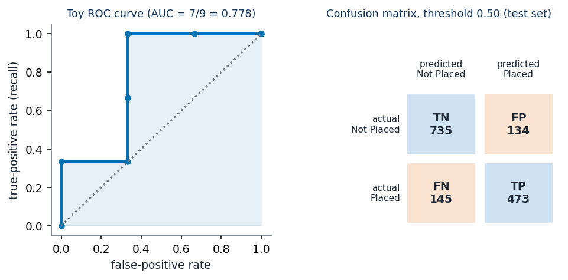

| Cell | Meaning | Example |
|---|---|---|
| **TP** true positive | predicted Placed, actually Placed | correct good news |
| **TN** true negative | predicted Not Placed, actually Not Placed | correct |
| **FP** false positive | predicted Placed, actually Not | false alarm / over-optimistic |
| **FN** false negative | predicted Not Placed, actually Placed | missed a student who was placed |

Using the test counts at threshold 0.50 (TP 473, TN 735, FP 134, FN 145; total 1,487; actually Placed = 473 + 145 = 618, actually Not = 735 + 134 = 869):

| Metric | Formula | Meaning | Calculation | When it matters |
|---|---|---|---|---|
| **Accuracy** | (TP + TN) / n | share of correct calls | (473 + 735)/1,487 = **0.812** | balanced classes; can mislead on imbalance |
| **Precision** | TP / (TP + FP) | of those called Placed, how many truly were | 473/607 = **0.779** | false alarms are costly |
| **Recall** (sensitivity, TPR) | TP / (TP + FN) | of the truly Placed, how many we found | 473/618 = **0.765** | misses are costly |
| **Specificity** (TNR) | TN / (TN + FP) | of the truly Not Placed, how many we cleared | 735/869 = **0.846** | |
| **F1** | 2PR / (P + R) | harmonic mean of precision and recall | 2(0.779)(0.765)/(0.779 + 0.765) = **0.772** | one summary of P and R |

**Why the harmonic mean?** It is dragged down by whichever of P or R is lower, so you cannot hide a bad recall behind a good precision. **Why accuracy alone is not enough:** answering "Not Placed" for everybody scores 58.4% accuracy with recall 0.

## 10.2 Threshold-independent metrics: scoring the probabilities themselves

**ROC curve and AUC.** For *every* threshold from 1 down to 0 compute recall (true-positive rate) and false-positive rate FP/(FP + TN); the plot of one against the other is the **ROC curve**. The **AUC** (area under it) equals the probability that a randomly chosen Placed student receives a higher score than a randomly chosen Not Placed student. *Toy example:* Placed scores 0.9, 0.6, 0.4 and Not Placed scores 0.7, 0.3, 0.2. Of the 9 pairs, Placed wins in 7 (0.9 beats all three; 0.6 beats 0.3 and 0.2; 0.4 beats 0.3 and 0.2), so **AUC = 7/9 = 0.778**. 0.5 = coin flip, 1.0 = perfect ranking.

**Log loss** = binary cross-entropy (Chapter 7). Punishes confident mistakes; lower is better. **Brier score** = mean of (p − y)². Toy: p = [0.9, 0.2, 0.6, 0.7], y = [1, 0, 1, 0]: (0.01 + 0.04 + 0.16 + 0.49)/4 = **0.175**. Both are *proper scoring rules*: they reward honest probabilities.

**Calibration.** A model is *calibrated* if among students given about 40% roughly 40% are placed. A *reliability curve* groups predictions into bins and compares mean predicted with the observed rate. **Calibration slope**: regress the outcome on logit(p); 1.0 is ideal, below 1 means over-confident predictions, above 1 slightly under-confident. **Calibration intercept** (and "calibration-in-the-large") tests whether predictions are on average too high or low; 0 is ideal. **Expected Calibration Error (ECE)**: split into bins and average |observed rate − mean prediction|, weighted by bin size. Our ECE uses bins of equal size (quantile bins).

**Confidence intervals.** A single test number is a sample estimate. We resampled the 1,487 test students **with replacement 2,000 times**, recomputed the metric each time, and took the 2.5th and 97.5th percentiles: a 95% *bootstrap* interval. It says how much the *statistic* could change with a different sample of students; it is **not** a statement about an individual's prediction.

| | Threshold-dependent | Threshold-independent |
|---|---|---|
| Metrics | accuracy, precision, recall, specificity, F1, confusion matrix | ROC-AUC, log loss, Brier score, calibration, ECE |
| Needs | a chosen cut-off (0.50 or 0.35) | only the probabilities |

## 10.3 Our test results <span class="tag m">REPORTED</span> (`results/metrics/modeling/08_*.csv`, n = 1,487, 618 placed)

| Metric | Value | 95% CI | Meaning |
|---|---|---|---|
| **ROC-AUC** | **0.8857** | 0.868 – 0.902 | in 88.6% of Placed-vs-Not-Placed pairs, the Placed student gets the higher probability. **Not "88.57% accuracy"** |
| Log loss | 0.420 | 0.393 – 0.449 | the always-the-base-rate dummy scored 0.679 on validation |
| Brier score | 0.134 | 0.124 – 0.145 | the same dummy scored 0.243 on validation |
| Calibration slope | 1.05 | 0.95 – 1.15 | essentially 1: probabilities neither over- nor under-confident |
| Calibration intercept | +0.04 | −0.10 – +0.18 | mean predicted 0.411 vs observed 0.416 |
| ECE | 0.016 | noise level: 0.023 mean, 0.034 at 95% | gap as small as chance alone would produce |

| Threshold | Accuracy | Precision | Recall | Specificity | F1 | TP | TN | FP | FN |
|---|---|---|---|---|---|---|---|---|---|
| 0.50 | 0.812 | 0.779 | 0.765 | 0.846 | 0.772 | 473 | 735 | 134 | 145 |
| 0.35 | 0.802 | 0.722 | 0.851 | 0.766 | 0.781 | 526 | 666 | 203 | 92 |

At 0.50, correct = 473 + 735 = 1,208 of 1,487; at 0.35, 526 + 666 = 1,192. Lowering the threshold finds 53 more genuinely placed students (FN 145 → 92) but gives 69 more false alarms (FP 134 → 203).

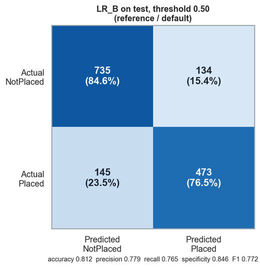
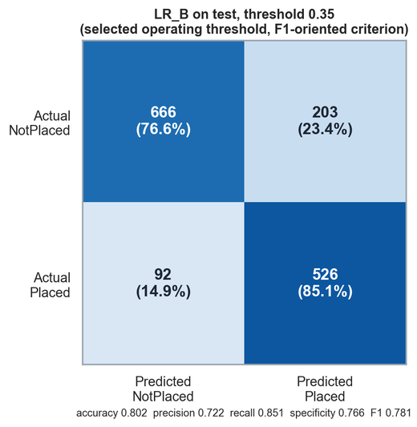

**Why ROC-AUC is not accuracy.** AUC compares *rankings* over all thresholds; accuracy counts correct *labels* at one threshold. Ours: AUC 0.886 but accuracy 0.812 (0.50) or 0.802 (0.35). **Development vs test:** CV AUC 0.879, validation 0.872, test 0.886. These are consistent, not proof of "no loss on new data": the higher test value may be sampling variation plus the larger final fit.

<div class="wrap" markdown="1">
**Key takeaways.** Threshold metrics (accuracy, precision, recall, F1) depend on the cut-off; AUC, log loss, Brier and calibration judge the probabilities. Test AUC 0.8857 (0.868–0.902), log loss 0.420, Brier 0.134, slope 1.05, ECE 0.016.

**Formulas.** Acc = (TP+TN)/n; P = TP/(TP+FP); R = TP/(TP+FN); F1 = 2PR/(P+R); Brier = mean (p−y)²; AUC = P(score_placed > score_notplaced).

**Revision questions.** (1) Compute precision at 0.35 (526/729 = 0.722). (2) Why F1 not accuracy? (3) What does AUC = 0.5 mean? (4) What does slope 1.05 say? (5) What does a CI of 0.868–0.902 mean?

**Professor may ask.** "Is 88.57% your accuracy?" No: AUC is a ranking metric. "Is 37.3% a guarantee?" No: a group frequency among similar students, if calibrated.
</div>

# 11. Why Are There Two Thresholds?

This is the most likely "trap" topic in the viva. Learn the one-sentence answer: **the app uses ONE model and ONE probability, and applies TWO classification thresholds to that same probability.**

## 11.1 From probability to label

The model outputs p = P(Placed), a number between 0 and 1. A *label* needs a decision rule: **predict Placed if p ≥ threshold**, otherwise Not Placed (this is `classify()` in `app/prediction.py`). The threshold is a *policy choice* about how to trade two kinds of mistake; it is not something the model learns.

* **0.50** is the conventional value: it equals "z ≥ 0", the course's decision boundary, and treats the classes symmetrically. We keep it as a **reference**.
* **0.35** is our **project (operating) threshold**, chosen by a rule fixed *before* looking: *the grid value from 0.20 to 0.80 (step 0.05) with the highest **validation** F1, ties going to the value closest to 0.50*.

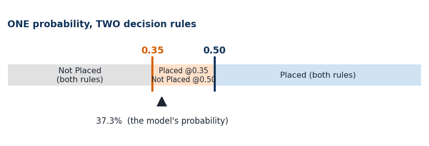

## 11.2 What lowering the threshold does

| | Threshold 0.50 | Threshold 0.35 | Change |
|---|---|---|---|
| Students labelled Placed | 607 (40.8%) | 729 (49.0%) | +122 |
| TP (placed, found) | 473 | 526 | **+53** |
| FN (placed, missed) | 145 | 92 | **−53** |
| FP (false alarms) | 134 | 203 | **+69** |
| TN | 735 | 666 | −69 |
| Recall / Precision | 0.765 / 0.779 | 0.851 / 0.722 | recall ↑, precision ↓ |

**Why recall rises:** a lower bar admits more students into "Placed", so more of the truly placed pass it. **Why precision falls:** the extra students admitted also include more not-placed ones. This is the **precision–recall trade-off**; moving the threshold slides you along it. **The probability itself never changes**: the student with p = 0.373 has p = 0.373 under both rules.

**Which error is worse?** *FP*: predicting Placed for a student who is not (false comfort). *FN*: predicting Not Placed for one who would be (a missed or discouraged student). The costs depend on how the output would be used, and the project **never defined them**. Illustration only: if a placement cell wanted to find students who might need extra support, it would prefer a threshold that errs toward flagging more people.

## 11.3 The evidence for 0.35, honestly <span class="tag m">REPORTED</span> (`07_threshold_selection.json`)

* Validation F1 at 0.35 = **0.766**; at 0.50 = **0.756**. F1 at 0.30 / 0.35 / 0.40 = 0.760 / 0.766 / 0.764: a **plateau** (0.35, 0.40 and 0.45 are within 0.005 of each other).
* Paired bootstrap difference in F1 (0.35 − 0.50) on validation: **+0.010, 95% interval −0.007 to +0.028, which includes zero**: no conclusive advantage.
* Cross-validated (out-of-fold) F1 was best at 0.40; 0.35 beat 0.50 in 4 of 5 folds.
* On the **test** set: F1 0.781 (0.35) vs 0.772 (0.50), but accuracy is *lower* at 0.35 (0.802 vs 0.812). A paired test interval for that F1 difference was **not computed**; the two separate F1 intervals (0.756–0.804 and 0.744–0.797) overlap almost entirely.

**So:** 0.35 is "the selected operating threshold under the F1-oriented rule"; 0.50 is "practically tied" with it. *Neither is universally optimal.* Never call 0.35 "the best threshold".

## 11.4 The UI example

Typical profile: p = **37.3%**. At 0.35: 0.373 ≥ 0.35 → **Placed**. At 0.50: 0.373 < 0.50 → **Not Placed**. Same probability, different label, because the two rules draw the line in different places. That is why the app shows both side by side and presents the probability as the primary output.

<div class="wrap" markdown="1">
**Key takeaways.** One model → one p → two decision rules. 0.50 conventional; 0.35 chosen by a predeclared validation-F1 rule. Lower threshold → higher recall, lower precision. Neither is proven best.

**Formulas.** label = Placed if p ≥ t; z-threshold: t = 0.35 ⇒ z ≥ −0.619; t = 0.50 ⇒ z ≥ 0.

**Revision questions.** (1) How many models does the app use? (2) Why is recall higher at 0.35? (3) How was 0.35 selected? (4) Why is it not "the best"? (5) What happens to a student at p = 0.40?

**Professor may ask.** "Which threshold would you use in practice?" Depends on the cost of FP vs FN, which must be defined first. "Why is accuracy lower at 0.35?" We trade some correct negatives for more caught positives.
</div>

# 12. Explainability and Feature Contributions

## 12.1 What it is and why we need it <span class="tag s">SUPPLEMENT</span>

**Explainability** = being able to say *why* the model gave a particular estimate. It matters because a number such as 37.3% is much more useful (and checkable) if the user can see which inputs pushed it up or down, and because the course lists "Explainable AI / model interpretability / transparency and accountability" among the ethical considerations of predictive modelling (Lecture 3).

## 12.2 What our app actually does <span class="tag v">VERIFIED</span> (`app/explainability.py`, `app/ui_helpers.py`)

The technique is **coefficient × transformed value**, read directly from the logistic model. It is **not SHAP, not LIME, not permutation importance**: none of those is computed by the app.

1. `x = pipeline.named_steps["prep"].transform(input_row)` gives the 15 processed values.
2. `terms = x * model.coef_[0]`: one term per processed column.
3. Terms are **summed per original feature** (for example the three Projects columns together).
4. Check: `intercept + Σ contributions = z`, the exact log-odds (reconstruction verified to 1e-9 by `verify_app.py`).
5. Each contribution is also shown as an **odds multiplier** e^(contribution).

**Baseline.** Contributions are relative to the reference student: every score at the training average (x = 0 after scaling), every count at its reference level, Yes/No at "No". Hence "Projects = 2 contributes −0.31" means "compared with 3 projects".

**How the UI decides what to show.** `factor_html()` splits the contributions: **≥ +0.005** go under "Factors that raise the model's estimate" (largest first), **≤ −0.005** under "Factors that lower…", and any with |contribution| < 0.005 under "At or very near the baseline". Bars scale to the largest contribution *within that prediction*.

**Our typical-profile example** (z = −0.52): placement training +0.97, extracurricular +0.72, soft skills +0.05, aptitude +0.04, SSC +0.02; workshops −0.32, projects −0.31, HSC −0.03; CGPA (+0.0009) and internships (0) near baseline. Intercept −1.66 + 1.14 = −0.52.

**Related analysis in notebook 07 (not in the app)** <span class="tag m">REPORTED</span>: global coefficients with odds ratios; **permutation importance** on validation data (20 repeats; top three by AUC drop: AptitudeTestScore 0.021, PlacementTraining 0.018, ExtracurricularActivities 0.013); an unpenalised statsmodels logit for inference; and feature-group ablation.

## 12.3 Limitations

* **Association, not causation.** A bar shows how the model *builds its score*, not what would happen if a real student changed that input. Higher CGPA goes with placement in this dataset; it has not been shown to cause it.
* **Baseline dependent.** Change the reference level and the numbers change.
* **Correlated features share credit** (aptitude and HSC, r = 0.56; extracurricular and training overlap 85%).
* **A local explanation of one prediction**: it does not say how reliable the model is.
* For linear models the exact contribution is simple; for the tree models in Chapter 8 it would not be.

<div class="wrap" markdown="1">
**Key takeaways.** Explanations = coefficient × processed value, summed per feature; exact for LR; baseline is the reference student; UI sorts positive/negative with a ±0.005 cut. No SHAP. No causation.

**Formulas.** contribution_f = Σ over columns of f of x_j·b_j; z = b₀ + Σ contributions; multiplier = e^contribution.

**Revision questions.** (1) Is SHAP used? (2) What does "baseline" mean here? (3) Why do contributions sum to z? (4) What does a negative bar mean? (5) Why are explanations not causal?

**Professor may ask.** "Why is it exact?" Because the model is linear in the log-odds. "Why is CGPA near baseline for the typical student?" CGPA 7.7 ≈ the average 7.697, so its scaled value ≈ 0.
</div>

# 13. The Technology Stack, as Actually Used

| Technology | What it is (simple) | Where we use it | Version |
|---|---|---|---|
| **Python** | General-purpose language; the common language of data science | everything | 3.11.9 (3.11+ required) |
| **Pandas** | Library for tables ("DataFrames"): read CSV, filter, group, describe | data cleaning, EDA, building the one-row input (`to_frame`) | 3.0.5 |
| **NumPy** | Fast arrays and maths on whole arrays at once | `x * model.coef_`, exp, bootstrap indices | 2.4.2 |
| **Matplotlib & Seaborn** | Plotting (Seaborn is a nicer layer on Matplotlib) | notebooks and report figures only; **not** in the app | in `requirements.txt` |
| **SciPy / statsmodels** | Statistical tests / inference models | notebooks 04–07 (Mann-Whitney, chi-square, VIF, unpenalised logit); SciPy's `L-BFGS-B` is the optimiser behind `solver='lbfgs'` | 1.17.0 / (notebooks) |
| **scikit-learn** | The machine-learning library | `StandardScaler`, `OneHotEncoder`, `ColumnTransformer`, `Pipeline`, `LogisticRegression`, tree models, `train_test_split`, `StratifiedKFold`, metrics | **1.9.1** (pinned) |
| **Streamlit** | Turns a Python script into a web page | the app (`app/app.py`) | 1.64.0 |
| **Joblib** | Saves/loads Python objects, efficient for NumPy data | `joblib.dump` saves the fitted pipeline; `joblib.load` in the app | 1.6.0 |
| **Git & GitHub** | Version control and online hosting of the repository | the project is a git repository, branch `main`, remote `origin` = `github.com/AryanRajguru22/student-placement-prediction` | – |
| Jupyter / nbformat | Notebook files; the scripts `src/build_notebook_*.py` generate them | notebooks 01–08 | `requirements.txt` |

**Not used:** SHAP, LIME, TensorFlow/PyTorch (no neural networks), `GridSearchCV`, a database, cloud hosting.

**How they fit together.** *Training time*: pandas reads CSVs → scikit-learn Pipeline preprocesses and fits → metrics computed → `joblib.dump`. *Inference time*: Streamlit form → validation → pandas one-row DataFrame → `joblib.load`-ed Pipeline → `predict_proba` → NumPy explanation → Streamlit display.

## 13.1 Scikit-learn's grammar

Every object follows the same interface: **estimators** have `fit`; **transformers** have `transform`; **predictors** have `predict` / `predict_proba`. A `Pipeline` chains them and exposes `.named_steps`. This uniformity is why our app can say `pipeline.predict_proba(df)` without knowing what is inside.

## 13.2 Streamlit in five ideas

1. **The whole script re-runs from top to bottom on every user interaction** (a click, a typed value). State must therefore be kept explicitly.
2. **Widgets** return values: `st.number_input`, `st.selectbox`, `st.radio`, `st.button`.
3. **`st.session_state`** keeps values between re-runs (we store the last prediction there, and drop it if any input changes, so a stale result is never shown).
4. **`st.cache_resource`** runs a function once per server session; we use it so the model loads (and its SHA-256 is checked) only once.
5. **Layout**: `st.columns`, `st.container`, `st.expander`; results via `st.markdown`, `st.table`, `st.error`, `st.warning`.

## 13.3 Joblib and the frozen model

`joblib.dump(pipeline, "LR_B_final.joblib")` writes the entire fitted Pipeline (scaler statistics, encoder categories, coefficients). `joblib.load` restores it. Because the saved object only works with the scikit-learn version that made it, the app records the version (1.9.1) and the file's SHA-256 in `model_metadata.json` and refuses to start if either differs.

## 13.4 Git and GitHub

*Git* records snapshots (**commits**) of the project so you can see, compare or restore earlier versions; *branches* are parallel lines of work (ours: `main`); *GitHub* is the website that stores a remote copy. The `.gitignore` deliberately excludes `.venv/`, caches and every file containing the held-out test rows (`DATA_NOTE.md`).

<div class="wrap" markdown="1">
**Key takeaways.** Python + pandas/NumPy for data, scikit-learn for the model, joblib to freeze it, Streamlit to serve it, git/GitHub to version it. Matplotlib/Seaborn/statsmodels only in notebooks.

**Revision questions.** (1) Why joblib? (2) Why is the scikit-learn version pinned? (3) What does `st.cache_resource` do? (4) Which libraries are *not* in the app? (5) What does a `Pipeline` guarantee?

**Professor may ask.** "Why Streamlit over Flask?" Pure-Python UI with no front-end code; enough for a demo. "Do you retrain on every click?" No: frozen model.
</div>

# 14. Application Architecture

## 14.1 Training time versus prediction time

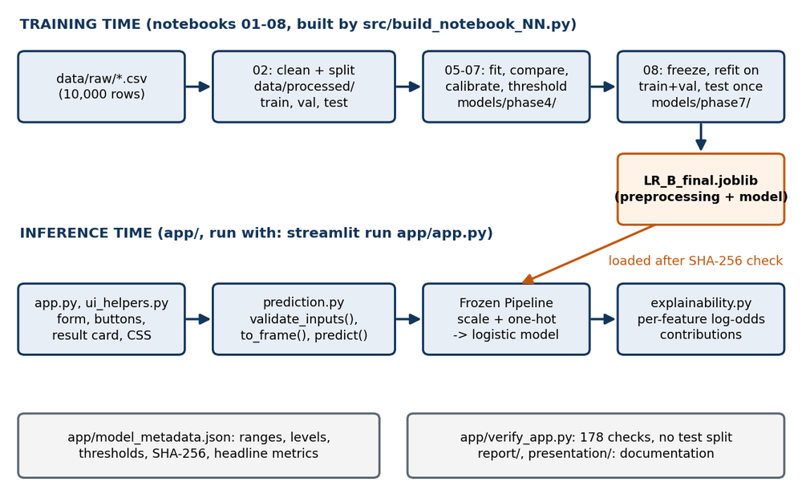

**Why the app loads a frozen model instead of training.** Training takes the 8,425 labelled rows and many iterations, would need the dataset (the app never reads any dataset file), and could produce a slightly different model each time. A frozen artifact gives the same answer for the same input every time, starts instantly, and is exactly the model whose test results we reported.

## 14.2 One prediction, step by step <span class="tag v">VERIFIED</span>

| # | What happens | Code (file → function) |
|---|---|---|
| 1 | The user opens the page; the model is loaded **once**: metadata read, SHA-256 and scikit-learn version checked, pipeline loaded, ten feature names confirmed | `app.py` → `get_bundle()` (`@st.cache_resource`) → `prediction.load_bundle()` |
| 2 | The user fills ten fields (all empty at first) or presses **Load typical profile** | `app.py` → `num_input`, `level_input`, `st.radio`; `load_typical_profile` |
| 3 | **Validation** on pressing **Predict Placement Probability**: missing, non-numeric, non-finite, out-of-range or unknown-level values give an error message; nothing is clipped; no prediction is made | `prediction.validate_inputs(raw, metadata)` |
| 4 | Clean values become a one-row DataFrame with the exact column names, counts as `int` | `prediction.to_frame()` |
| 5 | The saved pipeline's `prep` step scales and one-hot encodes | inside `pipeline.predict_proba` |
| 6 | The logistic model computes z (`decision_function`) | `prediction.predict()` |
| 7 | The sigmoid turns z into p (`predict_proba[0, 1]`) | same |
| 8 | Two thresholds give two labels; a descriptive band (0–0.2 "very low" … 0.8–1 "very high") is attached | `classify()`, `probability_band()` |
| 9 | Contributions are computed | `explainability.explain()` |
| 10 | Streamlit renders percentage, labels, band, factor bars, calculation table, inputs used, and the disclaimer | `ui_helpers.result_card`, `factor_bars`, `disclaimer` |

**Invalid values.** Example: CGPA 9.8 → "CGPA: 9.8 is outside the range the model was developed on (6.5 to 9.1); no prediction is made for out-of-range values." The result panel is removed. Why: the model never saw such values, so any number would be extrapolation, and would *look* more reliable than it is. A real student with a 9.8 CGPA is plausible; supporting that needs new data and a re-fit (Chapter 16).

**Other guard rails.** An input edited after a prediction removes the stale result; rare levels (Projects = 0: 22 students) trigger a warning; the entries are never written to disk or logged; `config.toml` binds the server to `localhost`.

**Testing** <span class="tag v">VERIFIED</span>. `python app/verify_app.py` ran 178 checks with 0 failures when the project guide was prepared (27 October 2026): model hash, probabilities equal direct pipeline output, thresholds at boundaries, explanation reconstruction, validation, a headless end-to-end run, metadata consistency, and that no test file was opened. Passing tests show the *code* does what was designed, not that the *predictions* are right for real students.

<div class="wrap" markdown="1">
**Key takeaways.** Load once → validate → DataFrame → pipeline (scale, encode, z, sigmoid) → two thresholds → explanation → render. Frozen, hash-checked artifact. Out-of-range inputs are refused.

**Revision questions.** (1) What does `get_bundle()` check? (2) What does `validate_inputs` do with 9.8? (3) Where is the sigmoid applied? (4) Why not clip 9.8 to 9.1? (5) What is stored in session state?

**Professor may ask.** "Does the app retrain?" No. "Can I trust the model hash check?" It detects a swapped or mismatched file, not a wrong model.
</div>

# 15. Project Walkthrough

Everything below exists at `student-placement-prediction/` (the project root). No file name is invented.

| Path | Purpose |
|---|---|
| `README.md`, `DATA_NOTE.md` | overview; which data files are omitted from GitHub and why |
| `requirements.txt` / `requirements-app.txt` | notebook dependencies / exact pinned versions for the app |
| `run_app.bat` | Windows launcher: creates `.venv` once, installs `requirements-app.txt`, starts Streamlit on <http://localhost:8501> |
| `.streamlit/config.toml` | theme; local-only server; hides stack traces |
| `.gitignore` | keeps test-row files and `.venv` out of git |
| `data/raw/` | the three CSVs exactly as downloaded (`train`, `validation`, `test`) |
| `data/processed/` | `modeling_dataset.csv` (9,912), `train.csv`, `validation.csv`, `test.csv`, a flagged combined file |
| `notebooks/01…08` | 01 data understanding · 02 quality and split · 03 EDA · 04 statistics · 05 preprocessing and baselines · 06 calibration and CV · 07 thresholds, explainability, ablation · 08 final test evaluation |
| `src/build_notebook_01…08.py` | scripts that generate those notebooks (training-time code) |
| `src/*_findings.md` | written findings per phase |
| `models/phase4/` | candidate models (`LR_A`, `LR_B`, `DT_*`, `RF_*`, `GB_*`, `DUMMY_prior`, balanced LR) and `model_configs.json` |
| `models/phase7/` | final refits `LR_B_final.joblib` (**the app's model**), `GB_B_final`, `RF_B_final`, and `final_model_configs.json` |
| `app/app.py` | the Streamlit page |
| `app/prediction.py` | loading, validation, prediction, thresholds |
| `app/explainability.py` | coefficient × value contributions |
| `app/ui_helpers.py` | styling, result card, factor bars, disclaimer |
| `app/model_metadata.json` | frozen settings, SHA-256, ranges, levels, thresholds, headline metrics |
| `app/build_app_metadata.py` | builds that metadata from saved results |
| `app/verify_app.py` | the verification script (178 checks) |
| `app/README.md` | app guide and troubleshooting |
| `results/metrics/`, `results/metrics/modeling/`, `results/figures/` | every saved number and chart |
| `report/` | `final_report.*`, `Student_Placement_Predictor_Complete_Project_Guide.*`, `viva_questions.md`, `figures/`, `guide_assets/` and this book |
| `presentation/` | `final_presentation.pptx`, `slide_notes.md` |
| `design/ui_ux/` | UI design briefs and reviews (documents, no code) |
| `theory ppts/` | the course material |

# 16. Limitations, Risks and Future Improvements

| Area | The issue | What a careful answer says |
|---|---|---|
| **Provenance** | Origin of the dataset is undocumented; structure looks rule-generated (hard limits, huge effects, step patterns) | "I cannot claim it is real institutional data. I treat results as a demonstration of a sound pipeline." <span class="tag u">UNKNOWN</span> |
| **Representativeness / generalisation** | One dataset, one split, one college-like population; narrow ranges | strong scores here do not establish performance elsewhere; no external validation |
| **Dataset bias** | Marks, training access and extracurriculars can reflect unequal opportunity; labels may encode past hiring preferences | the model may reproduce such patterns |
| **Correlation vs causation** | Observational data | coefficients and bars are associations; changing an input in the app is not advice |
| **Calibration** | Test slope 1.05, ECE 0.016, but a small under-prediction in the top decile (predicted 0.905, observed 0.946) | probabilities are good on this data; not recalibrated because no method met the materiality rule |
| **Supported input ranges** | CGPA 6.5–9.1, aptitude 60–90, soft skills 3.0–4.8, SSC 55–90, HSC 57–88; Projects = 0 has 22 rows | out-of-range inputs are refused; rare levels warn |
| **Threshold choice** | Costs of FP and FN were never defined; 0.35 not conclusively better | choose the threshold from the real costs |
| **Test-set caveat** | Early EDA looked descriptively at test rows | use the qualified wording (Chapter 5) |
| **Explainability limits** | Contributions are baseline-dependent associations | not SHAP, not causal |
| **Production** | Local app only; no hosting, authentication, monitoring, drift detection; no evidence of any real use | a demonstration, not a service |
| **Privacy and fairness** | Entries stay in session memory and are never logged; no sensitive attributes in the data, so no fairness audit was possible | real use needs consent, governance and subgroup audits |

## What would be needed before real placement decisions

1. Documented, **consented data from the institution**, with a proper data dictionary.
2. **External validation** on a later cohort or a second college; re-check calibration.
3. A **defined cost** for false positives and false negatives, and a threshold derived from it.
4. A **fairness audit** across relevant groups, and a review of whether features such as SSC/HSC marks proxy for disadvantage.
5. **Human-in-the-loop use**: a decision *aid*, never an automatic decision; an appeal route.
6. Operational controls: hosting, access control, monitoring for drift, retraining policy.

**Future improvements** (none done): widen the supported ranges with new data and a full refit; repeated or nested cross-validation; interaction features (for example Extracurricular × Training); an uncertainty display per prediction; subgroup analysis.

<div class="wrap" markdown="1">
**Key takeaways.** The result shows the *pipeline* is sound, not that the model works on real students. Unknown provenance, no external validation, undefined costs, no fairness audit.

**Revision questions.** (1) Why is the app limited to CGPA 6.5–9.1? (2) Why might SSC marks be unfair as a predictor? (3) Name three requirements before real use. (4) Why is a probability not a guarantee? (5) What is not claimed about 0.35?

**Professor may ask.** "What is the weakest part?" Dataset provenance and representativeness. "Would you deploy it?" Not on this evidence.
</div>

# 17. Presentation and Demonstration

Say these in your own words; they are deliberately plain.

## 17.1 The pitches

**30 seconds.** "I built a Streamlit app that takes ten details about a student, like CGPA, projects and aptitude score, and gives the estimated probability of being placed. It uses logistic regression and reached a test ROC-AUC of 0.886. I also explain which inputs pushed the number up or down, and I am careful about what the result does and does not mean."

**1 minute.** Add: "The data is a public dataset of 10,000 rows. I removed 72 duplicates and 16 contradictory rows, leaving 9,912, and split them 70/15/15. I compared logistic regression, a decision tree, a random forest and gradient boosting. Three of them performed almost the same, so I kept logistic regression because I can explain every number in it. The app shows the probability and, side by side, the label at two thresholds."

**3 minutes.** Problem → data and cleaning → preprocessing (10 columns to 15) → model and why logistic → results (AUC 0.886, calibrated; accuracy 81% at 0.50) → two thresholds with the 37.3% example → limits. Finish with "the dataset's origin is undocumented, so this is a demonstration of a sound method."

**5 minutes.** Use the eight slides below, about 40 seconds each.

## 17.2 Slide-by-slide (5–6 minutes)

| # | Slide | Show | Say |
|---|---|---|---|
| 1 | Problem | "10 inputs → probability" | "Predictive analytics: learn from past records, estimate a new student's chance." |
| 2 | Data | cleaning flow figure | "Hugging Face, CC0. 10,000 → 9,912 after removing 72 duplicates and 16 conflicting rows. Origin undocumented." |
| 3 | Preparation | pipeline figure, split bar | "Standardise 5 scores, one-hot 5 columns: 10 become 15. Stratified 6,938 / 1,487 / 1,487, seed 42." |
| 4 | Models | validation table | "Four families; logistic, forest and boosting tied, so I kept the simplest." |
| 5 | Logistic regression | sigmoid figure, formula | "Weighted sum, sigmoid, probability. L2 penalty, C = 1, fitted in 30 iterations." |
| 6 | Results | metric table | "Test AUC 0.886, log loss 0.420, well calibrated. AUC is not accuracy: accuracy is 81%." |
| 7 | Thresholds and demo | threshold figure, then the app | "One probability, two rules." |
| 8 | Limits and close | limitations list | "Associations, not causes; real data needed before real use." |

## 17.3 Live demonstration script

1. **Before class:** run `run_app.bat`; open <http://localhost:8501>. The first load can take a few seconds: wait, do not refresh repeatedly.
2. **Point out the sections:** *Student profile* (three groups: Academic, Technical, Employability; ten required fields, each with its supported range); the three buttons (**Predict**, **Load typical profile**, **Clear profile**); *Result* (percentage, labels at both thresholds, band); *Key factors* (blue raises, orange lowers); *Show the full calculation*; *Inputs used*; *Model information* (model, data, held-out results); *About the thresholds and the limits of this tool*.
3. Press **Load typical profile**, then **Predict**: **37.3%**. "Placed at 0.35, Not Placed at 0.50: the same probability and two rules."
4. Explain the bars: "Placement training and extracurriculars push up; having 2 projects and 1 workshop, compared with the reference levels, pushes down. These are associations."
5. Change **CGPA to 8.45** → **43.9%**, and show "Inputs used" holds 8.45.
6. Type **CGPA 9.8** → red message "Out of range: enter a value from 6.5 to 9.1" and no result. "The model has never seen that range, and a made-up number would look more reliable than it is."
7. If asked about credibility: "You are right to ask. The source is public and undocumented; I treat the result as a demonstration of method."

**How to introduce the dataset:** "public CC0 dataset on Hugging Face, ten columns, 10,000 rows, origin undocumented". **The model:** "a weighted sum turned into a probability by the sigmoid". **The results:** "AUC 0.886, calibrated, accuracy 81% at 0.50".

**Close.** "For this dataset and protocol, logistic regression gave the best balance of accuracy, calibration and explainability. It shows the pipeline is sound; it does not show that the model works on a different college, so I would validate it on real institutional data before anyone relied on it."

**Avoid / say instead.**

| Avoid | Say |
|---|---|
| "88.6% accurate" | "AUC 0.886; accuracy 81.2% at 0.50" |
| "The test set was untouched" | "Not used for development, selection, tuning, calibration or threshold choice" |
| "0.35 is the best threshold" | "Selected by a predeclared validation-F1 rule; 0.50 is practically tied" |
| "CGPA increases your chances" | "Higher CGPA is associated with higher placement in this dataset" |
| "It trained for N epochs" | "Fitted by L-BFGS, converged in 30 iterations" |
| "Real student data / deployed" | "Public dataset of unknown origin; local demo app" |

# 18. The Viva Question Bank

*110 questions. ★ = basic, ★★ = intermediate, ★★★ = hard. Answers are short on purpose; the chapter numbers tell you where to read more.*

## A. Basic predictive analytics ★


**Q1. What is predictive analytics?** Using historical data, statistics and machine learning to estimate a future or unknown outcome ("learning from the past to predict the future", course Unit 1). Ours estimates P(placed). *(Ch. 1)*

**Q2. Descriptive vs predictive vs prescriptive?** What happened / what will happen / what should we do. We do the first in EDA, the second in the model; never the third.

**Q3. What is supervised learning?** Learning from examples that carry the correct label. Each training student has a known Placed/NotPlaced.

**Q4. Classification vs regression?** Category versus number. Ours is classification (binary), even though the algorithm is called Logistic *Regression*.

**Q5. Feature and target?** Feature = input (CGPA…); target = what we predict (PlacementStatus).

**Q6. Why is it binary classification?** Two outcomes: Placed (1) and NotPlaced (0).

## B. Dataset ★


**Q7. Source and licence?** Hugging Face `Krooz/Campus_Recruitment_CSV`, CC0-1.0 (public-domain dedication). *(Ch. 2)*

**Q8. Size and structure?** 10,000 rows × 11 columns originally, split in three files (7,225/1,275/1,500); 9,912 rows after cleaning.

**Q9. Is it real student data?** Unknown. The structure looks rule-generated, so I do not claim it is real.

**Q10. Which columns are categorical?** ExtracurricularActivities and PlacementTraining (Yes/No) plus the target; the three counts are numeric but encoded as categories.

**Q11. Why are Internships/Projects/Workshops encoded as categories although they are numbers?** EDA showed non-monotonic placement rates (workshops 28%, 21%, 73%, 56%), so a straight-line effect would be wrong.

**Q12. What does the dataset not contain?** Sensitive attributes, a data dictionary, provenance.

## C. EDA ★★


**Q13. What is EDA and why first?** Understanding data before modelling; it exposed duplicates, non-monotonic counts and class balance. *(Ch. 3)*

**Q14. Which plots did you use?** Histograms with KDE, box plot, count plot, violin, bar charts with error bars, scatter, ECDF, heat-maps; no pie chart.

**Q15. What does the correlation heat-map tell you, and what can't it?** Which features move together (largest r = 0.56, aptitude-HSC); not cause.

**Q16. Is there class imbalance?** Moderate: 41.56% Placed. Handled by judging probability quality; class weighting was tested and not adopted.

**Q17. Did you remove outliers?** No. The IQR rule flagged none in the five scores.

## D. Data cleaning ★★


**Q18. What cleaning did you do?** Removed 72 surplus exact duplicates and excluded 16 rows (8 groups) with conflicting labels: 10,000 → 9,912. *(Ch. 4)*

**Q19. Exact vs conflicting duplicates?** Same features and same label vs same features but different labels.

**Q20. Why not a majority vote for conflicts?** Each group has one of each label (a tie); guessing would invent data.

**Q21. Why remove duplicates?** They over-weight profiles and let the model be scored on what it memorised.

**Q22. Any missing values or imputation?** None missing; none imputed.

**Q23. Could cleaning bias results?** Slightly: the conflicting rows are all top-end profiles; only 0.88% of rows affected.

## E. Preprocessing, one-hot encoding, standardisation ★★


**Q24. Why preprocess?** Models need numbers; and scale matters for regularisation. *(Ch. 6)*

**Q25. What is one-hot encoding?** One 0/1 column per category.

**Q26. Why drop one category?** Remaining columns determine it; it removes redundancy with the intercept and gives "relative to reference" coefficients.

**Q27. What is the dummy-variable trap?** Keeping all K columns makes them sum to 1 (perfectly redundant), making coefficients ambiguous.

**Q28. What is standardisation?** z = (x − μ)/σ, mean 0, SD 1.

**Q29. Standardisation vs normalisation?** Z-score has no fixed range; min-max maps to [0, 1]. We used standardisation.

**Q30. Fit vs transform?** Fit learns μ, σ, categories from data; transform applies them.

**Q31. 10 columns → 15: how?** 5 scaled + (2 + 3 + 3) counts + 2 binary = 15.

## F. Train / validation / test ★★


**Q32. Why split?** To measure performance on data the model has not learned from. *(Ch. 5)*

**Q33. Roles of the three sets?** Train fits; validation chooses; test scores once.

**Q34. Sizes and method?** 6,938 / 1,487 / 1,487; two stratified `train_test_split` calls, seed 42.

**Q35. What does stratify do?** Keeps the Placed share (41.56%) equal in all parts.

**Q36. Why refit on train + validation?** More data after the choices are frozen: 8,425 rows.

**Q37. Did you leak the test set?** Not into development, selection, tuning, calibration or threshold selection; early descriptive EDA looked at those rows and is disclosed.

## G. Logistic Regression ★★


**Q38. What is Logistic Regression?** A linear score turned into a probability by the sigmoid; fitted by maximum likelihood. *(Ch. 7)*

**Q39. Why "regression"?** It linearly regresses the log-odds.

**Q40. Linear vs logistic?** Linear predicts any number; logistic predicts a probability between 0 and 1.

**Q41. What do the coefficients mean?** The change in log-odds per unit (per SD for scores, or versus the reference level); eᵇ is the odds multiplier.

**Q42. What is the intercept?** The log-odds for the reference student (−1.661, i.e. P = 0.16).

**Q43. Does scaling matter for LR?** With the L2 penalty and L-BFGS, yes.

**Q44. Is LR a neural network?** No: no layers, neurons or epochs.

## H. Sigmoid and probability ★★


**Q45. Formula of sigmoid?** p = 1/(1 + e⁻ᶻ).

**Q46. Why needed?** To squash any real score into (0, 1).

**Q47. What is z = 0?** p = 0.5.

**Q48. Is the sigmoid an "activation function" in your model?** It is the logistic link; there is no neural layer. The course slide mentions activation layers because the same function is used there.

## I. Loss, regularisation, C, L-BFGS ★★★


**Q49. What is the loss function?** Binary cross-entropy (log loss) = −mean[y ln p + (1−y) ln(1−p)].

**Q50. Why that loss?** It is the negative log-likelihood of the Bernoulli model: minimising it = maximum likelihood.

**Q51. Why take logs of the likelihood?** Products of many small numbers underflow; sums are easier and have the same maximiser.

**Q52. What is regularisation?** A penalty on large weights to reduce over-fitting.

**Q53. L1 vs L2?** L1 (sum of |w|) can zero weights; L2 (sum of w²) shrinks smoothly. We use L2.

**Q54. What does C do?** It is the *inverse* strength: small C = strong penalty, large C = weak. C = 1 here.

**Q55. Is the intercept penalised?** No (verified from the scikit-learn source and numerically).

**Q56. What is L-BFGS?** A quasi-Newton optimiser, the solver. It is not an activation function.

## J. Model training and loops ★★★


**Q57. What does `.fit()` do?** Learns scaler/encoder values, then L-BFGS finds 16 numbers (15 coefficients + intercept). *(Ch. 9)*

**Q58. Learned parameter vs hyper-parameter?** Learned: coefficients. Chosen by us: C, solver, depth.

**Q59. How many fits?** About 237, from counting loops in the build scripts; an estimate, not a log.

**Q60. How many epochs?** None. The final model took 30 optimiser iterations (cap 5,000).

**Q61. What was cross-validation used for?** Stability and calibration checks on train only (5 folds), not model choice.

**Q62. How was the model chosen?** Lowest validation log loss within the statistically indistinguishable set, tie broken by interpretability.

## K. Decision Tree, Random Forest, Gradient Boosting ★★


**Q63. How does a decision tree split?** It picks the question that most reduces Gini impurity (1 − Σp²).

**Q64. Why do deep trees overfit?** They can memorise single students: our unlimited tree had train AUC 1.0, validation log loss 11+.

**Q65. What is a random forest?** Many trees on bootstrap samples with random feature subsets; probabilities averaged.

**Q66. What is gradient boosting?** Small trees added one after another, each fitted to the previous errors; scaled by the learning rate.

**Q67. Bagging vs boosting?** Parallel and averaged (variance) vs sequential and corrective (bias).

**Q68. What were your RF and GB settings?** RF: 300 trees, depth 10, leaf 10, sqrt features. GB: 300 stages, rate 0.05, depth 2.

**Q69. Why not use the forest?** It did not beat LR; LR is simpler and better calibrated here.

## L. Model evaluation ★★


**Q70. Confusion matrix?** TP/TN/FP/FN counts; at 0.50: 473/735/134/145. *(Ch. 10)*

**Q71. Accuracy, precision, recall formulas?** (TP+TN)/n; TP/(TP+FP); TP/(TP+FN).

**Q72. What is F1?** Harmonic mean of precision and recall.

**Q73. What is ROC-AUC?** Probability a random Placed student outranks a random Not Placed one; 0.8857.

**Q74. Why is AUC not accuracy?** AUC ranks over all thresholds; accuracy is one threshold's correct share (0.812).

**Q75. Log loss and Brier?** Proper scores for probabilities: 0.420 and 0.134; lower is better.

**Q76. What is calibration slope 1.05?** Very close to ideal 1: probabilities are neither over- nor under-confident.

**Q77. What does the CI 0.868–0.902 mean?** The range of AUC across 2,000 resamples of test students; it is not about one student.

## M. Thresholds ★★★


**Q78. Why two thresholds?** One probability, two rules: 0.50 is conventional; 0.35 is our validation-F1-selected operating threshold. *(Ch. 11)*

**Q79. How was 0.35 chosen?** Highest validation F1 on a 0.20–0.80 grid, ties toward 0.50; fixed in advance.

**Q80. Is 0.35 the best?** No: F1 is flat from 0.35 to 0.45 and the validation gain over 0.50 (+0.010) has a CI including zero.

**Q81. What does lowering the threshold do?** Raises recall (0.765 → 0.851), lowers precision (0.779 → 0.722).

**Q82. What happens at p = 0.373?** Placed at 0.35, Not Placed at 0.50.

**Q83. Does the probability change with the threshold?** Never.

## N. Explainability ★★


**Q84. How does the app explain predictions?** Coefficient × processed value, summed per feature; contributions plus intercept equal the log-odds. *(Ch. 12)*

**Q85. Is SHAP used?** No.

**Q86. What does a bar mean?** Contribution to the log-odds relative to a baseline student.

**Q87. Does it prove causation?** No: associations from observational data.

## O. Python libraries and Streamlit ★


**Q88. Why pandas?** Tables: reading CSVs, cleaning, one-row inputs. *(Ch. 13)*

**Q89. Why scikit-learn Pipeline?** One object that preprocesses and predicts identically in training and app.

**Q90. What is joblib?** Saves/loads the fitted pipeline.

**Q91. How does Streamlit work?** The script re-runs on each interaction; widgets return values; `session_state` keeps state.

**Q92. What is `st.cache_resource` for?** Load the model once.

**Q93. Which libraries are only in notebooks?** Matplotlib, Seaborn, statsmodels, Jupyter.

## P. Application architecture ★★


**Q94. Walk me through a prediction.** Validate → DataFrame → scale/encode → z → sigmoid → two thresholds → contributions → render. *(Ch. 14)*

**Q95. Why a frozen model?** Reproducible, instant, and exactly the evaluated model.

**Q96. What happens if CGPA = 9.8?** Rejected with a range message; nothing is clipped.

**Q97. How does the app detect a wrong model file?** SHA-256 and scikit-learn version checks.

## Q. Limitations ★★


**Q98. Biggest weakness?** Unknown data provenance and no external validation. *(Ch. 16)*

**Q99. Can real placement offices use it?** Not on this evidence; it would need real consented data, validation, defined costs and a fairness audit.

**Q100. Is 37.3% the student's real chance?** No: the estimate for similar students in this dataset, if calibrated.

**Q101. What would you do with more time?** Define costs, validate on a second dataset, subgroup audit.

## R. Difficult follow-ups ★★★


**Q102. If L-BFGS needed 30 iterations, why max_iter = 5000?** A safety cap; hitting it would signal non-convergence. The build code asserts `n_iter_ < 5000`.

**Q103. Why not use accuracy as the training loss?** It is not smooth (no gradient); log loss is smooth, convex and rewards honest probabilities.

**Q104. Is fitting the scaler on all 8,425 rows leakage?** No: the test rows are excluded; the earlier development pipelines were fitted on train only.

**Q105. Why is the penalty only 0.04% of the objective, and does C matter?** With 8,425 rows the data term dominates; AUC barely changes from C = 0.1 to 100.

**Q106. Two correlated features: what happens?** Weight is shared between them and individual coefficients are less interpretable; VIF here is below 2.

**Q107. Validation was used to choose: is the test number optimistic?** The test set was not used to choose; validation figures are the optimistic ones.

**Q108. Sigmoid vs softmax?** Sigmoid for two classes; softmax normalises K scores for K classes (course Multinomial LR).

**Q109. What does the odds ratio 2.65 for training mean?** Odds of Placed are 2.65 times higher for trained students, others fixed. Association only.

**Q110. How would you test the model on another college's data?** Run its `predict_proba` on that data without refitting, compare AUC/calibration, expect calibration shift, and refit only with a new protocol.

# Glossary

| Term | Meaning (with our example) |
|---|---|
| Accuracy | share of correct labels at a threshold (0.812 at 0.50) |
| AUC / ROC-AUC | probability a random Placed student outranks a random Not Placed one (0.8857) |
| Bagging / bootstrap | train models on resamples drawn with replacement, then average (random forest) |
| Binary classification | two possible classes (Placed / NotPlaced) |
| Boosting | add weak models one after another, each fixing earlier errors (gradient boosting) |
| Brier score | mean of (p − y)²; lower is better (0.134) |
| C | inverse regularisation strength; smaller = stronger penalty (C = 1) |
| Calibration | whether stated probabilities match observed frequencies (slope 1.05, ECE 0.016) |
| CC0 | public-domain dedication; free reuse |
| Coefficient / weight | learned multiplier of a feature in the score (15 of them) |
| ColumnTransformer | applies different preprocessing to different columns |
| Confusion matrix | table of TP, TN, FP, FN |
| Convergence | optimiser stopped because the gradient was tiny (30 iterations) |
| Cost / loss function | single number measuring how wrong the model is (log loss) |
| Cross-validation | repeated train/hold-out rotation (5-fold stratified) |
| Data leakage | information from outside the training data influencing the model |
| Epoch | one pass over the data in iterative neural-network training (none here) |
| Feature / predictor | input column (10 raw, 15 processed) |
| Fit / transform | learn from data / apply what was learned |
| Frozen model | the saved artifact the app loads and never changes |
| Generalisation | doing well on unseen data |
| Gini impurity / entropy | measures of how mixed a tree node is |
| Hyper-parameter | setting chosen by us, not learned (C, max_iter, depth) |
| Intercept (b₀) | score for the reference student (−1.661) |
| L1 / L2 | penalty on |w| / on w² |
| L-BFGS | quasi-Newton optimiser (solver), not an activation function |
| Log-odds (logit) | ln(p/(1−p)) = z |
| Log loss / cross-entropy | −mean[y ln p + (1−y) ln(1−p)] |
| MLE | choose parameters that make the observed labels most probable |
| Odds / odds ratio | p/(1−p) / factor e^b by which odds change |
| One-hot encoding | one 0/1 column per category |
| Overfitting / underfitting | too tuned to training noise / too simple to learn the pattern |
| Pipeline | scikit-learn chain: preprocessing → model |
| Precision / recall / specificity / F1 | TP/(TP+FP) / TP/(TP+FN) / TN/(TN+FP) / harmonic mean of P and R |
| Reference level | the category dropped from one-hot encoding |
| Regularisation | penalty on large weights |
| Sigmoid | 1/(1+e⁻ᶻ); the logistic link |
| Standardisation | z = (x − μ)/σ |
| Stratified split | each part keeps the class proportion |
| Supervised learning | learning from labelled examples |
| Threshold | cut-off turning a probability into a label (0.35, 0.50) |

# Formula Sheet

| Topic | Formula |
|---|---|
| Mean, variance, SD | μ = Σx/n; σ² = Σ(x−μ)²/n; σ = √σ² |
| Z-score | z = (x − μ)/σ |
| Min-max (course) | x′ = (x − x_min)/(x_max − x_min) |
| IQR outlier fences | Q1 − 1.5·IQR, Q3 + 1.5·IQR |
| Linear predictor | z = b₀ + b₁x₁ + … + bₙxₙ |
| Sigmoid | p = 1/(1 + e⁻ᶻ) |
| Log-odds | ln(p/(1−p)) = z |
| Odds ratio | OR = eᵇ |
| Bernoulli | P(Y=y) = pʸ(1−p)¹⁻ʸ |
| Likelihood | L = Π pᵢʸⁱ (1−pᵢ)¹⁻ʸⁱ |
| Log loss | −(1/n) Σ[yᵢ ln pᵢ + (1−yᵢ) ln(1−pᵢ)] |
| Gradients (sum loss) | ∂L/∂w = Σ(pᵢ − yᵢ)xᵢ; ∂L/∂b = Σ(pᵢ − yᵢ) |
| Gradient step | w ← w − η·∂L/∂w |
| scikit-learn objective (L2) | (1/n)Σ loss + ‖w‖²/(2Cn)  ⇔  CΣ loss + ½‖w‖² |
| Gini; entropy | 1 − Σpₖ²; −Σpₖ log₂pₖ |
| Accuracy; precision; recall | (TP+TN)/n; TP/(TP+FP); TP/(TP+FN) |
| Specificity; F1 | TN/(TN+FP); 2PR/(P+R) |
| Brier | mean (p − y)² |
| Threshold in z | t = 0.35 ⇔ z ≥ −0.619; t = 0.50 ⇔ z ≥ 0 |

# One-Page Quick Revision Sheet

**Project in one line:** Ten student inputs → 15 processed columns → Logistic Regression (L2, C = 1, L-BFGS, 30 iterations) → probability → two thresholds (0.35, 0.50) → Streamlit app with explanations.

**Numbers to know:** 10,000 → −72 −16 → **9,912** · split **6,938 / 1,487 / 1,487** · seed **42** · refit **8,425** · 10 → **15** columns · tree models 18 columns · ≈**237** fits (estimate) · **30** iterations · test **AUC 0.8857** (0.868–0.902) · log loss **0.420** · Brier **0.134** · slope **1.05** · ECE **0.016** · at 0.50: **473 / 735 / 134 / 145**, accuracy 0.812, precision 0.779, recall 0.765, F1 0.772 · at 0.35: **526 / 666 / 203 / 92**, accuracy 0.802, precision 0.722, recall 0.851, F1 0.781 · typical profile **37.3%** (z = −0.52) · CGPA 8.45 → **43.9%** · CGPA range 6.5–9.1.

**Always say:** one model, one probability, two thresholds · AUC is not accuracy · LR tied with RF and GB, kept for simplicity and calibration · test set not used for development, selection, tuning, calibration or threshold choice (early descriptive EDA disclosed) · associations, not causes · 237 is an estimate · dataset origin unknown.

**Never say:** the test set was untouched · 0.35 is the best · 88.57% accuracy · real student data · deployed · epochs · SHAP · it is a neural network.

# Appendix A: Evidence Map

| Claim | Where it is verified |
|---|---|
| 10,000 raw rows; 72 duplicates; 8 groups / 16 rows; 9,912 | `results/metrics/02_data_quality_audit.csv`; `src/build_notebook_02.py` |
| Split 6,938 / 1,487 / 1,487, seed 42, stratified, two `train_test_split` calls | `results/metrics/02_split_summary.csv`; `src/build_notebook_02.py` lines 153–154 |
| Pipeline: `prep` (`num` StandardScaler 5, `cnt` OneHotEncoder drop [1,3,0], `bin` OneHotEncoder drop first) + `model` | loaded `models/phase7/LR_B_final.joblib` |
| 15 output columns and names; encoder categories | `pre.get_feature_names_out()`, `categories_` of the same artifact |
| C = 1, L2 (`l1_ratio=0`), lbfgs, max_iter 5000, no class weight, `n_iter_=[30]`, `random_state=42` | `get_params()` and `n_iter_` of the artifact; `models/phase7/final_model_configs.json` |
| Objective convention (intercept not penalised; 1/(C·n)) | `sklearn/linear_model/_logistic.py` (`l2_reg_strength = 1.0 / (C * sw_sum)`); numeric gradient check on the 8,425 rows (max \|gradient\| 6.2e-5 < tol 1e-4) |
| Scaler mean/σ from 8,425 rows (CGPA 7.6974 / 0.6390) | `pre.named_transformers_['num']` |
| Worked examples (37.3%, 43.9%, 2.1%, 89.8%) | `decision_function` / `predict_proba` of the artifact, recomputed by hand |
| Course examples (z = 6 → 0.9975; GD w = 0.4689, b = −0.0311) | `Model 5- Logistic Regression.pdf` slides 25–26, 42–44; recomputed in Python |
| DT_B 32 leaves depth 5; RF_B 300 trees; GB_B 300 stages; trees use 18 columns | loaded `models/phase4/*.joblib` |
| Fit counts (92, 4, 10, 1, 15, 75, 3, 31, 6) | loops in `src/build_notebook_05.py` – `08.py`; `05_tuning_grids.csv` (92 rows); `06_cv_fold_results.csv` (15); `07_feature_ablation_fold_results.csv` (25) |
| Test metrics (AUC, CI, log loss, Brier, ECE, slope, confusion counts) | `results/metrics/modeling/08_test_classification_metrics.csv`, `08_test_bootstrap_ci.csv`, `08_test_calibration_metrics.csv`; `app/model_metadata.json` |
| Threshold rule and evidence | `results/metrics/modeling/07_threshold_selection.json` |
| Model-selection rule | `results/metrics/modeling/05_provisional_selection.json` |
| Explainability method; UI cut of ±0.005 | `app/explainability.py`; `app/ui_helpers.py` (`factor_html`) |
| Test-set access history | `08_frozen_protocol.json`, `08_test_access_log.json`; `src/phase7_findings.md` |
| Tools and versions | `requirements-app.txt`; `requirements.txt`; installed versions printed in this session |

# Appendix B: Unknowns and Estimates

| Status | Item |
|---|---|
| <span class="tag u">UNKNOWN</span> | Origin of the dataset (real or generated); the meaning of the columns beyond their names; how many times notebooks were re-run during development; total training runtime and hardware; per-fit iteration counts (only the final model's 30 is saved) |
| <span class="tag e">ESTIMATE</span> | ≈237 pipeline fits (and ≈36 calibrator fits): counts of code paths in one execution of the final build scripts, not an execution log |
| Not re-verified here | CC0 licence page online (recorded in project documents); the "178 checks passed" figure is the 27 October 2026 record (re-run recommended before your viva: `python app/verify_app.py`); UI fix tests mentioned in project history (46/46, 37/37) have no saved record |
| Manual review suggested | Compare the "Typical profile → 37.3%" and "CGPA 8.45 → 43.9%" numbers in your live app; confirm your name, date and university on the cover |

# Appendix C: Course Coverage Map

| Topic | In your slides? | In our project? |
|---|---|---|
| Descriptive / predictive / prescriptive | Yes (Unit 1, Lectures 1–3) | descriptive and predictive only |
| Data collection, cleaning, missing values, outliers (z-score, IQR) | Yes (Module 2) | duplicates and conflicts cleaned; IQR informational; no imputation |
| Normalisation, standardisation, label and one-hot encoding, binning, log transform | Yes | standardisation and one-hot used; the rest not |
| Feature engineering and selection (filter, wrapper, embedded, PCA) | Yes | not used (L2 regularisation is a form of embedded shrinkage, but no selection was done) |
| Charts: bar, histogram, pie, heat-map, scatter | Yes | all except pie used (plus box, violin, ECDF) |
| Linear regression (least squares, multiple) | Yes | background only |
| Logistic regression: sigmoid, MLE, Bernoulli, cross-entropy, gradient descent | Yes | **core of the project** |
| Multinomial (softmax) and ordinal logistic regression | Yes | not used (binary target) |
| Regularisation, L-BFGS, C | No slides | used (supplement in Chapter 7) |
| Train/validation/test, cross-validation, ROC-AUC, F1 | Syllabus only | used (supplement in Chapters 5 and 10) |
| Decision trees, random forest, boosting | No slides | used for comparison (Chapter 8) |
| Time series, LDA/QDA, Poisson | Syllabus | not used |
