

# PREDICTING STUDENT PLACEMENT PROBABILITY
# USING ACADEMIC, TECHNICAL AND EMPLOYABILITY FEATURES

### A Probability-Based Machine Learning Approach to Student Placement Prediction

**Final Project Report**

Dataset: Hugging Face — `Krooz/Campus_Recruitment_CSV` (CC0-1.0) 
Final model: Logistic Regression B (`LR_B`), raw probabilities, operating thresholds 0.35 and 0.50

---

## Table of Contents

1. Abstract
2. Introduction
3. Problem Statement
4. Objectives
5. Project Roadmap and Terminology
6. Dataset
7. Data Quality and Leakage Audit
8. Test-Set Access History
9. Exploratory Data Analysis
10. Statistical Analysis
11. Preprocessing
12. Baseline Modeling
13. Model Selection
14. Cross-Validation
15. Calibration
16. Threshold Selection
17. Explainability
18. Feature-Group Ablation
19. Error Analysis
20. Final Test Evaluation
21. Final Calibration on the Test Set
22. Model Comparison on the Final Test Set
23. Development Versus Test Results
24. The Prediction Application
25. Limitations
26. Ethical and Responsible Use
27. Conclusion
28. References

- Appendix A. Artifact Index
- Appendix B. Glossary of Metrics
- Appendix C. Training Configuration and Convergence

---

## 1. Abstract

**Problem.** Campus placement outcomes are shaped by academic record, technical exposure and employability signals. This project estimates, for a student described by ten recorded characteristics, the model-estimated probability that `PlacementStatus = Placed`, and derives a binary label from that probability using a predefined operating threshold.

**Dataset and data quality.** The source is the Hugging Face dataset `Krooz/Campus_Recruitment_CSV` (10,000 rows, 11 columns; 4,197 Placed and 5,803 NotPlaced). A data-quality audit found 72 surplus exact duplicate rows and 8 groups of rows with identical predictor values but opposite labels. All 16 rows in the conflicting groups were excluded (no majority vote) and the 72 same-label duplicates were collapsed, giving a cleaned modeling dataset of 9,912 rows. Because 33 feature profiles crossed the supplied train/validation/test boundaries, the supplied split was not used; a new stratified 70/15/15 split (6,938 / 1,487 / 1,487) was created with no feature-profile overlap between splits.

**Methodology.** After exploratory and statistical analysis (effect sizes, odds ratios, Cochran–Mantel–Haenszel stratification, Holm correction, variance inflation factors), two preprocessing representations were compared: count variables kept numeric (A) or one-hot encoded (B). Logistic regression, decision tree, random forest and gradient boosting were compared against a base-rate reference on validation data, with log loss as the primary selection criterion, followed by stratified 5-fold cross-validation, calibration analysis, a nested recalibration comparison, validation-based threshold analysis, coefficient and permutation-importance explanations, feature-group ablation and error analysis.

**Final model.** For this dataset and experimental protocol, Logistic Regression B (`LR_B`: L2 penalty, C = 1, categorical Internships/Projects/Workshops, raw probabilities) was retained. Logistic regression, gradient boosting and random forest were practically tied on probability quality in development; the interpretable model was retained. No recalibration method met the predefined materiality criterion. The operating threshold 0.35 was selected under a predefined F1-oriented validation criterion; 0.50 is reported as the conventional reference.

**Final test performance.** In a single held-out evaluation (n = 1,487) the frozen specification, refit on train + validation, obtained ROC-AUC = 0.886 (95% CI 0.868–0.902), log loss = 0.420 (0.394–0.449) and Brier score = 0.134 (0.124–0.145), with calibration slope 1.05 and expected calibration error 0.016. At threshold 0.50 accuracy was 0.812 and F1 0.772; at 0.35 recall rose to 0.851 and F1 to 0.781 while precision fell to 0.722. Gradient boosting and random forest were statistically indistinguishable from `LR_B` on the primary metrics. Test performance was broadly consistent with the development estimates.

**Application.** The frozen model is exposed through an interactive Streamlit application that returns the estimated probability, the 0.35 and 0.50 classifications and an additive explanation of the estimate.

**Limitations.** The results come from one dataset and one final split; the data show structure consistent with a rule-based or constructed origin (not established); associations are not causal; the threshold depends on error costs that were not defined; the top probability decile is mildly under-predicted; and earlier exploratory notebooks accessed the eventual test rows descriptively (Section 8). The estimated probability describes a group of similar students and is not a statement about what will happen to any individual.

---

## 2. Introduction

Placement outcomes matter to students, to institutions that support them and to the programmes that prepare them. A student who understands how academic performance, technical experience (projects, internships, workshops and certifications, aptitude) and employability signals (soft skills, extracurricular activities, placement training) relate to placement outcomes in historical data can make better-informed decisions about where to invest effort. An institution can, in the same way, review which kinds of support are associated with better outcomes.

A binary prediction — "Placed" or "NotPlaced" — is a poor summary of this situation. Two students labeled "Placed" may differ greatly in how certain the model is, and a label throws away that information. A **probability estimate** keeps it: a student with an estimated probability of 0.92 and one with 0.55 are both "likely placed" under most thresholds but carry very different levels of uncertainty. A probability can also be turned into different decisions by different users, because the threshold at which one acts depends on the relative cost of a missed opportunity versus a false alarm, and those costs vary by purpose. Finally, a probability can be *checked*: if a model says "0.8" for many students, roughly 80% of them should in fact be placed. This property, called calibration, can be tested, and it is the reason this project evaluates probability quality (log loss, Brier score, calibration slope and reliability diagrams) and not only classification accuracy.

The project also values **interpretability**. A model whose estimate can be decomposed into per-feature contributions is easier to scrutinize, easier to challenge and less likely to be misused than a black box. This is why a regularised logistic regression was a natural baseline and, as the results show, remained competitive with more flexible models.

A note on language. Throughout this report, statements about features describe **prediction and association** in the available data: what the fitted model uses to produce an *estimated probability*, and how each feature's *model contribution* is related to that estimate. The analyses are observational. Nothing in this report establishes that any characteristic produces, or changes, a placement outcome, and the model's output is an estimate, not an outcome.

---

## 3. Problem Statement

**Input.** Ten recorded characteristics of a student:

| Group | Characteristic |
|---|---|
| Academic | CGPA, SSC_Marks, HSC_Marks |
| Technical | AptitudeTestScore, Internships, Projects, Workshops/Certifications |
| Employability | SoftSkillsRating, ExtracurricularActivities, PlacementTraining |

**Primary output.** The model-estimated probability

$$\hat p(X) \;=\; \widehat{P}\,(Y = \text{Placed} \mid X),$$

where $X$ is the vector of the ten characteristics and $Y$ is `PlacementStatus`. This is a *model estimate* of a conditional probability learned from historical data; it is not a measured quantity and it inherits every limitation of the data and the model.

**Secondary output.** A binary classification

$$\hat y(X) = \text{Placed} \quad\text{if}\quad \hat p(X) \ge \tau,$$

for a predefined operating threshold $\tau$. Two thresholds were declared before the final evaluation: $\tau = 0.50$ (conventional reference) and $\tau = 0.35$ (selected under a predefined F1-oriented validation criterion, Section 16).

The probability is the primary output; the label depends on the threshold and is secondary.

---

## 4. Objectives

1. Understand the dataset and its quality.
2. Identify duplicate and conflicting records.
3. Prevent feature-profile leakage across the train, validation and test splits.
4. Explore associations between the predictors and placement.
5. Perform statistical analysis of those associations.
6. Compare interpretable and nonlinear models.
7. Evaluate probability quality using log loss and the Brier score.
8. Assess calibration.
9. Select an operating threshold using validation data.
10. Explain individual predictions.
11. Evaluate feature-group contribution through ablation.
12. Perform one final held-out test evaluation.
13. Deploy the model through an interactive application.

---

## 5. Project Roadmap and Terminology

The project was carried out in phases, each with a notebook, saved metrics and a findings file. This report follows the **project README numbering**.

| Phase | Content | Notebook | Findings file |
|---|---|---|---|
| 1 | Data understanding | `01_data_understanding` | — |
| 1.5 | Data quality and split integrity | `02_data_quality_and_split` | — |
| 2 | Exploratory data analysis | `03_eda` | `src/eda_findings.md` |
| 3 | Statistical analysis | `04_statistical_analysis` | `src/stat_findings.md` |
| 4 | Preprocessing and baseline modeling | `05_preprocessing_and_baselines` | `src/phase4_findings.md` |
| 5 | Cross-validation and calibration | `06_calibration_and_cross_validation` | `src/phase5_findings.md` |
| 6 | Threshold, explainability, ablation, error analysis | `07_threshold_explainability_ablation` | `src/phase6_findings.md` |
| 7 | Final test evaluation | `08_final_test_evaluation` | `src/phase7_findings.md` |
| 8A | Streamlit application | `app/` | `app/README.md` |
| 8B | This report | — | `report/final_report.md` |

Note that notebook numbers run one ahead of phase numbers from Phase 2 onward because Phase 1.5 has its own notebook.

**Evidence labels.** Three kinds of evidence are kept distinct throughout:

- **Development evidence** — training data, 5-fold cross-validation (CV) on the training set, and the validation split (Phases 1–6).
- **Final test evidence** — one evaluation of the frozen model on the held-out test split (Phase 7, Sections 20–23).
- **Descriptive evidence** — exploratory and statistical analysis of the cleaned dataset (Phases 2–3), which describes associations and does not fit predictive models.

**Protocol.** Fit on training data, select on validation data, evaluate on the test data once.

---

## 6. Dataset

**Source.** Hugging Face — `Krooz/Campus_Recruitment_CSV` (<https://huggingface.co/datasets/Krooz/Campus_Recruitment_CSV>), licence CC0-1.0. The dataset card does not describe how the data were collected. The three files supplied (`train.csv`, `validation.csv`, `test.csv`; 7,225 / 1,275 / 1,500 rows) were saved unmodified in `data/raw/` and their checksums were verified at later stages.

**Original dataset.** 10,000 rows and 11 columns: ten predictors and the target `PlacementStatus`. There were no missing values and no values outside plausible bounds (for example, no CGPA outside [0, 10]; no negative counts). The class distribution of the original data was **Placed = 4,197 (41.97%)** and **NotPlaced = 5,803 (58.03%)**.

**Table 1. Dataset variables.**

| Variable | Type | Observed range / levels (original 10,000 rows) | Group |
|---|---|---|---|
| CGPA | continuous score | 6.5 – 9.1 | Academic |
| SSC_Marks | continuous score (%) | 55 – 90 | Academic |
| HSC_Marks | continuous score (%) | 57 – 88 | Academic |
| AptitudeTestScore | integer score | 60 – 90 | Technical |
| Internships | count | 0, 1, 2 | Technical |
| Projects | count | 0, 1, 2, 3 | Technical |
| Workshops/Certifications | count | 0, 1, 2, 3 | Technical |
| SoftSkillsRating | continuous score | 3.0 – 4.8 | Employability |
| ExtracurricularActivities | binary | No / Yes | Employability |
| PlacementTraining | binary | No / Yes | Employability |
| **PlacementStatus** (target) | binary | NotPlaced / Placed | — |

The scores have hard floors and ceilings with visible pile-ups at their limits (for example CGPA at 6.5, aptitude at 90, soft skills at 4.8), and the three count variables take only three or four values. These properties matter later: they motivate treating the counts as categories (Section 11) and they are part of the evidence that the dataset may have a constructed or rule-based character (Section 25).

**Original versus cleaned dataset.** The original dataset and the cleaned modeling dataset differ and are kept distinct throughout this report.

| | Original dataset | Cleaned modeling dataset |
|---|---|---|
| Rows | 10,000 | **9,912** |
| Placed | 4,197 (41.97%) | 4,119 (41.56%) |
| NotPlaced | 5,803 (58.03%) | 5,793 (58.44%) |
| Use | audited (Section 7) | all analysis, modeling and evaluation |

Statistics in Sections 9–10 describe the cleaned dataset (n = 9,912); tables in Section 7 describe the original dataset and the cleaning steps.

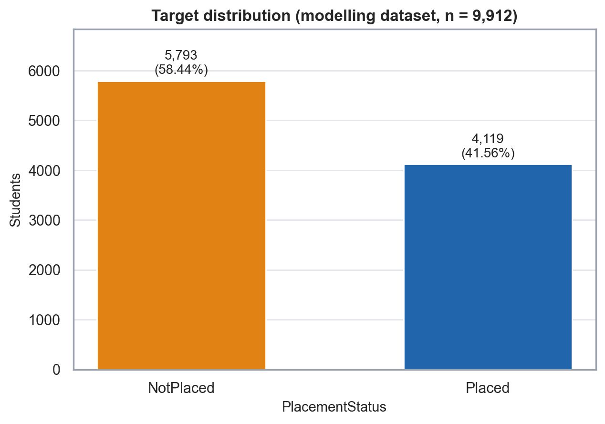

---

## 7. Data Quality and Leakage Audit

This section documents what is arguably the most important methodological step in the project. Phase 1 and Phase 1.5 audited the data *before* any analysis or modeling.

### 7.1 Duplicates and conflicting labels

**Table 2. Data-quality audit (original 10,000 rows).**

| Check | Result |
|---|---|
| Missing values | 0 |
| Exact duplicate groups | 66 |
| Rows involved in exact duplicate groups | **138** |
| **Surplus** exact duplicate rows (rows beyond the first in each group) | **72** |
| Distinct feature profiles (all ten predictors) | 9,920 |
| Feature profiles occurring more than once | 74 (66 with identical labels + 8 with conflicting labels) |
| **Conflicting-label groups** | **8** |
| Rows in conflicting-label groups | 16 |
| Feature profiles that crossed the original train/validation/test files | **33** |

**Exact duplicates with the same label.** Of the 74 repeated feature profiles, 66 carried the same label in every copy. Keeping duplicates would let the same student profile appear in both a training and an evaluation split and would inflate evaluation scores. The 72 surplus rows were therefore collapsed to one record each.

**Conflicting-label groups.** In 8 groups, two rows had *identical values for all ten predictors but opposite labels* (one Placed, one NotPlaced). All eight sit at the top of the profile range (aptitude 90, two workshops, three projects, extracurricular activities and placement training both "Yes", very high soft-skills ratings). For these profiles the ten recorded features do not determine the label, so the label either depends on something not recorded or contains noise.

**Handling decision.** No majority vote was used, because with one row per label there is no majority, and any choice would be arbitrary. **All 16 rows belonging to the 8 conflicting groups were excluded.** The groups are listed in `results/metrics/02_conflicting_label_groups.csv`.

**Resulting dataset.**

$$10{,}000 \;-\; 72\ (\text{same-label duplicate surplus}) \;-\; 16\ (\text{conflicting rows}) \;=\; \mathbf{9{,}912}\ \text{rows.}$$

### 7.2 Duplicate feature-profile leakage

The supplied train/validation/test files were not independent: **33 feature profiles** appeared in more than one of the three files (69 rows; 33 validation or test rows shared a profile with a training row). Evaluating on those files would partly measure memorisation of repeated profiles instead of generalisation to new ones. For flexible models (random forests, boosting) the effect could be substantial, and it would not apply equally to all models, which would bias model comparison as well.

For this reason **the supplied split was not retained for modeling.** Instead, the cleaned 9,912 rows were pooled and re-split with a stratified random split (seed 42). Because every remaining feature profile occurs exactly once, any split of these rows is free of profile duplication across splits; this was asserted programmatically.

**Table 3. Final modeling split.**

| Split | Rows | Share | Placed | NotPlaced | Placed % |
|---|---:|---:|---:|---:|---:|
| Train | 6,938 | 70% | 2,883 | 4,055 | 41.55% |
| Validation | 1,487 | 15% | 618 | 869 | 41.56% |
| Test | 1,487 | 15% | 618 | 869 | 41.56% |
| **Total** | **9,912** | 100% | 4,119 | 5,793 | 41.56% |

> **No feature-profile overlap was present among the final train, validation and test splits.**

The audit step (duplicate collapse, conflict exclusion, leakage-aware re-splitting with an explicit zero-overlap assertion) is a methodological contribution of the project in its own right: without it, headline performance would have been measured partly on profiles the model had already seen, and the comparison between flexible and simple models would have been distorted in favour of the flexible ones.

---

## 8. Test-Set Access History

Transparency about how the test data were handled is part of the scientific record of this project, so the history is stated in full.

> **The test data were not used for model development, selection, tuning, calibration, or threshold selection. Earlier exploratory notebooks accessed the eventual test rows for descriptive analysis. In Phase 7, the test set was accessed once for the final gated evaluation after the modeling protocol had been frozen. Two additional pre-evaluation shell accesses inspected file structure/metadata only and were not used for model decisions.**

One qualification to the "metadata only" wording: the two shell accesses were `head -2 data/processed/test.csv`, which displayed the header line and the first data row, and `wc -l data/processed/*.csv`, which returned line counts only. The first therefore did display one data row, not only the header. Neither result was used for any model decision, tuning, threshold selection, calibration or fitting; every such decision had already been frozen and recorded.

**Table 4. Test-data access, by kind.**

| Kind of access | When | What was done | Used for model decisions? |
|---|---|---|---|
| **Development / EDA access** | Phases 1, 1.5, 2, 3 | The notebooks loaded the original and then the cleaned dataset, including the rows later assigned to the test split, for data-quality, descriptive and statistical analysis and split-sanity checks | **No predictive model was fitted or evaluated on those rows.** However, the descriptive analyses (which informed the categorical treatment of count variables) included test rows, so test independence is not absolute |
| Pre-evaluation orientation | Immediately before Phase 7 | `head -2` (header + one data row) and `wc -l` (line counts) in the shell, outside the notebook audit hook | No |
| Development modeling | Phases 4, 5, 6 | These notebooks' own audit hooks prohibited reading the test file and listed every file opened | The hooks describe those notebooks only, not the whole project history |
| **Final evaluation access** | Phase 7 | One read of the processed test file under an audit gate, after the protocol was frozen | Reporting only; nothing was changed afterwards |
| Application and report | Phase 8A, 8B | The application and this report read no test split data or per-student test predictions; the report uses saved aggregate results | No new analysis |

**Controls on the final evaluation.** (i) The model, representation, hyperparameters, probability treatment (raw, no recalibration), thresholds (0.50 and 0.35), metrics and bootstrap settings were written to a protocol file (`08_frozen_protocol.json`) *before* the test file was opened. (ii) An audit hook permitted exactly one read of the processed test file and none of the raw one. (iii) A marker file written immediately after the read blocks re-execution of the opening cell. (iv) Two dry runs used the validation split as a stand-in. (v) Processed and raw data files and the Phase 4 model artifacts were checked by checksum at the start and end of the run.

**What this does and does not establish.** No model was fitted on test rows; no threshold was selected using test; no calibration decision was made using test; and no model selection was performed using test. The Phase 1–3 descriptive access is a genuine caveat: no model was fitted, selected, tuned, calibrated or thresholded using test rows, but the categorical representation of the count variables was motivated partly by descriptive analyses that included them (and was then chosen on validation), so the test split is not a perfectly independent sample in the strictest sense. This caveat is repeated in the limitations (Section 25).

**Statistics in this report drawn from descriptive phases.** The effect sizes, odds ratios, per-feature AUC values, VIFs and placement rates in Sections 9–10 were computed on all 9,912 cleaned rows, which include the eventual test rows. The key statistical results were also replicated on the training split alone, with the same direction and significance (effect sizes within about 0.03 in Cohen's d and 0.3 in odds ratio).

---

## 9. Exploratory Data Analysis

The exploratory analysis (Phase 2) described associations in the cleaned dataset (n = 9,912). No model was fitted, no feature was created and the exploratory quantile bins used in some plots were never saved as features. All statements describe association in this dataset.

### 9.1 Class balance

41.56% of students are Placed and 58.44% NotPlaced, a ratio of about 1.4 : 1 (moderate imbalance; Figure 1). This is not severe enough to require resampling, and class-balanced logistic regressions, which were compared in Phase 4, did not improve probability quality (Section 12). Accuracy alone would be a weak yardstick (always predicting NotPlaced gives 58.4% accuracy), which is another reason to prioritize log loss, Brier score and ROC-AUC.

### 9.2 Continuous scores

All five scores (CGPA, aptitude, soft skills, SSC marks, HSC marks) show hard bounds and often pile-ups at their limits, without long tails; no outlier rule was applied. Placed students have higher values on every score. The standardised mean differences (Cohen's *d*, Placed minus NotPlaced, pooled SD) are:

| Predictor | Cohen's *d* | Mean (Placed) | Mean (NotPlaced) |
|---|---:|---:|---:|
| AptitudeTestScore | **1.23** | 84.4 | 75.8 |
| HSC_Marks | **1.18** | 79.7 | 70.6 |
| Projects (as numeric count) | **1.08** | 2.50 | 1.67 |
| SSC_Marks | **1.07** | 74.8 | 65.0 |
| SoftSkillsRating | **0.95** | 4.53 | 4.17 |
| CGPA | **0.94** | 8.01 | 7.47 |
| Workshops/Certifications (as numeric count) | **0.78** | 1.39 | 0.73 |
| Internships (as numeric count) | **0.53** | 1.24 | 0.90 |

Every predictor is associated with placement. Correlations with the 0/1 target range from about 0.52 (aptitude) and 0.50 (HSC) to about 0.42 (CGPA, soft skills), and the Pearson and Spearman values agree closely (differences ≤ 0.03). The large mean differences combined with only moderate linear correlation reflect overlapping distributions: the groups differ on average but are not cleanly separable.

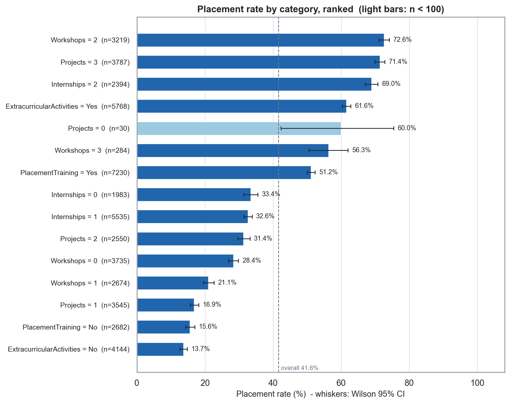

### 9.3 Binary predictors

- **ExtracurricularActivities:** 61.6% of students with "Yes" were placed against 13.7% with "No".
- **PlacementTraining:** 51.2% against 15.6%.

The two binary predictors co-occur (85% of students with extracurricular activities also had placement training) and their patterns combine. Observed placement rates were 6.1% for neither (n = 1,826), 19.7% for training only, 35.9% for extracurricular only and 66.1% for both (n = 4,912).

### 9.4 CGPA and aptitude

The joint behaviour of the strongest numeric predictors is steep (Figure 3). In an exploratory CGPA × aptitude grid (quartile bins, visualisation only), the observed placement rate rises from 7.8% in the lowest bins to 88.7% in the highest. Aptitude is moderately correlated with HSC marks (r = 0.56), projects (0.54), soft skills (0.51) and SSC marks (0.51), so these variables share part of their information.

### 9.5 Projects, internships and workshops/certifications

The three count variables do not behave monotonically (Figure 4):

| Variable | Placement rate by level |
|---|---|
| Internships | 33.4% (0), 32.6% (1), **69.0% (2)** — flat from 0 to 1, then a step |
| Workshops/Certifications | 28.4% (0), **21.1% (1)**, 72.6% (2), **56.3% (3)** — level 1 below level 0; level 3 below level 2 |
| Projects | 60.0% (0; n = 30 only), 16.9% (1), 31.4% (2), 71.4% (3) |

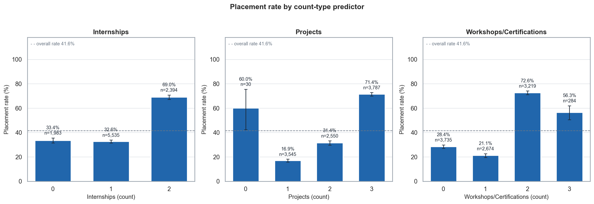

**Interpreting the non-monotonic patterns.** These patterns should not be read as "one workshop is worse than none". Two descriptive observations temper such a reading. First, composition: students with two workshops have higher average CGPA (8.05 vs 7.5), higher aptitude (about 85 vs 76–77), more projects (2.56 vs 1.7) and far more extracurricular activity (87% vs 41–43%), so their raw placement rate partly reflects who sits at that level. Second, the dip at Workshops = 1 persists within aptitude terciles (for example, low band 15.4% → 9.9%, mid 29.3% → 25.3%, high 58.4% → 53.3%), so aptitude alone does not explain it; other covariates, such as extracurricular activity, may contribute. The patterns are descriptive features of this dataset. No explanation involving the effect of any activity on placement is supported, and the Projects = 0 level is too small (30 students) to interpret.

### 9.6 Data-character observations

Hard floors and ceilings, very large and systematic effects across all predictors, step-like count patterns and conflicting-label profiles at the top of the range are *consistent with a rule-based or constructed dataset*. This is an observation, not a conclusion: the dataset card gives no provenance, and nothing in the analysis establishes that the data are synthetic. It does imply caution about how far performance on this dataset transfers (Section 25).

---

## 10. Statistical Analysis

Phase 3 tested the exploratory observations formally. The purpose was to find out which associations are statistically distinguishable from noise, how large they are, and what they imply for feature representation and model choice. All tests used α = 0.05, and each reports a statistic, p-value, effect size and confidence interval. As in Section 9, the analysis is based on the cleaned dataset (n = 9,912) and is descriptive of association.

### 10.1 Methods

| Question | Method | Why this method |
|---|---|---|
| Do scores differ between Placed and NotPlaced? | Mann–Whitney U (primary), Welch *t* (sensitivity); Cohen's *d* and rank-biserial correlation with bootstrap CIs; AUC of the single feature | Scores are bounded and non-normal; rank-based testing needs no normality assumption, and Welch confirms the conclusion |
| Are the binary predictors associated with placement? | Pearson chi-square of independence (expected-count assumptions checked), Cramér's *V*, odds ratio with Woolf CI | Standard 2×2 association analysis with an effect size |
| Do count predictors differ across levels? | Omnibus chi-square, then planned pairwise comparisons (z-test or Fisher's exact for small groups) with Newcombe CIs for rate differences | Trend tests were avoided because the patterns are non-monotonic |
| Are count effects confounded by aptitude? | Cochran–Mantel–Haenszel (CMH) stratified by aptitude terciles; Breslow–Day homogeneity; crude vs stratified odds ratios | Checks whether aptitude explains part of the pattern; not a causal adjustment |
| Are predictors redundant? | Pearson and Spearman correlations; variance inflation factors (VIF) | Multicollinearity affects coefficient stability |
| Many tests were run | Holm correction within separate logical families; raw and adjusted *p* both reported | Controls the familywise error rate |

### 10.2 Main results

**Table 5. Statistical effects (cleaned dataset, n = 9,912).**

| Predictor | Statistic | Effect | Holm-adjusted *p* |
|---|---|---|---|
| AptitudeTestScore | Cohen's *d* = 1.23; single-feature AUC = **0.81** | Largest of the scores | < 0.05 |
| HSC_Marks | *d* = 1.18; AUC = 0.78 | | < 0.05 |
| SSC_Marks | *d* = 1.07; AUC = 0.77 | | < 0.05 |
| SoftSkillsRating | *d* = 0.95; AUC = 0.76 | | < 0.05 |
| CGPA | *d* = 0.94; AUC = 0.76 | | < 0.05 |
| ExtracurricularActivities | OR = **10.1** (95% CI 9.1–11.2); Cramér's *V* = 0.48 | Large | < 0.05 |
| PlacementTraining | OR = **5.7** (95% CI 5.1–6.4); Cramér's *V* = 0.32 | Medium–large | < 0.05 |
| Projects | omnibus Cramér's *V* = 0.49 | Medium–large | < 0.05 |
| Workshops/Certifications | omnibus Cramér's *V* = 0.45 | Medium–large | < 0.05 |
| Internships | omnibus Cramér's *V* = 0.31 | Medium | < 0.05 |

All five scores differ between Placed and NotPlaced; Welch and Mann–Whitney agree for every feature. With about 10,000 students even small differences give tiny *p*-values, so **effect sizes and confidence intervals, not *p*-values, guide interpretation**. All results replicated on the training split alone.

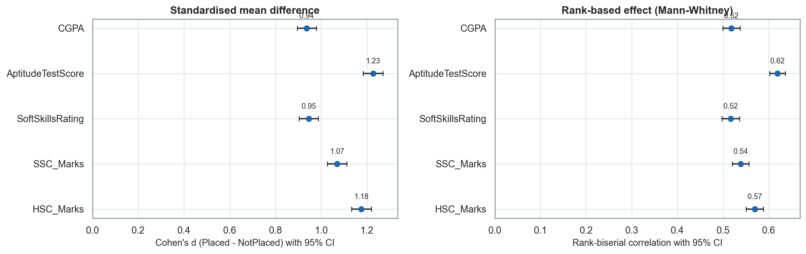

**Pairwise count comparisons.** Internships 1 vs 2 (+36.4 percentage points) and 0 vs 2 (+35.5 pp); Workshops 0 vs 1 (−7.3 pp), 1 vs 2 (+51.5 pp) and 2 vs 3 (−16.3 pp); Projects 1 vs 2 (+14.5 pp) and 2 vs 3 (+40.0 pp) were statistically supported. Two comparisons were **not** supported: Internships 0 vs 1 (−0.8 pp, 95% CI −3.3 to +1.6, Holm *p* = 0.50; an absence of evidence of a difference, not proof of equality) and Projects 0 vs 3 (+11.4 pp, CI −4.1 to +29.1, Holm *p* = 0.22; underpowered with only 30 students at level 0).

**Stratified (CMH) analysis.** Stratifying by aptitude tercile shrinks the large upward steps (Workshops 1 → 2: crude OR 9.9 → Mantel–Haenszel OR 4.7; Workshops 0 → 2: 6.7 → 3.6; Projects 2 → 3: 5.5 → 3.0; Projects 1 → 2: 2.25 → 1.86), so aptitude accounts for part of those differences. The non-monotonic *dips* persist (Workshops 0 → 1: MH OR 0.74, 95% CI 0.65–0.83; Workshops 2 → 3: 0.63, 0.48–0.83), so aptitude alone does not explain them. Breslow–Day tests suggest heterogeneity of odds ratios across aptitude bands for Workshops 0 vs 2 (*p* = 0.007) and 2 vs 3 (*p* = 0.036). Only one coarse variable was stratified, so other covariates (for example, extracurricular activity) may contribute.

**Multicollinearity.** The strongest predictor-predictor association is aptitude / HSC marks (Pearson *r* = 0.559, Spearman ρ = 0.554). The **maximum VIF is 1.96** (HSC_Marks, with all ten predictors included; 1.91 for the eight numeric predictors), far below the usual thresholds of 5 or 10. Coefficients for aptitude, HSC marks and projects will share explanatory credit but are not expected to be unstable; no variable was removed.

### 10.3 What the statistics informed — and what they did not replace

The statistical analysis informed three design decisions: (i) treat Internships, Projects and Workshops/Certifications as **categorical** in at least one candidate representation, because a single linear slope would misrepresent non-monotonic patterns; (ii) **keep all ten predictors**, since all are associated with placement and VIF does not argue for removal; (iii) include a regularised logistic regression as an interpretable baseline and tree-based models to capture steps and interactions. It also set expectations: large single-feature separation (AUC 0.76–0.81) suggested high attainable discrimination, and the conflicting-label profiles suggested a ceiling.

The statistics did **not** replace predictive modeling. They are marginal or lightly stratified associations estimated and tested on the same data; they say nothing about out-of-sample predictive accuracy, probability calibration or the joint use of the ten predictors, and significance at n ≈ 10,000 is easy to obtain. Whether the categorical treatment actually helps prediction had to be tested on validation data, which Phase 4 did (Section 12). Finally, none of the statistics is a causal estimate.

---

## 11. Preprocessing

Two representations of the predictors were considered (Phase 4), so that the question raised by the exploratory and statistical analysis could be answered empirically.

| | **Representation A — numeric counts** | **Representation B — categorical counts** |
|---|---|---|
| Internships, Projects, Workshops/Certifications | Kept as numeric columns | One-hot encoded (each level its own indicator) |
| Five continuous scores (CGPA, aptitude, soft skills, SSC, HSC) | Standardised for logistic regression | Standardised for logistic regression |
| ExtracurricularActivities, PlacementTraining | Binary 0/1 | Binary 0/1 |
| Rationale | Simplest; assumes a monotonic effect per count | Allows each level its own effect; consistent with the non-monotonic patterns found in Sections 9–10 |

**Why categorical representation was considered.** The EDA and statistical analysis showed that Workshops/Certifications has a dip at level 1 and at level 3, Projects has a step between levels 2 and 3, and Internships jumps only at level 2. A single numeric slope would force a monotonic relationship that the data do not show.

**Implementation.**

- *Scaling.* The five continuous scores are standardised (training mean, training SD) for logistic regression. Tree-based models use unscaled scores because they are invariant to monotonic rescaling.
- *One-hot encoding.* In Representation B each count variable is split into level indicators; for logistic regression the reference levels are Internships = 1, Projects = 3 and Workshops/Certifications = 0, and coefficients are interpreted as contrasts against those levels.
- *Binary encoding.* ExtracurricularActivities and PlacementTraining are encoded as Yes/No with "No" as the reference.
- *No leakage.* All preprocessing is part of a scikit-learn `Pipeline` with a `ColumnTransformer`, so scalers and encoders are fitted only on training data during development (inside each CV fold during cross-validation). The final `LR_B` therefore has 15 coefficients and an intercept: 5 standardised scores, 2 + 3 + 3 count-level indicators and 2 binary indicators.
- *Deprecation note.* scikit-learn 1.9 deprecates `penalty="l2"`; the equivalent `l1_ratio=0` was used, and the coefficients were verified to be identical.

---

## 12. Baseline Modeling

Phase 4 fitted candidate models on the **training** set and compared them on the **validation** set. No threshold was tuned (default 0.50), and the test set was not read by that notebook.

**Why these models.**

| Model | Role |
|---|---|
| **Logistic regression** (L2) | Interpretable probability baseline; each coefficient is a readable log-odds contrast; naturally produces probabilities |
| **Decision tree** | Captures threshold structure and interactions in a transparent way; known to produce coarse probabilities |
| **Random forest** | Ensemble of trees; flexible nonlinear model |
| **Gradient boosting** | Boosted shallow trees; flexible nonlinear model, often strong on tabular data |
| **Dummy (base-rate) reference** | Sanity baseline: always predicts the training placement rate |

Each model was fitted under both representations (A, B) with a small explicit hyperparameter search on validation (grids saved in `results/metrics/modeling/05_tuning_grids.csv`). Class-balanced logistic regressions were included for comparison. Selected configurations: logistic regression C = 1; decision tree depth 3 (A) or depth 5 with minimum leaf 5 (B); random forest 300 trees (B: depth 10, minimum leaf 10, √p features per split); gradient boosting depth 2 (B: 300 trees, learning rate 0.05).

**Table 6. Development validation results (n = 1,487; default threshold 0.50).**

| Model | Representation | ROC-AUC | Log loss | Brier | F1 |
|---|---|---:|---:|---:|---:|
| Dummy (base rate) | — | 0.500 | 0.679 | 0.243 | 0.000 |
| Logistic regression | A numeric | 0.869 | 0.446 | 0.142 | 0.762 |
| **Logistic regression** | **B categorical** | **0.872** | **0.441** | **0.141** | 0.756 |
| Logistic regression, class-balanced | B categorical | 0.872 | 0.447 | 0.144 | 0.763 |
| Decision tree | A numeric | 0.827 | 0.495 | 0.161 | 0.721 |
| Decision tree | B categorical | 0.846 | 0.480 | 0.155 | 0.743 |
| Random forest | A numeric | 0.868 | 0.445 | 0.144 | 0.755 |
| Random forest | B categorical | 0.869 | 0.443 | 0.143 | 0.749 |
| Gradient boosting | A numeric | 0.870 | 0.442 | 0.142 | 0.752 |
| Gradient boosting | B categorical | 0.871 | 0.441 | 0.142 | 0.758 |

For `LR_B` the 95% bootstrap intervals are ROC-AUC 0.854–0.890, log loss 0.412–0.470 and Brier 0.130–0.152.

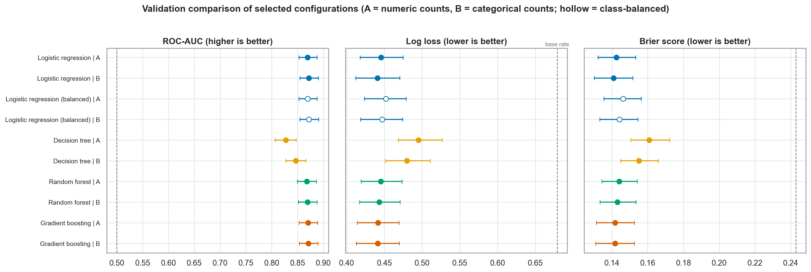

**Reading the results carefully.**

- **Logistic regression, random forest and gradient boosting are practically tied.** ROC-AUC lies within 0.868–0.872 and log loss within 0.441–0.446, differences far smaller than the width of each model's bootstrap interval. The results do not support claiming that one of the three is meaningfully superior. Only the single decision tree is clearly worse (paired interval for the gap to the leading models excludes 0).
- All competitive models improve substantially on the base rate (log loss 0.44 vs 0.68; Brier skill about 0.42). A randomly chosen Placed validation student receives a higher probability than a randomly chosen NotPlaced student about 87% of the time.
- **Numeric vs categorical counts.** Representation B helps the decision tree clearly (ΔAUC +0.019, 95% CI +0.010 to +0.028) and logistic regression only marginally (ΔAUC +0.002, CI −0.001 to +0.006; Δlog loss −0.005, CI −0.010 to +0.000). It makes no distinguishable difference for random forest or gradient boosting, which can split on thresholds natively. The preference for B is therefore mild, not proven.
- **Class-balanced logistic regressions** trade precision for recall by design (recall about 0.79–0.80) and have slightly worse log loss and Brier, so they were kept as comparison only.
- **Overfitting check.** The train–validation AUC gap is smallest for logistic regression (+0.009), larger for gradient boosting (+0.019) and largest for the random forests (RF_B +0.044, flagged as suspicious; RF_A +0.056, flagged as large and excluded from selection). Unregularised deep trees (depth unlimited, leaf size 1) had validation log loss above 11, illustrating why probability quality and overfitting must be checked, not only accuracy.
- **Probability quality.** Logistic regression, random forest and gradient boosting give broad, non-degenerate probability distributions; the decision tree produces a few coarse levels (leaf proportions), which explains its poor log loss and Brier score despite similar accuracy.

---

## 13. Model Selection

**Predeclared rule (fixed before the comparison).**

1. *Primary criterion:* lowest validation log loss among eligible models (log loss rewards well-calibrated probabilities and penalises confident errors heavily).
2. *Tie interpretation:* models whose paired-bootstrap confidence interval for the log-loss difference to the leading model contains zero are treated as statistically tied.
3. *Within the tied set:* prefer the most interpretable model.

**Application.** `LR_B` had the lowest validation log loss (0.4408) and Brier score (0.1409). The paired bootstrap placed `LR_A`, `GB_A`, `GB_B` and `RF_B` in the same indistinguishable set (the decision trees and the class-balanced variants were not in the tied set, and `RF_A` was excluded because of its train–validation gap). Within the tied set, logistic regression with categorical counts is the most interpretable: its coefficients and odds ratios are directly readable and its output decomposes additively on the log-odds scale. It also has the smallest train–validation gap among the competitive models, its mean predicted probability (0.410) is close to the observed rate (0.416), and it does not produce extreme probability pile-ups.

**Provisional → final.** The choice was provisional after Phase 4, was re-examined with cross-validation, calibration and error analysis in Phases 5–6 (Sections 14–19) without any reason to replace it, and was fixed in a predeclared protocol before the test set was opened. It rests on interpretability and consistency, not on a demonstrated accuracy advantage.

> For this dataset and experimental protocol, Logistic Regression B was retained as the final model.

This is not a claim of universal superiority. A different dataset, split or cost structure could favour a different model.

---

## 14. Cross-Validation

**Design.** Five-fold stratified cross-validation (shuffled, seed 42) was run on the **training set only** (n = 6,938) for the three leading candidates. The decision tree was omitted because Phase 4 showed it was clearly weaker. Cross-validation (i) estimates performance with less dependence on one validation split, (ii) gives a fold-to-fold standard deviation that serves as a yardstick for sampling variability, and (iii) provides out-of-fold (OOF) probabilities for calibration and threshold analysis that come from models that never saw the corresponding student.

**Table 7. Five-fold CV on the training set (mean ± SD across folds).**

| Model | ROC-AUC | Log loss | Brier | F1 (secondary) |
|---|---|---|---|---|
| **Logistic regression B** | 0.879 ± 0.010 | 0.431 ± 0.016 | 0.139 ± 0.006 | 0.756 |
| Gradient boosting B | 0.876 ± 0.011 | 0.434 ± 0.020 | 0.141 ± 0.008 | 0.750 |
| Random forest B | 0.876 ± 0.010 | 0.433 ± 0.015 | 0.140 ± 0.006 | 0.746 |

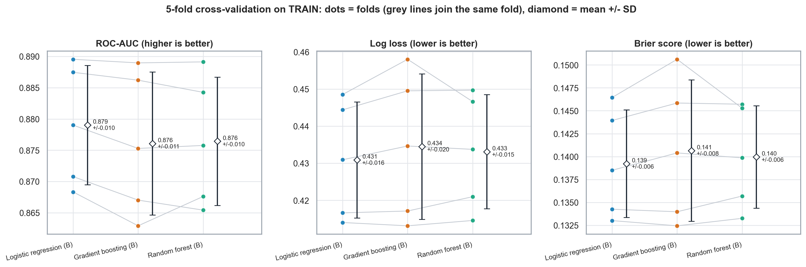

**Reading.** The gap between the best and worst fold-mean is only about 0.2–0.3 of the typical fold-to-fold SD for every primary metric (AUC 0.003 vs SD 0.010; log loss 0.004 vs 0.017; Brier 0.001 vs 0.006). Logistic regression has the numerically best mean on all three primary metrics and a directionally consistent small AUC edge across folds, but **every Nadeau–Bengio-corrected 95% interval for the paired differences includes zero** (for example, LR minus GB log loss −0.011 to +0.004). The cross-validation therefore supports the Phase 4 conclusion that the three models are practically tied. The validation AUC for `LR_B` (0.872) lies within the CV fold range (0.868–0.890), so the validation split did not look unusually favourable.

**Limitations of the cross-validation evidence.**

- Only five folds were used, giving coarse stability estimates; fold training sets overlap, so the folds are not independent.
- These are **development estimates**. Each fold model uses 80% of the training data.
- Hyperparameters for the gradient boosting and random forest models were chosen on the validation split in Phase 4, so their CV estimates are not fully independent of validation. The representation choice was also informed by Phases 2–3.
- Bootstrap intervals on pooled OOF predictions treat predictions as independent and therefore understate uncertainty slightly.

---

## 15. Calibration

### 15.1 Why calibration matters for a probability-focused project

A model is **calibrated** if, among students to whom it assigns a probability near *p*, a fraction near *p* are in fact placed. For a project whose primary output is a probability, this property is not optional. A model can rank students well (high ROC-AUC) and classify them accurately at some threshold and still report probabilities that are systematically too high, too low, too extreme or too moderate. Anyone reading "0.90" as "about nine in ten similar students are placed" would be misled by such a model, and the label alone would hide the problem. A model with good classification but poor calibration would therefore be unsuitable for a probability-based application, because the quantity being communicated would be wrong even when the decisions derived from it look acceptable. For this reason calibration was examined explicitly, using out-of-sample predictions only.

**Measures used.**

- *Calibration slope* (ideal = 1): below 1 means probabilities are too extreme, above 1 too moderate.
- *Calibration intercept* and *calibration-in-the-large* (ideal = 0): systematic over- or under-prediction.
- *Expected calibration error (ECE)* over 10 equal-count bins, always read against a **noise yardstick** — the ECE expected from sampling noise alone if the model were exactly calibrated.
- *Reliability diagrams* with Wilson 95% intervals per bin; log loss and Brier score as overall proper scoring rules.

### 15.2 Calibration of the raw probabilities in development

**Table 8. Calibration of raw probabilities (`LR_B`, development data).**

| Data | n | Slope (95% CI) | Intercept | ECE | ECE noise yardstick (mean / 95th pct) |
|---|---:|---|---:|---:|---|
| Training OOF (5-fold) | 6,938 | **0.99** (0.95–1.03) | −0.002 (≈ 0) | **0.021** | 0.011 / 0.016 |
| Validation | 1,487 | 0.98 | +0.039 | 0.024 | — / 0.034 |

The mean predicted probability equals the observed placement rate on the out-of-fold predictions (41.6%). For the other leading models the OOF slopes were 0.98 (gradient boosting) and 1.08 (random forest; probabilities slightly too moderate, CI excluding 1). The logistic regression OOF ECE (0.021) is modestly above its noise yardstick (95th percentile 0.016), reflecting small local departures of up to about 5–6 percentage points in some bins (the 52–68% range is over-predicted by about 5 points; the 21–35% range and the top decile are under-predicted by about 4 points). On the validation set, where bins contain only about 149 students, all ECEs fell within the noise range.

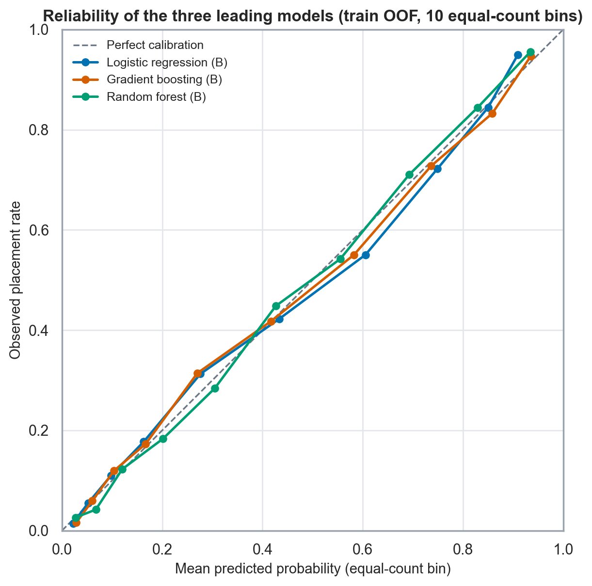

### 15.3 Where the probabilities sit

The `LR_B` out-of-fold probabilities range from 0.005 to 0.949. About 38.9% of students fall below 0.20 (observed placement rate 8.4%), 40.2% between 0.20 and 0.80 (observed 48.8%) and 20.8% above 0.80 (observed 89.5%). The confident bands are borne out by the data — the observed rate is within about 2 percentage points of the mean prediction in both extreme bands — but the **middle band is genuinely uncertain**: students predicted between 0.2 and 0.8 are placed about half the time. Confident predictions can still be wrong for individual students (roughly 1 in 10 students above 0.8 is not placed, and roughly 1 in 12 below 0.2 is placed).

### 15.4 Does recalibration help?

Two recalibration methods were compared with the raw probabilities in a nested, leakage-safe analysis on training data (calibrators fitted only on data that excludes the evaluated student) and then confirmed once on validation (calibrators fitted on train only): **sigmoid** (Platt scaling on the logit) and **isotonic** regression.

**Predeclared materiality criterion.** A recalibration method was considered worthwhile only if it improved log loss by **at least 0.005 with a confidence interval entirely below zero**.

| Change in log loss vs raw probabilities | Logistic regression | Gradient boosting | Random forest |
|---|---|---|---|
| Sigmoid, train nested | −0.0000 (−0.0001, +0.0001) | −0.0000 (−0.0004, +0.0003) | −0.0006 (−0.0015, +0.0002) |
| Isotonic, train nested | −0.0008 (−0.0034, +0.0018) | +0.0015 (−0.0008, +0.0037) | +0.0029 (+0.0006, +0.0052) — worse |
| Sigmoid, validation | −0.0000 | −0.0001 | −0.0005 |
| Isotonic, validation | +0.0012 | +0.0015 | +0.0031 |

**No candidate met the criterion.** Sigmoid recalibration changes almost nothing; isotonic recalibration lowers ECE (about 0.009) but leaves log loss and Brier unchanged or worse, slightly lowers AUC by collapsing predictions into tied values, and assigns clipped extreme probabilities (0.001/0.999) to 0.8–2.5% of students, which is over-confident. Because ECE is the most binning-sensitive measure while log loss and Brier are proper scoring rules, the decision rested on the latter. **Therefore the raw `LR_B` probabilities were retained**, with no calibration step in the final pipeline.

---

## 16. Threshold Selection

### 16.1 Probability estimation versus classification

Producing a probability and turning it into a label are different tasks with different criteria. Probability quality (log loss, Brier, calibration) is a property of the model's outputs. A classification threshold is a **policy choice** that encodes how a false "likely placed" is weighed against a missed placed student. Changing the threshold does not change the model, its AUC, log loss or calibration; it only moves students across the label boundary. The project therefore treated the probability as the primary output and the threshold as a secondary, declared decision rule.

### 16.2 Predeclared criterion and result

The criterion, fixed in advance (Phase 6): among thresholds on a 0.20–0.80 grid (step 0.05), choose the one with the **highest validation F1**, with ties going to the value closest to 0.50. The result is **threshold = 0.35** (validation F1 = 0.766). It is described as the *selected operating threshold under the F1-oriented criterion*, not as the optimal threshold: F1 weights precision and recall equally and ignores the unequal costs that real decisions have.

**Table 9. Validation performance at selected thresholds (`LR_B`, n = 1,487).**

| Threshold | Accuracy | Precision | Recall | Specificity | F1 | FP / FN | Predicted placed |
|---|---:|---:|---:|---:|---:|---|---:|
| 0.30 | 0.774 | 0.681 | 0.859 | 0.713 | 0.760 | 249 / 87 | 52.5% |
| **0.35 (selected)** | 0.787 | 0.705 | 0.838 | 0.750 | **0.766** | 217 / 100 | 49.4% |
| 0.50 (reference) | 0.802 | 0.772 | 0.741 | 0.845 | 0.756 | 135 / 160 | 39.9% |
| 0.70 | 0.777 | 0.850 | 0.561 | 0.930 | 0.676 | 61 / 271 | 27.4% |

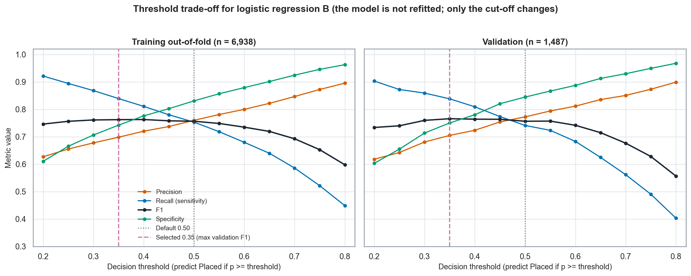

### 16.3 How decisive is the choice?

- **F1 is flat over a wide range.** Validation F1 is within 0.01 of its maximum for every threshold from 0.30 to 0.55 (0.760, 0.766, 0.764, 0.764, 0.756, 0.757). The paired bootstrap difference F1(0.35) − F1(0.50) is +0.010 (95% CI −0.007 to +0.028), which includes zero, so 0.50 is practically tied with 0.35 on F1.
- On the independent out-of-fold data the F1-maximising threshold is 0.40 (F1 0.763); F1 at 0.35 is 0.762 against 0.756 at 0.50, and 0.35 is better in 4 of 5 folds. The selection sits on a plateau (about 0.35–0.45), not on a sharp optimum.
- **What the choice trades.** Lowering the threshold from 0.50 to 0.35 converts 60 false negatives into 82 additional false positives on validation: recall rises from 0.74 to 0.84, precision falls from 0.77 to 0.71, accuracy falls from 0.802 to 0.787, and the model labels 49% of students "Placed" against a true rate of 42%.
- **At 0.50** the rule is more conservative: higher precision and specificity. **At 0.35** it is more inclusive: higher recall.

The right threshold depends on the relative costs of the two errors — for example, whether identifying every student who could benefit from outreach matters more than avoiding unnecessary outreach — and those costs were not defined in this project. 0.35, 0.40 and 0.50 are all defensible; **0.35 is not claimed to be universally optimal**. Validation figures at the selected threshold are also somewhat optimistic because validation informed the choice.

---

## 17. Explainability

### 17.1 Logistic-regression coefficients

For logistic regression the model is exactly additive on the log-odds scale:

$$\operatorname{logit}\big(\hat p\big)=\ln\frac{\hat p}{1-\hat p}\;=\;\beta_0+\sum_{j}\beta_j\,x_j,$$

where $x_j$ are the transformed inputs (standardised scores and level indicators). Exponentiating a coefficient gives an **odds ratio** (OR): the multiplicative change in the model's *predicted odds* associated with a one-training-SD increase in a score, or with a category relative to its reference level, with the other model variables held fixed. These are conditional associations learned from one dataset and one representation; they do not state what would happen if a real student changed a characteristic.

**Table 10. `LR_B` odds ratios (development fit on the training set; 95% Wald intervals from an unpenalised fit on the same design).**

| Feature (reference) | Odds ratio (95% interval) | Reading |
|---|---|---|
| PlacementTraining = Yes (No) | **2.75** (2.33–3.28) | Largest single coefficient |
| ExtracurricularActivities = Yes (No) | **1.95** (1.66–2.28) | |
| AptitudeTestScore (per 1 SD) | **1.65** (1.51–1.81) | Largest of the standardised scores |
| SSC_Marks / SoftSkillsRating / CGPA / HSC_Marks (per 1 SD) | 1.33 / 1.32 / 1.29 / 1.23 | Each about 1.2–1.3 |
| Workshops = 2 vs 0 | 1.53 (1.30–1.80) | |
| Workshops = 1 vs 0 | 0.73 (0.61–0.86) | Level 1 below level 0, as in Sections 9–10 |
| Workshops = 3 vs 0 | 0.99 (0.71–1.39) | About equal to level 0 (n = 208) |
| Projects = 1 / 2 vs 3 | 0.66 (0.55–0.79) / 0.73 (0.61–0.86) | Fewer than three projects associated with lower predicted odds |
| Projects = 0 vs 3 | 1.65 (0.63–6.04) | **Unreliable: 19 training students; interval includes 1; not interpreted** |
| Internships = 0 / 2 vs 1 | 1.26 (1.06–1.49) / 1.25 (1.07–1.48) | Small effect; level 1 slightly lower than 0 and 2 |

The two binary variables and aptitude carry the largest associations. The count variables stay non-monotonic after adjustment for the other predictors, which supports the categorical representation. Internships has a small coefficient and almost no predictive importance once the other variables are included, in contrast to its strong raw association in the EDA; this suggests (as an inference from the model, not a directly tested statement) that its raw association overlaps with that of the other predictors. The coefficients above come from the development fit on the training set; the deployed model was refit on train + validation, which moved every coefficient by at most 0.058 log-odds except `Projects = 0` (0.111).

### 17.2 Permutation importance

Permutation importance shuffles one raw column at a time in the full pipeline and records how much validation performance is lost (20 repeats, baseline validation AUC 0.872 and log loss 0.441).

**Table 11. Permutation importance of `LR_B` on validation.**

| Rank | Feature | AUC lost (mean ± SD) | Log loss added |
|---:|---|---|---:|
| 1 | AptitudeTestScore | **0.0208** ± 0.0036 | 0.0333 |
| 2 | PlacementTraining | **0.0177** ± 0.0043 | 0.0267 |
| 3 | ExtracurricularActivities | **0.0125** ± 0.0022 | 0.0189 |
| 4 | Workshops/Certifications | 0.0081 ± 0.0015 | 0.0136 |
| 5 | SoftSkillsRating | 0.0060 ± 0.0015 | 0.0098 |
| 6 | SSC_Marks | 0.0050 ± 0.0019 | 0.0087 |
| 7 | Projects | 0.0039 ± 0.0011 | 0.0069 |
| 8 | HSC_Marks | 0.0038 ± 0.0016 | 0.0064 |
| 9 | CGPA | 0.0036 ± 0.0013 | 0.0064 |
| 10 | Internships | 0.0003 ± 0.0006 | 0.0006 |

Aptitude, placement training and extracurricular activities are the three most important features under permutation importance and under the spread of each feature's contribution to the linear predictor (rank correlation 0.92 over only ten features), and Internships is last in both. Ranks 5–9 are close (AUC loss 0.0036–0.0060 with SDs of 0.0013–0.0019), so their order should not be over-read. Because the scores are moderately correlated (aptitude with HSC marks *r* = 0.56), shuffling one column removes only the information that the others do not duplicate; importance is shared, and there is no single "true" ranking.

### 17.3 Individual prediction decomposition

For one student the log-odds decompose as

$$\operatorname{logit}(\hat p) \;=\; \beta_0 + \sum_{\text{features}} c_j, \qquad c_j=\sum_{k\in j}\beta_k\,x_k,$$

where $c_j$ is the contribution of feature $j$ relative to a baseline student (all scores at the training average and all categories at their reference level). The contributions plus the intercept reproduce the model's log-odds exactly. Six validation students selected by fixed rules illustrate the method:

**Table 12. Individual explanations (validation students; contributions in log-odds).**

| Case | Actual | Estimated *p* | Class at 0.50 / 0.35 | Main positive | Main negative |
|---|---|---:|---|---|---|
| 1 Very high | Placed | 0.91 | Placed / Placed | placement training +1.01, extracurricular +0.67, aptitude 87 (+0.47) | none |
| 2 Very low | NotPlaced | 0.02 | NotPlaced / NotPlaced | CGPA 8.0 (+0.12) | aptitude 69 (−0.63), soft skills 3.6 (−0.49), Projects = 1 (−0.41) |
| 3 Boundary | Placed | 0.50 | Placed / Placed | training +1.01, extracurricular +0.67, HSC 88 (+0.32) | Projects = 1 (−0.41), aptitude 76 (−0.20) |
| 4 Most confident false positive | NotPlaced | 0.93 | Placed / Placed | training +1.01, extracurricular +0.67, aptitude 90 (+0.65) | none |
| 5 Most confident false negative | Placed | 0.02 | NotPlaced / NotPlaced | none | soft skills 3.6 (−0.49), CGPA 6.6 (−0.44), Projects = 1 (−0.41) |
| 6 Middle | NotPlaced | 0.34 | NotPlaced / NotPlaced | training +1.01, SSC 83 (+0.38), soft skills 4.8 (+0.32) | Projects = 2 (−0.32), Workshops = 1 (−0.31) |

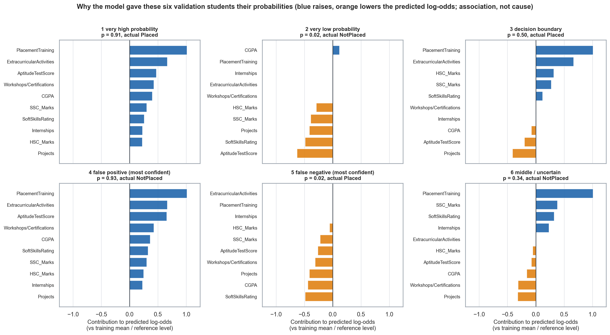

Cases 4 and 5 are deliberately the most extreme errors, not typical ones. Case 4 has essentially the top profile and is almost indistinguishable from the correctly predicted case 1, which matches the conflicting-label profiles found in the data audit: for such students the recorded features carry no information that could separate the outcomes.

**These contributions are explanations of the model, not causal effects.** They show how the fitted model arrives at its estimate; they do not show that changing a feature would change a student's outcome.

---

## 18. Feature-Group Ablation

To assess how much each group of features adds to predictive performance, five logistic regressions with the same preprocessing and regularisation as `LR_B` were fitted on different feature groups and evaluated by the same 5-fold CV on the training set and once on validation. The full model reproduces `LR_B` exactly.

**Table 13. Feature-group ablation (logistic regression).**

| Model | Features | CV ROC-AUC (mean ± SD) | Val ROC-AUC (95% CI) | Val log loss | Val Brier |
|---|---|---|---|---:|---:|
| Academic only (CGPA, SSC, HSC) | 3 | 0.840 ± 0.013 | **0.823** (0.802–0.845) | **0.510** | 0.166 |
| + Aptitude | 4 | 0.859 ± 0.013 | **0.844** (0.825–0.864) | **0.482** | 0.157 |
| + Technical counts (Internships, Projects, Workshops) | 7 | 0.866 ± 0.011 | **0.856** (0.836–0.875) | **0.465** | 0.150 |
| Employability only (soft skills, extracurricular, training) | 3 | 0.834 ± 0.004 | **0.828** (0.807–0.849) | **0.507** | 0.166 |
| **Full model** | 10 | 0.879 ± 0.010 | **0.872** (0.854–0.890) | **0.441** | 0.141 |

Reference (always predict the training rate): AUC 0.500, log loss 0.679, Brier 0.243.

**Table 14. Paired differences between nested models.**

| Step | Validation ΔAUC (95% CI) | Validation Δlog loss (95% CI) | CV folds improved (AUC / log loss) |
|---|---|---|---|
| Aptitude added to academic | +0.021 (0.013–0.030) | −0.029 (−0.040 to −0.018) | 5/5, 5/5 |
| Technical counts added to academic + aptitude | +0.012 (0.006–0.018) | −0.017 (−0.025 to −0.009) | 5/5, 5/5 |
| Employability added to academic + aptitude + technical | +0.016 (0.008–0.023) | −0.024 (−0.035 to −0.013) | 5/5, 5/5 |
| Full vs academic only | +0.049 (0.037–0.061) | −0.070 (−0.087 to −0.053) | 5/5, 5/5 |
| Full vs employability only | +0.044 (0.029–0.058) | −0.066 (−0.083 to −0.046) | 5/5, 5/5 |

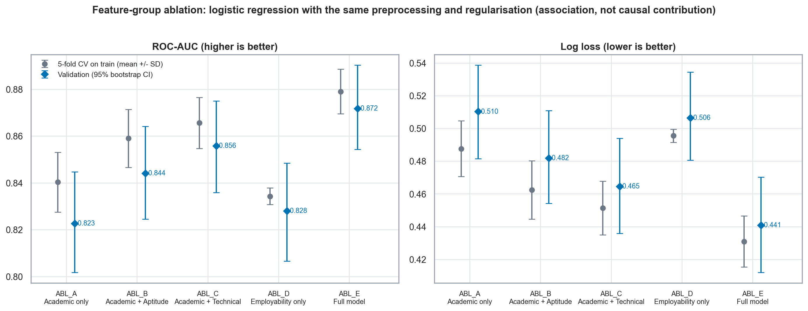

Academic information alone already gives validation AUC 0.82 and log loss 0.51, well above the base-rate reference. Employability alone (only three features) is about as informative as academic alone (AUC 0.828 vs 0.823; log loss 0.507 vs 0.510). Each added group improved performance in the observed 5/5 fold comparisons, with validation intervals excluding zero; no group was redundant and none dominated.

**Caution.** The feature groups overlap and are correlated, so the increments are **order-dependent**: employability's gain is measured only after everything else, and aptitude's only after academic information alone. The increments should not be interpreted as independent causal contributions of each group. They are also modest, and the smaller steps (about 0.012 AUC) are of the same size as the fold-to-fold SD (0.011–0.013), although consistent in sign. The individual validation intervals overlap widely; only the paired differences carry the evidence.

---

## 19. Error Analysis

Error analysis used the validation predictions of `LR_B` at the 0.50 threshold.

**Overall.** There were 295 errors: 135 false positives (9.1% of students) and 160 false negatives (10.8%), an error rate of **about 19.8%**. If the model's probabilities were exactly calibrated, the error rate expected from them (the mean of min(*p*, 1 − *p*)) would be 19.6%. The model therefore errs about as often as its own probabilities say it should; the errors are mostly irreducible uncertainty given the ten recorded features, not a calibration failure.

**Where errors occur.** **Approximately 70% of all errors fall among the 42% of students with predicted probabilities between 0.2 and 0.8.** The predicted-probability distributions of Placed and NotPlaced students overlap substantially (overlap coefficient 0.39).

**High-confidence predictions.** 773 students (52.0%) were correctly predicted with high confidence (*p* ≥ 0.8 or ≤ 0.2). **88 students (5.9%; 29.8% of all errors) were wrong with high confidence**:

| High-confidence error | n | Share of students | Description |
|---|---:|---:|---|
| False positive (*p* ≥ 0.8, NotPlaced) | **28** | 1.9% | Profile close to correctly predicted high-probability Placed students (all standardised differences at most 0.44 in absolute value; 100% have placement training, 96% extracurricular activities); nothing recorded distinguishes them |
| False negative (*p* ≤ 0.2, Placed) | **60** | 4.0% | More extracurricular activity (38% vs 16%; d = 0.52), higher aptitude (d = 0.46) and more projects (d = 0.36) than other low-probability students, but still below 0.2 |

**Interpretation.** These results are evidence of **overlap and ambiguity in the available features**, not proof of mislabeled data or of a hidden cause. They are consistent with the conflicting-label profiles found in the audit and with the practical performance ceiling suggested by the model-family tie: an error rate near 20% at 0.50 and roughly 1 in 10 confident predictions wrong in each band appear to be about what these ten features support in this dataset. The two high-confidence groups are small (28 and 60 students), so the feature patterns are descriptive only.

---

## 20. Final Test Evaluation

> **This section reports the ONE final held-out evaluation.** The test split was read once, under an audit gate, after the model, representation, hyperparameters, probability treatment, thresholds and metrics had been frozen (Section 8). Nothing below was used to change any decision.

### 20.1 What was evaluated

| | Development model (Phases 4–6) | Final model (Phase 7) |
|---|---|---|
| Specification | `LR_B`: L2, C = 1, no class weighting, categorical Internships/Projects/Workshops, raw probabilities | **Identical** (scikit-learn clone; parameters asserted equal to the Phase 4 configuration) |
| Fitted on | Training set (6,938) | **Train + validation (8,425)**, after every decision was frozen |
| Used for | Validation, CV, calibration, threshold selection, explanations | Test predictions only |

Before refitting, a clone fitted on train only was verified to reproduce the saved Phase 4 validation probabilities (tolerance 10⁻⁸), showing that the specification was unchanged and deterministic. Refitting re-estimates only fitted quantities: scaler means moved by at most 0.02 and SDs by at most 0.05, and no coefficient moved by more than 0.058 log-odds except `Projects = 0` (0.111; 19 training students). The CV and validation numbers elsewhere in this report describe train-only models; the test numbers describe the train + validation refit. Intervals are percentile bootstrap intervals (2,000 resamples of test students, seed 42).

### 20.2 Discrimination and probability quality

**Test set: n = 1,487 (618 Placed, 869 NotPlaced; placed rate 41.56%).**

**Table 15. Final test results — probability metrics (`LR_B`).**

| Metric | Estimate | 95% bootstrap CI | Reference: always predict base rate |
|---|---|---|---|
| **ROC-AUC** | **0.886** | 0.868 – 0.902 | 0.500 |
| **Log loss** | **0.420** | 0.394 – 0.449 | 0.679 |
| **Brier score** | **0.134** | 0.124 – 0.145 | 0.243 |

(The base-rate reference values are the Phase 4 values, obtained by predicting the training placement rate; the validation and test splits have the same placed rate, 41.56%.) A randomly chosen Placed test student receives a higher estimated probability than a randomly chosen NotPlaced student about 89% of the time.

### 20.3 Classification at the two predeclared thresholds

**Table 16. Final test results — classification metrics.**

| Metric | Threshold 0.50 (reference) | Threshold 0.35 (selected under F1-oriented criterion) |
|---|---|---|
| Accuracy | 0.812 (0.792–0.831) | 0.802 (0.781–0.820) |
| Precision | 0.779 (0.746–0.811) | 0.722 (0.689–0.754) |
| Recall (sensitivity) | 0.765 (0.732–0.797) | **0.851** (0.822–0.878) |
| F1 | 0.772 (0.744–0.797) | 0.781 (0.756–0.804) |
| Specificity | **0.846** (0.821–0.869) | 0.766 (0.737–0.793) |
| TP / TN / FP / FN | 473 / 735 / 134 / 145 | 526 / 666 / 203 / 92 |
| Share labeled "Placed" | 40.8% | 49.0% |

**The trade-off.** Moving from 0.50 to 0.35 converts **53 fewer false negatives (145 → 92)** at the price of **69 more false positives (134 → 203)**. Recall rises by 8.6 percentage points, precision falls by 5.7, specificity falls by 8.0 and accuracy falls by 1.1; F1 differs by only 0.009. On the final test set, 0.35 produced higher recall and F1 than 0.50 while also producing lower precision and specificity. **No inferential test was computed for the F1 difference**, the F1 intervals overlap almost completely, and no difference in F1 is claimed. As in development, neither threshold is universally preferable: the choice depends on the relative cost of a false "likely placed" versus a missed placed student, which was not defined. The probability remains the primary output. Only these two thresholds were evaluated on test.

---

## 21. Final Calibration on the Test Set

**Table 17. Calibration of raw `LR_B` probabilities on the test set.**

| Quantity | Value | Reading |
|---|---|---|
| Calibration slope (joint fit) | **1.05** (95% CI 0.95–1.15) | Compatible with 1 |
| Calibration intercept (joint fit) | **+0.04** (−0.10 to +0.18) | Compatible with 0 |
| Calibration-in-the-large (slope fixed at 1) | +0.03 (−0.10 to +0.17) | Mean prediction 0.411 vs observed rate 0.416 |
| ECE (10 equal-count bins) | **0.016** | At or below the ECE expected from sampling noise alone if exactly calibrated (mean 0.023, 95th percentile 0.034) |
| ECE (10 equal-width bins, sensitivity) | 0.017 | |

**No reliability bin fell outside the Wilson 95% interval**: in all ten equal-count bins (148–149 students each) the bin's mean predicted probability lies inside the Wilson interval of the observed placement rate.

**A visible pattern, reported as a limitation.** The largest bin gap is in the top decile: mean predicted probability ≈ 0.905 against an observed placement rate of ≈ 0.946 (gap 0.041). The next largest are bin 8 (0.739 predicted vs 0.770 observed; 0.031), bin 5 (0.273 vs 0.248; 0.024) and bin 2 (0.015). The model therefore **mildly under-predicts at the top**: students with a predicted probability above 0.80 were placed 90.5% of the time against a mean prediction of 87.7%. The same pattern was seen in development (Phase 5 top decile: 0.909 predicted vs 0.949 observed), so it is a consistent small feature of the model and not a test-only surprise. It is within sampling noise at this sample size, and **no recalibration was applied or tested** after seeing it, because the recalibration decision had been made in Phase 5. It is stated here as a limitation instead of being hidden.

**Probability distribution on test.**

| Band | Share of test students | Observed placed rate | Mean predicted |
|---|---:|---:|---:|
| Below 0.20 | 38.9% (n = 579) | 8.1% | 8.2% |
| 0.20 – 0.80 | 42.0% (n = 624) | 50.3% | 50.5% |
| Above 0.80 | 19.1% (n = 284) | 90.5% | 87.7% |

Predicted probabilities range from 0.007 to 0.942 (median 0.334). The distribution is very similar to the Phase 5 out-of-fold distribution (shares of 38.9%, 40.2% and 20.8%). About 58% of students fall in a confident band, and in both bands the observed rate is within about 3 points of the mean prediction. The middle band is placed about half the time and remains genuinely uncertain.

As in development, a probability describes a **group** of similar students, not a statement about a particular student (for example, decile 9: mean prediction 0.843, observed rate 0.838).

---

## 22. Model Comparison on the Final Test Set

`GB_B` and `RF_B` were predeclared as descriptive secondary comparators, refit on train + validation in the same way as `LR_B`. They were not used to select or replace the primary model.

**Table 18. Final test comparison (frozen models; descriptive only).**

| Model | ROC-AUC (95% CI) | Log loss | Brier | F1 @ 0.50 | F1 @ 0.35 | Calibration slope | ECE |
|---|---|---:|---:|---:|---:|---:|---:|
| `LR_B` (primary) | 0.886 (0.868–0.902) | 0.420 | 0.134 | 0.772 | 0.781 | 1.05 | 0.016 |
| `GB_B` | 0.886 (0.868–0.902) | 0.419 | 0.134 | 0.752 | 0.778 | 1.06 | 0.031 |
| `RF_B` | 0.886 (0.868–0.902) | 0.420 | 0.135 | 0.756 | 0.778 | 1.15 | 0.024 |

**Table 19. Paired bootstrap differences (`LR_B` minus other model; 95% CI).**

| Comparison | ROC-AUC | Log loss | Brier |
|---|---|---|---|
| vs `GB_B` | −0.000 (−0.003, +0.003) | +0.001 (−0.004, +0.006) | −0.000 (−0.003, +0.002) |
| vs `RF_B` | −0.000 (−0.004, +0.004) | −0.001 (−0.007, +0.007) | −0.001 (−0.004, +0.001) |

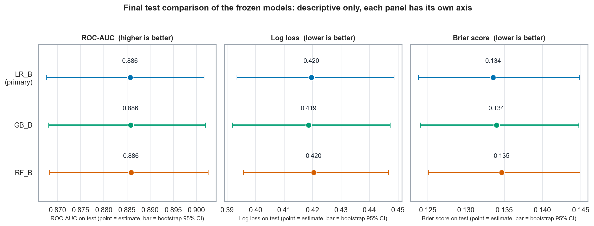

**Reading.** On the three primary metrics the models are **practically tied**: ROC-AUC is 0.886 for all three, log loss lies in 0.419–0.420 and Brier in 0.134–0.135, and every paired bootstrap interval includes zero. This continues the tie observed in validation (Section 12) and cross-validation (Section 14). **No ranking among the three models is made.** At the 0.50 threshold the boosted and forest models have lower recall (0.727 and 0.725 against 0.765) at similar precision, hence lower F1; at 0.35 all three have F1 of about 0.78. These F1 differences were not tested and are descriptive. The random forest again shows a calibration slope above 1 (1.15), as in Phase 5 (1.08).

**Why `LR_B` remains the final model.** The primary model was frozen before the test set was opened, and test differences this small are within sampling noise; nothing in the final evaluation provides a reason to replace it. Its retention rests on (i) interpretability — readable coefficients, an exact additive explanation for each prediction; (ii) strong probability performance with good calibration without any recalibration step; (iii) simplicity — 15 coefficients rather than hundreds of trees; and (iv) practical equivalence with the nonlinear alternatives, whose added complexity bought no measurable improvement in this dataset. This is a statement about this dataset and protocol, not a claim of general superiority.

---

## 23. Development Versus Test Results

**Table 20. `LR_B` — development estimates against the final test result.**

| | 5-fold CV on train (mean; fold SD) | Validation (train-only model) | **Test** (train + validation model) |
|---|---|---|---|
| ROC-AUC | 0.879 (SD 0.0095) | 0.872 (0.854–0.890) | **0.886** (0.868–0.902) |
| Log loss | 0.431 (SD 0.0157) | 0.441 (0.412–0.470) | **0.420** (0.394–0.449) |
| Brier | 0.139 (SD 0.0059) | 0.141 (0.130–0.152) | **0.134** (0.124–0.145) |
| Calibration slope / intercept | 0.99 / −0.002 | 0.98 / +0.039 | 1.05 / +0.041 |
| ECE | 0.021 | 0.024 | 0.016 |

CV and validation figures come from train-only models; the CV models use 80% of the training data in each fold.

> Test performance was broadly consistent with development estimates, with test metrics falling within approximately one CV standard deviation of the corresponding CV means. The higher test performance does not by itself establish improved generalization and may reflect sampling variation and the larger train+validation refit.

Detail behind the statement: test AUC is 0.007 above the CV mean (about 0.7 fold SDs) and 0.014 above the validation value; test log loss and Brier are slightly *better* than the development estimates (about 0.7 and 1.0 fold SDs). The test intervals contain both the CV mean and the validation value for all three metrics. The comparison cannot separate a favourable test split from the effect of the 21% extra training data in the refit model, and the slight optimism that validation may carry (it informed model selection) is not clearly visible either. The appropriate reading is "consistent with the development estimates", not "better than expected". Nothing here is evidence of overfitting, and calibration remains reasonable.

---

## 24. The Prediction Application

Phase 8A turned the frozen model into an interactive **Streamlit** application (`streamlit run app/app.py`, launched from the project root).

**Model.** The application loads the frozen artifact `models/phase7/LR_B_final.joblib` — the Phase 4 pipeline (preprocessing + L2 logistic regression) refit on train + validation and evaluated once in Phase 7 — exactly as saved, with its checksum verified at load. The application trains nothing, tunes nothing, recalibrates nothing and re-implements no part of the model.

**Inputs.** The ten student characteristics, all required. Allowed values are those observed in the development data:

| Field | Supported values |
|---|---|
| CGPA | 6.5 – 9.1 |
| SSC Marks / HSC Marks | 55 – 90 / 57 – 88 |
| Aptitude Test Score | 60 – 90 |
| Soft Skills Rating | 3.0 – 4.8 |
| Internships | 0, 1, 2 |
| Projects / Workshops-Certifications | 0, 1, 2, 3 (Projects = 0 is rare, so its estimate is unreliable) |
| Extracurricular Activities / Placement Training | No / Yes |

Missing, non-numeric, out-of-range or unknown values are rejected with a message; nothing is clipped or silently defaulted.

**Outputs.**

| Output | Description |
|---|---|
| Estimated probability | Model-estimated probability of Placed, shown to one decimal place (rounded for display only) |
| Model classification at **0.35** | "Placed" if the probability is ≥ 0.35 — the selected operating threshold under the F1-oriented criterion |
| Reference classification at **0.50** | The conventional threshold, shown for comparison |
| Probability interpretation | A descriptive band (0–20% very low … 80–100% very high); not a confidence interval and not the classification threshold |
| Feature-contribution explanation | Per-feature log-odds contributions relative to a baseline student, with an optional full calculation |

**Explanation.** The explanation uses the same additive decomposition as Section 17.3. The contributions reconstruct the model's log-odds to numerical precision (reconstruction error below 10⁻⁹) and reproduce the saved Phase 6 explanations. They are model explanations and associations, not causal effects.

**Verification.** An automated verification script (`app/verify_app.py`; 122 checks in its original Phase 8A form, 178 checks in the final release form, which keeps the original checks, updates one interface-text check, and adds checks for stale-result handling, Clear profile, safe error messages, rounding near thresholds and documentation consistency; the final release run passed 178, failed 0, skipped 0) confirmed, among other things, that the model loads and matches its recorded checksum; that the application's probabilities equal direct `LR_B` predictions (difference 0 on seven manual profiles); that the 0.35 and 0.50 rules are applied correctly including boundary values; that the explanation reconstructs the log-odds; that invalid inputs are rejected; and that a headless end-to-end run of the interface works. The application and its verification never read the held-out test split or per-student test predictions. The held-out performance quoted in the application is read from saved aggregate results.

**Final release interface changes.** After the Phase 8A description above, the interface was revised without any change to the model, preprocessing, probabilities, explanation mathematics or reported metrics: the classifications at 0.35 ("project threshold") and 0.50 ("conventional threshold") are now shown side by side with neither called best, editing any input removes the earlier result so it cannot be mistaken for the new profile, a Clear profile button was added, and error messages no longer expose internal details. Table rows above that say "Model classification" and "Reference classification" refer to the Phase 8A labels for the same two classifications. Live-browser checks covered a typical profile, an edit after a prediction, an out-of-range value, Clear profile and a narrow window; they were not exhaustive and no screen-reader testing was done.

**Caveat on use.** The application inherits all limitations of the model (Section 25): it produces a group-level probability estimate from one dataset, not a statement about what will happen to a particular student, and it should not be used for high-stakes decisions (Section 26). No application screenshot was captured during Phase 8A and none is included here; the interface can be launched with the command above.

---

## 25. Limitations

The results should be read with the following limitations in mind.

**Table 21. Limitations.**

| # | Limitation | Consequence for interpretation |
|---|---|---|
| 1 | **Dataset representativeness is uncertain.** The source gives no information on collection, institution, year or sampling. | Performance may not transfer to other campuses, cohorts or years. |
| 2 | **The data may exhibit rule-based or constructed patterns**, such as hard floors and ceilings, step-like count effects, very large systematic effects, a performance plateau shared by three model families and conflicting-label profiles at the top of the range. Synthetic origin is **not established** by the analysis or by the dataset source. | Strong performance here does not establish equivalent performance on real-world placement populations; coefficients describe this dataset, not how placement works. |
| 3 | **Single dataset.** | No external validation was possible. |
| 4 | **Single final split.** One test sample of 1,487 students gives intervals of about ±0.017 for AUC and ±0.02 for accuracy. | Differences between models or thresholds smaller than these intervals cannot be resolved. |
| 5 | **Validation-based selection introduces some optimism.** Hyperparameters, the representation preference and the 0.35 threshold were chosen with validation data in view (and Phases 2–3 informed the categorical representation). | Development figures at the selected settings are somewhat optimistic; the test split is the independent check but is one sample. |
| 6 | **The threshold depends on decision costs.** 0.35 was selected under an F1 criterion that weights errors equally; costs were not defined. | Neither 0.35 nor 0.50 is universally appropriate. |
| 7 | **Associations are not causal effects.** Coefficients, permutation importance, ablation increments and individual contributions are model explanations from observational data. | They do not say that changing a characteristic would change a placement outcome. |
| 8 | **Test-set access history** must be disclosed (Section 8): descriptive early access, two orientation shell commands, one gated final evaluation. | The test split is not independent in the strictest sense, although no model was fitted, selected, tuned, calibrated or thresholded using test rows. |
| 9 | **Exploratory access to the eventual test rows occurred in early phases** (Phases 1–3 descriptive and statistical analyses on all 9,912 rows). | Descriptive statistics in Sections 9–10 include test rows; key results were replicated on the training split. |
| 10 | **Top-decile calibration shows some under-prediction** (≈ 0.905 predicted vs ≈ 0.946 observed on test; also seen in Phase 5). It was not recalibrated. | Very high probabilities are slightly conservative; the effect is small and within sampling noise. |
| 11 | **Real-world placement outcomes depend on factors absent from the dataset** (for example, the labor market, the hiring company, interview performance, programme of study). | About 20% of students are misclassified at 0.50 even within this dataset. |
| 12 | **Model performance is not a guarantee for an individual student.** | A probability describes a group of similar students, not a certainty for one person. |

Further technical limitations: the test results describe the train + validation refit, whereas CV and validation numbers describe train-only models; five CV folds give coarse stability evidence; coefficient intervals are Wald intervals for an unpenalised fit conditional on the chosen representation and reference levels; permutation importance is shared among correlated predictors; ablation increments are order-dependent; the high-confidence error groups are small; and the levels `Projects = 0` (30 students in the cleaned data; 19 in training, 22 in train + validation) and `Workshops = 3` (n = 208 in training) have too few students for reliable estimates.

---

## 26. Ethical and Responsible Use

- **Not a guarantee.** The model produces an estimated probability from historical or constructed data. It does not decide, and cannot assure, that any student will or will not be placed.
- **Not for high-stakes automated decisions.** Placement-related outcomes affect students' opportunities. The model should not be used on its own to select, rank, exclude or advise students for consequential decisions, and no automated decision should be taken on the basis of its output.
- **Support, not replace, human judgment.** The estimate is a decision aid. It should be read together with context the model cannot see and discussed with the student, and the explanation shown by the application should be read as a description of the model, not as advice about what the student should change.
- **Student data privacy.** Real use would involve personal academic and behavioral data. Collection, storage, access and retention would need to follow the applicable law and institutional policy, with informed consent and minimal retention. The application as built processes the entered values for the current session; it should not be connected to identifiable records without a proper privacy assessment.
- **Potential fairness concerns.** The model uses ten characteristics, some of which (marks, extracurricular activities, access to placement training, workshops) may reflect unequal access to resources. No analysis of subgroup performance (for example, by gender, socioeconomic background or programme) was possible, because such attributes are absent from the dataset. Disparate error rates across groups cannot be ruled out, and any real use would require a fairness audit on the relevant population.
- **Historical or constructed patterns may encode limitations.** A model trained on past outcomes reproduces whatever patterns, biases or rules produced them. Given that the dataset's structure is consistent with a constructed origin, the learned patterns should not be treated as a description of how real recruiters behave.
- **Communicating the output.** Probabilities should be presented as estimates with uncertainty. In particular, 0.35 and 0.50 are classification rules for a stated purpose, and a probability in the middle range (0.2–0.8) is close to a coin flip in this dataset.

---

## 27. Conclusion

This project set out to estimate the probability that a student is placed from ten academic, technical and employability characteristics, and to evaluate that estimate as carefully as the dataset allows. The main results are as follows.

- **Rigorous data-quality audit.** 72 surplus duplicate rows were collapsed and 16 rows in 8 conflicting-label groups were excluded without a majority vote, giving a cleaned dataset of 9,912 rows.
- **Leakage prevention.** Because 33 feature profiles crossed the supplied splits, a new stratified split was built with zero feature-profile overlap between train (6,938), validation (1,487) and test (1,487).
- **Statistical analysis.** All ten predictors are associated with placement (for example, aptitude *d* = 1.23; extracurricular OR ≈ 10.1; placement training OR ≈ 5.7), count variables behave non-monotonically, and multicollinearity is low (maximum VIF ≈ 1.96). These findings informed the representation and model choices without replacing predictive evaluation.
- **Model comparison.** Logistic regression, gradient boosting and random forest were practically tied on probability quality in validation, cross-validation and on the final test set; only the single decision tree was clearly weaker. For this dataset and experimental protocol, Logistic Regression B was retained as the final model.
- **Probability-focused evaluation.** Log loss and the Brier score were the primary criteria, supplemented by ROC-AUC.
- **Calibration.** Raw `LR_B` probabilities were already well calibrated (development slope 0.99; test slope 1.05, ECE 0.016); no recalibration method met the predefined materiality criterion. A mild under-prediction at the top decile is reported as a limitation.
- **Threshold analysis.** 0.35 was selected under a predefined F1-oriented validation criterion; F1 is flat across 0.30–0.55, and the choice between 0.35 and 0.50 is a trade-off between recall and precision that depends on costs.
- **Explainability.** Odds ratios, permutation importance and additive per-student explanations show that the model relies mainly on aptitude, placement training and extracurricular activities; ablation shows that each feature group adds predictive information, with order-dependent increments. These are associations, not causal effects.
- **Final test performance.** In one held-out evaluation, `LR_B` obtained ROC-AUC 0.886 (0.868–0.902), log loss 0.420 (0.394–0.449) and Brier score 0.134 (0.124–0.145), broadly consistent with development estimates.
- **Application.** The frozen model is available through an interactive application that reports the estimated probability, classifications at 0.35 and 0.50 and an additive explanation.

These results come with clear limits: one dataset whose structure is consistent with a constructed origin, one final split, a threshold that depends on undefined costs, a test-access history that is not perfectly clean, and an estimated probability that describes a group of similar students and not any individual.

Overall, the project demonstrates that a calibrated and interpretable probability-based approach can provide useful predictive estimates within the limits of this dataset and experimental protocol.

---

## 28. References

*The references below support the methods used. They are listed without DOIs; where a work has several editions only the edition used is given.*

**Data and software**

1. Krooz. *Campus_Recruitment_CSV* [dataset]. Hugging Face. <https://huggingface.co/datasets/Krooz/Campus_Recruitment_CSV> (licence CC0-1.0).
2. Pedregosa, F., et al. (2011). Scikit-learn: Machine learning in Python. *Journal of Machine Learning Research*, 12, 2825–2830.
3. Streamlit documentation. <https://streamlit.io>.

**Models and learning methods**

4. Hosmer, D. W., Lemeshow, S., & Sturdivant, R. X. (2013). *Applied Logistic Regression* (3rd ed.). Wiley.
5. Hastie, T., Tibshirani, R., & Friedman, J. (2009). *The Elements of Statistical Learning* (2nd ed.). Springer.
6. Breiman, L., Friedman, J. H., Olshen, R. A., & Stone, C. J. (1984). *Classification and Regression Trees*. Wadsworth.
7. Breiman, L. (2001). Random forests. *Machine Learning*, 45(1), 5–32.
8. Friedman, J. H. (2001). Greedy function approximation: A gradient boosting machine. *Annals of Statistics*, 29(5), 1189–1232.
9. Fisher, A., Rudin, C., & Dominici, F. (2019). All models are wrong, but many are useful: Learning a variable's importance by studying an entire class of prediction models simultaneously. *Journal of Machine Learning Research*, 20(177), 1–81.

**Evaluation, scoring rules and calibration**

10. Hanley, J. A., & McNeil, B. J. (1982). The meaning and use of the area under a receiver operating characteristic (ROC) curve. *Radiology*, 143(1), 29–36.
11. Fawcett, T. (2006). An introduction to ROC analysis. *Pattern Recognition Letters*, 27(8), 861–874.
12. Brier, G. W. (1950). Verification of forecasts expressed in terms of probability. *Monthly Weather Review*, 78(1), 1–3.
13. Gneiting, T., & Raftery, A. E. (2007). Strictly proper scoring rules, prediction, and estimation. *Journal of the American Statistical Association*, 102(477), 359–378.
14. Cox, D. R. (1958). Two further applications of a model for binary regression. *Biometrika*, 45(3/4), 562–565.
15. Platt, J. C. (1999). Probabilistic outputs for support vector machines and comparisons to regularized likelihood methods. In *Advances in Large Margin Classifiers* (pp. 61–74). MIT Press.
16. Niculescu-Mizil, A., & Caruana, R. (2005). Predicting good probabilities with supervised learning. *Proceedings of the 22nd International Conference on Machine Learning*, 625–632.
17. Guo, C., Pleiss, G., Sun, Y., & Weinberger, K. Q. (2017). On calibration of modern neural networks. *Proceedings of the 34th International Conference on Machine Learning* (PMLR 70), 1321–1330.
18. Steyerberg, E. W., et al. (2010). Assessing the performance of prediction models: A framework for traditional and novel measures. *Epidemiology*, 21(1), 128–138.
19. Van Calster, B., McLernon, D. J., van Smeden, M., Wynants, L., & Steyerberg, E. W. (2019). Calibration: The Achilles heel of predictive analytics. *BMC Medicine*, 17, 230.

**Statistical methods**

20. Mann, H. B., & Whitney, D. R. (1947). On a test of whether one of two random variables is stochastically larger than the other. *Annals of Mathematical Statistics*, 18(1), 50–60.
21. Cohen, J. (1988). *Statistical Power Analysis for the Behavioral Sciences* (2nd ed.). Lawrence Erlbaum Associates.
22. Cramér, H. (1946). *Mathematical Methods of Statistics*. Princeton University Press.
23. Woolf, B. (1955). On estimating the relation between blood group and disease. *Annals of Human Genetics*, 19(4), 251–253.
24. Wilson, E. B. (1927). Probable inference, the law of succession, and statistical inference. *Journal of the American Statistical Association*, 22(158), 209–212.
25. Newcombe, R. G. (1998). Interval estimation for the difference between independent proportions: Comparison of eleven methods. *Statistics in Medicine*, 17(8), 873–890.
26. Mantel, N., & Haenszel, W. (1959). Statistical aspects of the analysis of data from retrospective studies of disease. *Journal of the National Cancer Institute*, 22(4), 719–748.
27. Breslow, N. E., & Day, N. E. (1980). *Statistical Methods in Cancer Research, Volume I: The Analysis of Case-Control Studies*. International Agency for Research on Cancer.
28. Holm, S. (1979). A simple sequentially rejective multiple test procedure. *Scandinavian Journal of Statistics*, 6(2), 65–70.
29. Efron, B., & Tibshirani, R. J. (1993). *An Introduction to the Bootstrap*. Chapman & Hall.
30. Nadeau, C., & Bengio, Y. (2003). Inference for the generalization error. *Machine Learning*, 52(3), 239–281.

**Where each reference is relevant**

| Topic in this report | References |
|---|---|
| Dataset; software | 1, 2, 3 |
| Logistic regression, trees, forests, boosting | 4–8 |
| Permutation importance | 9 |
| ROC-AUC | 10, 11 |
| Brier score, log loss (proper scoring rules) | 12, 13 |
| Calibration slope/intercept, ECE, recalibration | 14–19 |
| Mann–Whitney, effect sizes, chi-square, odds ratios | 20–23 |
| Wilson and Newcombe intervals | 24, 25 |
| Cochran–Mantel–Haenszel, Breslow–Day | 26, 27 |
| Multiple-comparison correction | 28 |
| Bootstrap intervals; corrected CV comparisons | 29, 30 |

---

## Appendix A. Artifact Index

All numbers in this report were taken from the following existing project artifacts; no new analysis was run for the report.

| Report section | Source artifacts |
|---|---|
| 6–7 Dataset, audit | `results/metrics/01_data_quality_summary.csv`, `02_data_quality_audit.csv`, `02_split_summary.csv`, `02_conflicting_label_groups.csv`, `01_descriptive_statistics.csv`; `README.md` |
| 8 Test-access history | `src/phase7_findings.md`, `README.md`, `results/metrics/modeling/08_frozen_protocol.json`, `08_test_access_log.json` |
| 9 EDA | `src/eda_findings.md`, `results/metrics/03_eda_summary.csv`, `results/figures/eda/` |
| 10 Statistics | `src/stat_findings.md`, `results/metrics/statistical/04_*.csv` |
| 11–13 Preprocessing, baselines, selection | `src/phase4_findings.md`, `results/metrics/modeling/05_validation_results.csv`, `05_provisional_selection.json`, `05_variant_A_vs_B.csv`, `05_train_validation_comparison.csv`, `models/phase4/model_configs.json` |
| 14–15 Cross-validation, calibration | `src/phase5_findings.md`, `06_cv_summary.csv`, `06_calibration_metrics.csv`, `06_recalibration_comparison.csv`, `06_probability_distribution_summary.csv` |
| 16–19 Threshold, explainability, ablation, errors | `src/phase6_findings.md`, `07_threshold_analysis.csv`, `07_threshold_selection.json`, `07_logistic_coefficients.csv`, `07_permutation_importance.csv`, `07_individual_explanations.csv`, `07_feature_ablation.csv`, `07_feature_ablation_increments.csv`, `07_error_analysis.csv` |
| 20–23 Final test | `src/phase7_findings.md`, `08_test_classification_metrics.csv`, `08_test_threshold_comparison.csv`, `08_test_calibration_metrics.csv`, `08_test_calibration_bins.csv`, `08_test_bootstrap_ci.csv`, `08_final_model_comparison.csv`, `08_development_vs_test.csv`, `08_test_probability_distribution_summary.csv` |
| 24 Application | `app/README.md`, `app/model_metadata.json`, `models/phase7/LR_B_final.joblib` |
| Appendix C Training configuration | `models/phase7/LR_B_final.joblib`, `models/phase7/final_model_configs.json`, `models/phase4/model_configs.json`, `results/metrics/modeling/05_tuning_grids.csv`, `06_calibration_method_decision.csv`, `07_threshold_selection.json`, `08_*` files listed above, executed notebooks 05–08 and `src/build_notebook_05.py`–`08.py`. The reproduction check in C.2 is a read-only audit computation and is not a saved artifact. |

## Appendix B. Glossary of Metrics

| Term | Meaning |
|---|---|
| **ROC-AUC** | Probability that a randomly chosen Placed student receives a higher estimated probability than a randomly chosen NotPlaced student; 0.5 = no discrimination, 1 = perfect ranking. Does not depend on a threshold or on calibration. |
| **Log loss** | Average negative log-probability assigned to the observed outcome; heavily penalises confident errors; lower is better; proper scoring rule. The base-rate reference is 0.679. |
| **Brier score** | Mean squared difference between the estimated probability and the 0/1 outcome; lower is better; proper scoring rule. The base-rate reference is 0.243. |
| **Calibration slope** | Slope from regressing outcomes on the logit of the predicted probability; 1 = probabilities are neither too extreme nor too moderate. |
| **Calibration intercept / calibration-in-the-large** | Systematic over- or under-prediction; 0 = none. |
| **ECE** | Expected calibration error: average absolute gap between predicted and observed rates across probability bins; read against a sampling-noise yardstick. |
| **Precision / Recall / Specificity** | Share of predicted Placed that are Placed / share of Placed that are predicted Placed / share of NotPlaced that are predicted NotPlaced, at a given threshold. |
| **F1** | Harmonic mean of precision and recall; ignores true negatives and error costs. |
| **OR (odds ratio)** | Multiplicative change in odds; in this report, the change in the model's predicted odds (not an effect of intervening). |
| **Cohen's *d*** | Difference in group means divided by the pooled standard deviation. |
| **Cramér's *V*** | Association strength between categorical variables (0–1). |
| **VIF** | Variance inflation factor, a measure of multicollinearity. |
| **OOF** | Out-of-fold: a prediction made by a model that did not see that student during training. |

---

## Appendix C. Training Configuration and Convergence

This appendix records how the final model was trained, what evidence shows that the optimiser converged, and what each data portion was used for. It adds no new model, metric or evaluation. Every value comes from the saved model, the saved configuration files or the executed notebooks, except the reproduction check in C.2, which is labelled as such.

### C.1 Final Logistic Regression configuration

| Item | Value | Source |
|---|---|---|
| Artifact | `models/phase7/LR_B_final.joblib` | `app/model_metadata.json` |
| Variant | Logistic Regression B (counts one-hot encoded; five continuous scores standardised) | `models/phase4/model_configs.json` |
| Solver | `lbfgs` | saved model parameters; `src/build_notebook_05.py` |
| Penalty | L2 (`l1_ratio=0`; in scikit-learn 1.9.1 this replaces `penalty='l2'`) | same |
| Regularisation | `C = 1`, no class weighting | `models/phase7/final_model_configs.json` |
| Iteration limit | `max_iter = 5000` (tolerance 1e-4, the scikit-learn default) | saved model parameters |
| Fitted iterations | `n_iter_ = [30]` (one entry because the problem is binary: a single logistic function is fitted) | saved model |
| Input columns | 15, from the 10 original features: 5 standardised continuous scores + 8 one-hot columns for the three count variables (reference levels dropped) + 2 binary indicators (Section 11) | saved pipeline |
| Fitted on | 8,425 rows (train + validation) | `final_model_configs.json` |

### C.2 Evidence of convergence

**Recorded in the original project (historical results).**

- The saved final model stores `n_iter_ = [30]`. The three other Phase 4 logistic fits stored 11 (`LR_A`), 11 (`LR_A_balanced`) and 31 (`LR_B_balanced`); the train-only `LR_B` stored 30.
- Notebook 05 asserts `n_iter_[0] < 5000` after every logistic-regression fit (`src/build_notebook_05.py`), and it enables all warnings for its run.
- The executed notebooks 05–08 contain no convergence warning and no error output.

**Not recorded.** Per-iteration losses were not logged (`verbose=0`). The `n_iter_` values of the individual grid-search, cross-validation and inner calibration fits were not saved, and the historical log cannot be recovered. No iteration count should be quoted for them.

**Reproduction check (read-only audit, 2026-10-18; computed in memory, not part of the original training and not saved in the repository).** Refitting the frozen specification on train + validation reproduced the saved coefficients and intercept exactly (difference 0.0) with `n_iter_ = [30]`. Refitting `LR_B` on the training split, the five outer cross-validation folds and the 25 inner folds (31 fits) with convergence warnings treated as errors raised none; `n_iter_` ranged from 18 to 32. These figures confirm the historical result; they are not training logs.

**Why this supports convergence.** L-BFGS stops when its gradient tolerance is met, and scikit-learn warns when it stops at `max_iter` instead. The fitted model stopped after 30 iterations against a limit of 5,000, so the limit was never binding. The L2-regularised logistic loss is convex, so a solution that stopped on tolerance is the optimum for these data and settings, and a larger `max_iter` cannot change it. There is therefore no evidence-based reason to retrain merely to obtain a larger iteration count, and doing so would only put the frozen artifact and its recorded hashes at risk.

### C.3 Data used and the role of each portion

The source documented by the project is Hugging Face `Krooz/Campus_Recruitment_CSV`, licence CC0-1.0 (as recorded in the project documentation; the licence was not re-checked online). The dataset's provenance is not documented (Section 6).

| Step | Count |
|---|---|
| Original rows | 10,000 |
| Surplus exact duplicates removed | 72 |
| Rows in conflicting-label groups excluded (8 groups, no majority vote) | 16 |
| Cleaned dataset | 9,912 |
| One stratified split, seed 42: train / validation / test | 6,938 / 1,487 / 1,487 |
| Final model refit: train + validation | 8,425 |

| Portion | Role |
|---|---|
| Train (6,938) | Fits all model parameters, including scaler and encoders |
| Validation (1,487) | Compares models and configurations (grids of 92 tree and boosting settings), and selects the operating threshold under the predefined F1 rule |
| Five-fold stratified cross-validation on train | Assesses stability and calibration of the already-chosen configurations; it did not select the final model |
| Test (1,487) | One final held-out evaluation after the model specification was frozen |

The test data are not described as untouched. Phases 1–3 used the eventual test rows for descriptive analysis only, and two orientation shell commands touched the file (Section 8). The test data were not used for model development, selection, tuning, calibration or threshold selection.

### C.4 Final evaluation summary

Source: Sections 20–22 and `results/metrics/modeling/08_*.csv`. Test n = 1,487.

- **ROC-AUC 0.8857** (95% CI 0.868–0.902). Logistic Regression (0.8857), Gradient Boosting (0.8858) and Random Forest (0.8859) are practically tied. ROC-AUC does not depend on the classification threshold.
- **Logistic Regression was retained** for simplicity, interpretability, calibration (ECE 0.016, against 0.031 for Gradient Boosting and 0.024 for Random Forest) and a smaller train–validation gap. This is not a claim that it definitively outperformed the others.

| Threshold | TP | TN | FP | FN | Correct | Accuracy | Precision | Recall | F1 |
|---|---|---|---|---|---|---|---|---|---|
| 0.50 (reference) | 473 | 735 | 134 | 145 | 1,208 / 1,487 | 0.812 | 0.779 | 0.765 | 0.772 |
| 0.35 (operating) | 526 | 666 | 203 | 92 | 1,192 / 1,487 | 0.802 | 0.722 | 0.851 | 0.781 |

Threshold 0.35 was selected by the predefined validation-F1 rule. It is an operating choice, not a universally optimal threshold: the paired-bootstrap interval for the F1 difference from 0.50 on validation (−0.007 to +0.028) includes zero, so no decisive F1 advantage is claimed. A lower threshold labels more students Placed, so it finds more of the truly placed students (recall rises from 0.765 to 0.851; false negatives fall from 145 to 92) but also labels more NotPlaced students Placed (false positives rise from 134 to 203), which lowers precision from 0.779 to 0.722.

### C.5 Terminology

| Term | Meaning in this project |
|---|---|
| Epoch | One complete pass through the training examples in mini-batch training (for example, a neural network). An epoch count does not apply to this L-BFGS logistic regression fit, and none is reported. |
| Optimiser iteration | One L-BFGS update inside a single fit (`n_iter_`; 30 for the final model). |
| Fit | One complete pipeline training call (scaler, encoders and model). |
| Tree | One decision tree. Random Forest B uses 300 independent trees; Gradient Boosting B uses 300 sequential boosting stages, each adding one tree. |
| Fold | One partition of cross-validation. Five-fold cross-validation of one model entails five fits for that procedure. |

**Number of fits.** Counting the loops in the build scripts of the saved notebooks gives approximately 237 pipeline fits across the project (107 baseline and grid fits, 15 cross-validation fits, 75 inner calibration fits, 3 validation-confirmation fits, 31 ablation fits and 6 final-stage fits), plus 36 small calibrator fits. This is an audit estimate derived from code loops, not an exact training log; dry runs whose outputs were not saved are not counted.
